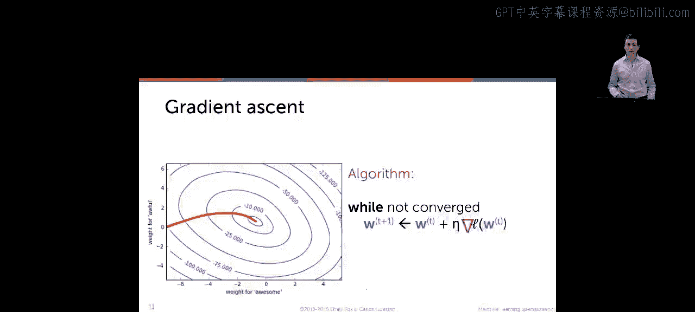
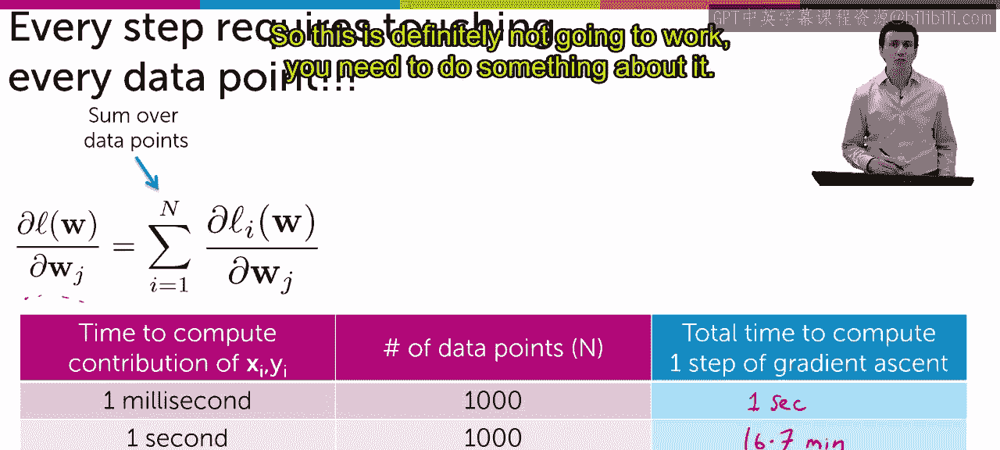

# 华盛顿大学《机器学习（分类，聚类和检索，第3-4课⧸共4课）｜Machine Learning》中英字幕 p108 107_为什么梯度上升法无法扩展.zh_en -BV1Sr421F7N7_p108-

。

The simplest form of stochastic gradient。Says when I estimated the gradient。

 one data point at a time。 So let's see what that looks like。

We're back to our gradient ascent setting， where we're going start from some point in the space。

 We're going to compute the gradient of the likelihood function， Take a little step in that space。

 then compute the gradient again， take another little step， a little step a little step。

 And this is the。Algorithm on the right that we've been using throughout this module before that。

And the question here is how expensive is this algorithm。

 let's look at the case of logistic regression just to remind ourselves of how expensive that is。

So what we need to do here is some some function of each data point and you can think about it as the contribution to the gradient that data point X I Y I has。

 and we're adding those up through each data point and so I'm going to thenote here by this term。

 the derivative L subscript I。With respect to parameter WJ is the contribution of I theta point to the gradient。

 and what we're doing here is summing up each one of these contributions in order to compute the final gradient that we're going to take。

 the final update for the parameters。So how computationally costly is it to do this approach。

 So let's， let's let's ask that question。 So， for example， if I were to say。

Computing the contribution of one data point takes me one millisecond。

 it's really fast and it takes me one millisecond and I have 1 thousand00 data points。

Then that's not too bad。 100 milliseconds is one second。I don't feel too bad about that outcome。

Or if you have a much more complex model like neural network or something。

 where one update takes one second instead of one millisecond and you have 1000 data points。

HaNow computing one step of gradient requires 1000 seconds， which if you can't do this in your head。

 I can't by cheat is 16。7 minutes。Now things are getting a little bit more complicated， so 16。

7 minutes a lot to wait。But 1000 data points is nothing， we said。

know we said YouTube has 5 billion data points per day or more。

 so let's say that we're going back to the one millisecond case。

 really it takes one millisecond to compute that gradient contribution。

 but you have 10 million data points。What happens， Well， the total time now becomes 2。8。Hours。

So things are starting to get nasty。But again，10 million data points is not that much。

 You has 5 billion，10 billion more per day。 So what happens if you have 10 billion data points and it takes you just one millisecond to compute that creating contribution。

 Well then it's going take us 10 billion milliseconds， which I cheated here， it's 115。Point7 days。

So it's gonna take about four months。Approximately。Just to compute one gradient。

 and if you remember for my implementation， you have to do many gradient updates before you converge。

So this is definitely not going to work， you need to do something about it。

