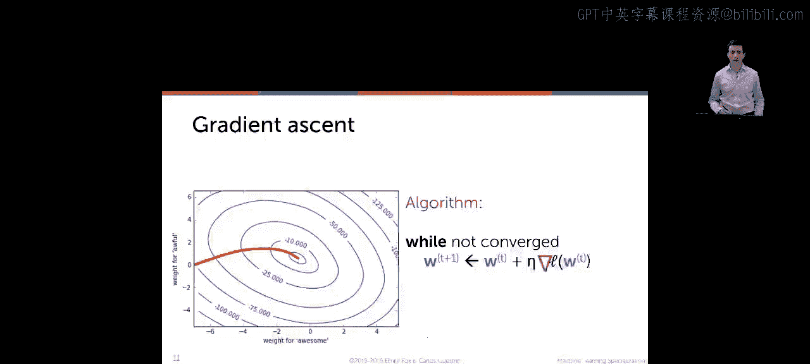
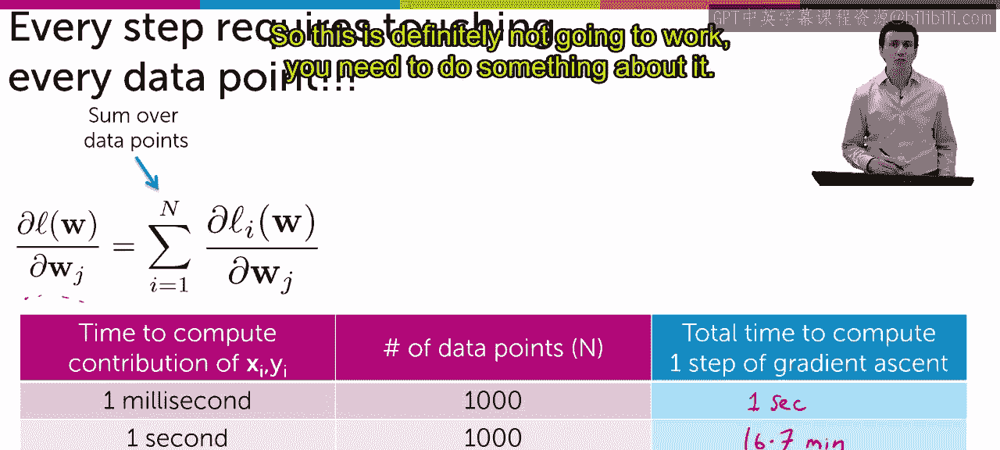

# 机器学习（分类，聚类和检索）：第3-4课：为什么梯度上升法无法扩展 ⚙️

在本节课中，我们将探讨梯度上升法在处理大规模数据集时面临的计算挑战。我们将分析其计算成本，并理解为什么对于现代海量数据，传统的批处理方法变得不可行。

---

上一节我们介绍了梯度上升法的基本流程。本节中我们来看看其计算成本的具体构成。

在梯度上升法中，我们从参数空间的某个点开始，计算似然函数的梯度，然后沿梯度方向前进一小步。这个过程不断重复，直至收敛。右侧展示的算法正是我们在本模块中一直使用的方法。

那么，这个算法的计算代价有多大呢？让我们以逻辑回归为例来具体分析。

为了计算梯度，我们需要对每个数据点进行运算。你可以将其理解为每个数据点 `(X_i, Y_i)` 对梯度的贡献。我们将所有数据点的贡献相加，得到最终的梯度，并用于更新参数。

这里用 `∂L_i/∂W_j` 表示第 `i` 个数据点对参数 `W_j` 的梯度贡献。我们的做法是汇总所有这些贡献，以计算用于参数更新的最终梯度。

那么，这种方法的计算成本如何呢？让我们通过几个例子来量化一下。

以下是几个计算成本的场景分析：

*   **场景一**：计算一个数据点的梯度贡献需要 **1毫秒**，并且我们拥有 **10万个** 数据点。那么总时间就是 0.1 秒，这完全可以接受。
*   **场景二**：模型更复杂（如神经网络），计算一个数据点的贡献需要 **1秒**，数据点数量为 **1000个**。那么总时间将达到 1000 秒，约合 **16.7分钟**。等待时间开始变得可观。
*   **场景三**：回到每个点1毫秒的情况，但数据量激增至 **1000万个**。总计算时间将变为 **2.8小时**。情况开始变得棘手。
*   **场景四**：考虑真正的海量数据，例如 **100亿个** 数据点，每个点仍只需1毫秒。总时间将高达 **115.7天**，大约 **4个月**。而这仅仅是计算**一次梯度更新**所需的时间。

请记住，在实际训练中，我们需要进行多次梯度更新才能达到收敛。因此，对于像YouTube这样每天产生数十亿数据点的场景，这种传统的批处理梯度上升法显然无法工作，我们必须寻找更高效的替代方案。

---

本节课中我们一起学习了传统梯度上升法在处理大规模数据时面临的计算瓶颈。通过量化分析，我们清楚地看到，当数据量达到百万乃至亿级时，计算单次梯度更新所需的时间会变得极其漫长，这使得该方法在实际的大规模机器学习应用中不可行。这引出了对更高效优化算法（如随机梯度下降）的需求。