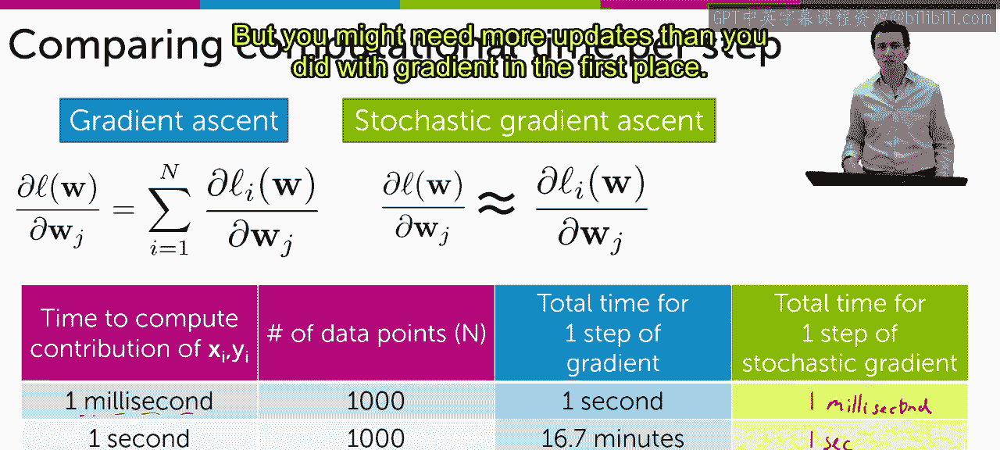

# 华盛顿大学《机器学习（分类，聚类和检索，第3-4课⧸共4课）｜Machine Learning》中英字幕 p109 108_随机梯度：一次学习一个数据点.zh_en -BV1Sr421F7N7_p109-

。

What we're going to do about it is introduce an algorithm called stochastic gradient instead of the standard gradient。

 So the standard gradient says update a parameter by computing the contribution of every data point and sum it up。

tochastic gradient in simple possible way， says we don't have to use every single data point。

 just use one data point。That's not the exact gradient。

 that's kind of an approximation to the gradient， as we will see。

And then instead of using just a single data point， every time we're going to do an update。

 we're going to use a different data point， so we're just going to use one to estimate the gradient。

 but we use a different one every time。😊，And this simple change， as we'll see， is extremely powerful。

Let's now dig in and understand that change that we hinted at where you use a little bit of data to compute the gradient instead of using the entire data set。

And in fact， we're just going to use one data point to compute the gradient instead of everything。

So this is the gradient scent algorithm for logistic regression。

 the one we've seen earlier in the course， and I'm showing the gradient explicitly over here。

Now it requires a sum over data points， which is the thing that we're trying to avoid。

 we're not going do some of data points at every update at every iteration。

 so let's throw out that sum， but each times we're going to pick a different data point。

So we're going to introduce an outer loop here where we loop over the data points one through n。

 and then we compute a gradient with respect to a data point， and then we update the parameters。

And we do that one at a time。So in gradient ascent。

 we did a sum over all data points in stochastic gradient。

 we just can approximate a gradient by the contribution of one data point and we'll see why that works。

But lets， let's go back to our table and investigate the total time for one step of gradient descent。

 schastic gradient descent。 So if it takes one millisecond to compute the contribution on data point X I。

You have 1 thousand0 data points。 gradientd takes you a second。

 Schastic gradient is going to take you1 millisecond to make the update。

Because it only looks at one data point。If it takes one second to complete the contribution data point。

 it's going to take you one second per update。If it goes back to 1 millisecond。

 but you have 10 million data points， it's still going to cost you 1 millisecond per update。

If it takes one millisecond to compute a contribution data point。

 but you have 10 billion data points， it's still going to take you one millisecond to make an update。

So this looks too good to be true and in a way it is。

But the thing to remember is that each update is going to be much cheaper than with gradient。

 but you might need more updates than you did with gradient in the first place。

