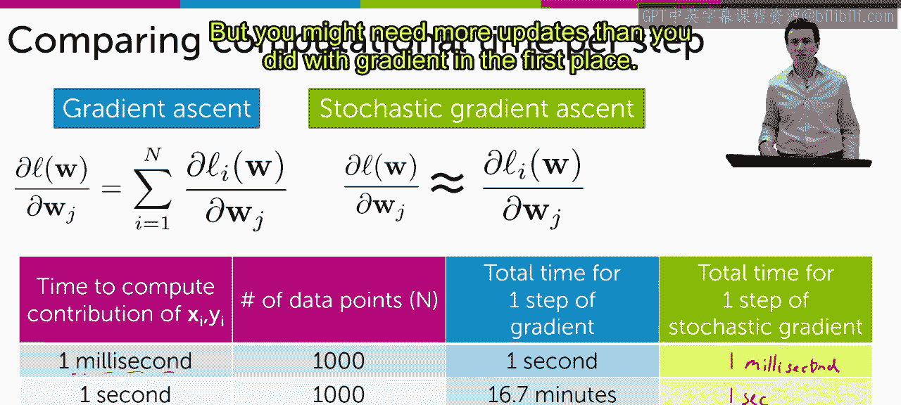

# 机器学习：3-4：随机梯度下降法

在本节课中，我们将学习一种名为**随机梯度下降**的优化算法。该算法旨在解决传统梯度下降法在处理大规模数据集时计算成本过高的问题。我们将探讨其核心思想、工作原理，并与标准梯度下降法进行对比。

---

## 算法核心思想 🎯

上一节我们介绍了标准梯度下降法，它需要计算所有数据点的贡献总和来更新参数。本节中我们来看看**随机梯度下降**，它采用了一种截然不同的策略。

随机梯度下降的核心思想非常简单：**不使用全部数据点来计算梯度，而是每次只使用一个数据点**。这并非精确的梯度，而是对真实梯度的一种近似。每次进行参数更新时，我们都会随机选取一个不同的数据点来估计梯度方向。

这个简单的改变，正如我们将看到的，具有极其强大的效果。

## 深入理解算法 🔍

现在让我们深入理解这个改变：即使用少量数据（实际上仅一个数据点）来计算梯度，而不是使用整个数据集。

以下是逻辑回归的标准梯度上升算法公式，我们之前课程中已经见过，这里明确写出了梯度表达式：

**标准梯度上升（逻辑回归）**:
`w_new = w_old + η * Σ_{i=1}^{n} [ (y_i - P(y_i=1|x_i, w)) * x_i ]`

这个公式要求对数据点求和，而这正是我们试图避免的操作。我们不希望在每次迭代更新时都对所有数据点求和。

因此，我们去掉这个求和符号。取而代之的是，我们引入一个外层循环，依次遍历数据点 1 到 n。对于每个数据点，我们计算**仅基于该数据点**的梯度，然后立即更新参数。我们一次只处理一个数据点。

**随机梯度上升（逻辑回归）**:
对于 i = 1 到 n:
`w_new = w_old + η * [ (y_i - P(y_i=1|x_i, w)) * x_i ]`

在梯度上升中，我们对所有数据点求和；在随机梯度上升中，我们仅用一个数据点的贡献来近似整个梯度。接下来我们将探讨为什么这样做是有效的。

## 计算效率对比 ⚡

让我们回到之前的表格，对比分析执行**一步**梯度下降与随机梯度下降所需的总时间。

以下是不同数据规模下的计算时间对比：

*   **计算一个数据点贡献耗时 1 毫秒，拥有 1000 个数据点**：
    *   梯度下降：`1 ms/点 * 1000 点 = 1 秒` 完成一次更新。
    *   随机梯度下降：仅需 `1 毫秒` 完成一次更新（因为它只查看一个数据点）。

*   **计算一个数据点贡献耗时 1 秒，拥有 1000 个数据点**：
    *   梯度下降：`1 秒/点 * 1000 点 = 1000 秒` 完成一次更新。
    *   随机梯度下降：仅需 `1 秒` 完成一次更新。

*   **计算一个数据点贡献耗时 1 毫秒，拥有 1000 万或 100 亿个数据点**：
    *   梯度下降：时间随数据量线性增长，分别为 `10^7 毫秒` 和 `10^10 毫秒`。
    *   随机梯度下降：无论数据量多大，**每次更新仍然只需要大约 1 毫秒**。

这看起来好得令人难以置信，在某种程度上确实如此。但需要记住的关键点是：虽然随机梯度下降的**每次更新**成本远低于梯度下降，但为了达到相似的优化效果，**你可能需要比梯度下降多得多的更新次数**。其优势在于，即使需要更多步数，每一步极低的成本使得处理海量数据成为可能。

---

## 总结 📝

本节课中我们一起学习了**随机梯度下降法**。我们了解到，该算法通过每次迭代仅随机使用一个数据点来估计梯度，从而极大地降低了单次参数更新的计算成本，使其能够高效处理大规模数据集。虽然每次更新方向不如标准梯度下降精确，且可能需要更多迭代次数才能收敛，但其卓越的计算效率使其成为现代机器学习中不可或缺的核心优化算法。