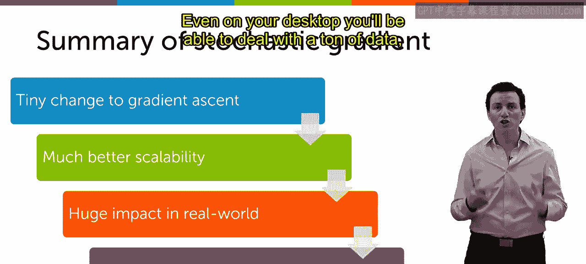
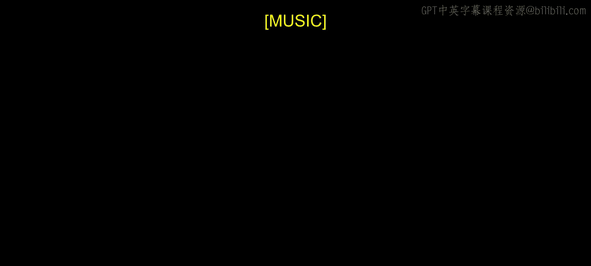

# 华盛顿大学《机器学习（分类，聚类和检索，第3-4课⧸共4课）｜Machine Learning》中英字幕 p110 109_比较梯度和随机梯度.zh_en -BV1Sr421F7N7_p110-

。

Let's take a moment to compare gradient to stochastic gradient to really understand how the two approaches relate to each other。

 and we see that this very， very small change in your algorithm in implementation is going to make a big difference。

So we're going to be about the table here comparing the two approaches， gradient in blue。

 stochastic gradient in green， and we'll see we saw already that gradient is slow at computing an update for large data while stochastic gradient is fast it doesn't depend on the data size it's always fast but the question is what's the total time each iteration is cheaper for stochastic gradient but is it cheaper overall and the two answers to this question。

😊，In theory。Schastic gradient for large data sets is always faster。Always。In practice。

 tend don't be more nuanced， but it's often faster， so it's often a good thing to do。However。

tochastic gradient has a significant problem， is much more sensitive to the choice of parameters like the choice of step size and it has lots of practical problems and so a lot of the focus of today's module is to talk about those practical challenges of stochastic gradient and how to overcome them and how to get the most benefit of the small change for your algorithm。

We will't see a lot of pictures like this so I'm going to take a few minutes to explain it。

 this picture compares gradient to schastic gradient。

 so the red line here is the behavior of gradient as you iterate through data so as you make passes through data and on the Y axis we see the data likelihood so higher is better feeding the data better。

The blue line here is stochastic gradient。And to be able to compare the two approaches in the X axis。

 I'm not showing exactly running time， but I'm showing you how many data points you need to touch。

So stochastic gradient is going to make an update every time it sees a data point。

 gradient is going to make update every time it makes a full pass of the data。

 and so we're showing you how many passes we're making over the data。

 so the full x axis here is 10 passes over the data， and you see that after 10 passes over the data。

 gradient is going into a likelihood that's much lower than that of stochastic gradient。

So casqueating goes to a point， it's much higher。And even if you look at it in the longer scale as we'll see schastic gradient is going to converge faster。

 however， it doesn't converge smoothly to the optimal solution。

 it oscillates around the optimal solution and well understand today why that happens and the oscillation。

 some of the challenges that are introduced by schastic gradient。😊。

So now we've extended it to from 10 passes over data to 100 passes over the data and obviously the gradient is getting to solutions very close to that stochastic gradient。

 but again you see a lot of noise and a lot of oscillation from stochastic gradient。

 sometimes it's good， sometimes bad， sometimes it's good， sometimes it's bad。

 so that's the challenge there。So here does a summary what we learn。

 make a tiny change your algorithm instead of using the whole data set to compute the gradient。

 use a single data point。Call that sarcastic gradient。' gonna get to better quality faster。However。

 it's going to be tricky， there's going to be some oscillations and you have to learn some of the practical issues that you need to address in order to make this really effective。

 but this change is going to allow you to scale to billions of data points。

 even on your desktop you' be able to deal with a ton of data， which is really super exciting。

