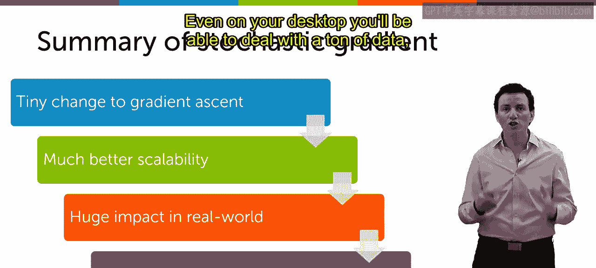

# 机器学习（分类，聚类和检索）：第3-4课：比较梯度下降与随机梯度下降 🆚


在本节课中，我们将要学习梯度下降与随机梯度下降这两种优化算法的核心区别。我们将通过对比它们的计算效率、收敛行为以及实际应用中的挑战，来理解为何一个微小的算法改动能带来巨大的性能差异。

## 概述

上一节我们介绍了梯度下降的基本原理。本节中，我们来看看它的一个重要变体——随机梯度下降。我们将通过对比表格和收敛曲线图，直观地理解两者在速度、稳定性以及对大规模数据的处理能力上的不同。

## 梯度下降 vs. 随机梯度下降

以下是两种方法的对比表格，蓝色代表梯度下降，绿色代表随机梯度下降。

| 特性 | 梯度下降 (Gradient Descent) | 随机梯度下降 (Stochastic Gradient Descent) |
| :--- | :--- | :--- |
| **更新速度** | 对于大数据集较慢。每次更新需计算整个数据集的梯度。 | **快**。每次更新只使用一个数据点，与数据集大小无关。 |
| **总训练时间** | 理论上是 `O(N * I)`，其中 `N` 是数据量，`I` 是迭代次数。 | 理论上对于大数据集**总是更快**。实践中通常也更快。 |
| **参数敏感性** | 对步长等参数相对不敏感。 | **非常敏感**。步长选择不当会导致严重问题。 |
| **收敛行为** | 平滑、稳定地收敛到最优解附近。 | 更快地接近高质量解，但会在最优解附近**振荡**。 |
| **可扩展性** | 处理海量数据（如十亿级）时计算成本过高。 | **能扩展到海量数据**，即使在单台桌面电脑上也能处理。 |

## 收敛行为图解

为了更直观地比较，我们来看一下两者的收敛曲线图。下图展示了在多次遍历数据的过程中，模型对数似然（Y轴，越高越好）的变化。X轴表示接触过的数据点数量（或等效的数据遍历次数）。


*   **红线（梯度下降）**：每完整遍历一次数据集（一个Epoch）才进行一次更新。在10次遍历后，其达到的对数似然值**远低于**随机梯度下降。
*   **蓝线（随机梯度下降）**：每看到一个数据点就进行一次更新。它更快地达到了更高的对数似然值，但其路径**不平滑**，存在明显的振荡。

当我们把观察尺度扩大到100次数据遍历时，情况如下：



此时，梯度下降最终也能达到与随机梯度下降相近的解。然而，随机梯度下降的**振荡**特性依然非常明显——它的性能时好时坏，围绕最优解波动。理解并处理这种振荡，是有效使用随机梯度下降的关键挑战之一。

## 核心公式与代码描述

两者的核心区别在于梯度计算方式：

*   **梯度下降**：使用全部 `N` 个数据点的平均梯度。
    **公式**：`θ_new = θ_old - η * (1/N) * Σ(∇L_i(θ_old))`，其中 `i` 从1到 `N`。
*   **随机梯度下降**：每次随机选取一个数据点 `j`，使用其梯度。
    **公式**：`θ_new = θ_old - η * ∇L_j(θ_old)`。

**代码示意**：
```python
# 梯度下降 (伪代码)
for epoch in range(num_epochs):
    total_gradient = compute_gradient(entire_dataset, current_parameters)
    parameters -= learning_rate * (total_gradient / dataset_size)

# 随机梯度下降 (伪代码)
for epoch in range(num_epochs):
    for data_point in shuffled_dataset:  # 遍历每个数据点
        single_gradient = compute_gradient([data_point], current_parameters)
        parameters -= learning_rate * single_gradient
```

## 总结

本节课中我们一起学习了梯度下降与随机梯度下降的对比。我们了解到，将算法从使用整个数据集计算梯度，改为仅使用单个数据点（即随机梯度下降），是一个微小的改动，却能带来巨大的好处：**它能让你更快地获得更高质量的模型，并且能够处理规模高达数十亿的数据集**。


然而，这种强大能力也伴随着挑战：随机梯度下降对学习率等参数更为敏感，并且其收敛过程存在振荡。在接下来的课程中，我们将重点探讨如何克服这些实际挑战，例如如何设置学习率、如何减少振荡等，从而充分发挥随机梯度下降的威力。