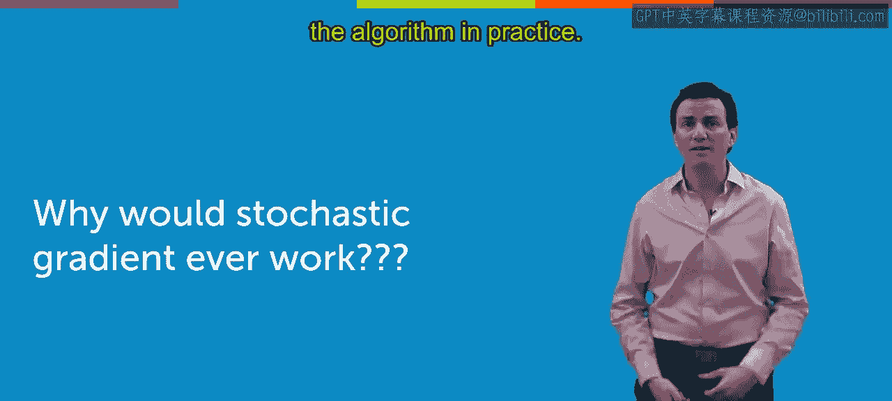
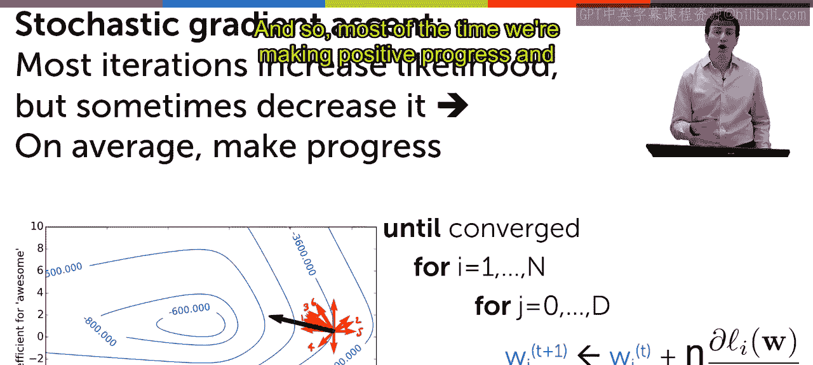

# 华盛顿大学《机器学习（分类，聚类和检索，第3-4课⧸共4课）｜Machine Learning》中英字幕 p111 110_为什么随机梯度会有效.zh_en -BV1Sr421F7N7_p111-

。

So we've made a small change to the gradientcent algorithm。But it feels big。 We。

 we start looking at all the data points or looking one at a time。 Why should it this even work。

 Why is this a good idea at all， Let's spend a little bit of time gaining intuition of why it works。

 And this in is going to help us understand the behavior， the algorithm in practice。

In this picture， I'm showing you the landscape， the contour plot for our sentiment analysis problem。

 which is the data that we'll be using throughout the module today。

 but just for a subset of the data where you're only looking at two possible features。

 coefficient for awful and a coefficient for awesome。If we were to start here at this point。

This would be the exact gradient that we would compute。And that exact gradient gives you the best。

Possible improvement of going from WT to W T plus one。That's the best thing you could possibly do。

Now。There are many other directions that also improve the value， improve the likelihood， the quality。

 So， for example， if we were to take this other direction over here。

And we reached some parameter W prime。Is still okay。

Because it is still going uphill we're increasing the likelihood。 In other words。

 the likelihood of W prime is going to be greater than the likelihood of WT。So in fact。

 any direction that take your hill would be good， the gradient is just the best direction。

The gradient direction is the sum of the contributions for each one of the data points。

 So if I look at that gradient direction。It is the sum。

Over my data points of the contributions from each one of these Xs。

 So this is the each one of these red lines here are the contributions from a data point。From。

Each oops。Each X， I， Y， I。Which is this part of the equation here。So interestingly。

 most contributions point upwards， so all of these over here are pointing in an upward direction。

 so if I were to pick any of those，I would make some progress if I picked any of the other ones。

 like the ones back here。This would not make progress。 This would be bad directions。But on average。

 most of them are good directions， and this is why stochastic gradient works。In stochastic gradient。

 we're just going to pick one of these directions。And。Most of them are okay。

 So most of the time we' going to make progress。 Sometimes when we pick a bad direction。

 we won't make progress。 we make negative progress， but on average。

 we're going to be making positive progress。 And so that's exactly why schastic gradient works。

 So if you think about the schastic gradient algorithm。

 we're going one data point of a time and picking the direction associated with that data point and taking a little step。

 So at the first situation we might this data point and make some progress in the second one we make this number two here and make negative progress。

 but in the third one I pick another one that makes positive progress。

 then I pick a fourth one that makes positive progress and I pick a fifth one a dozen' and I pick a sixth one that does and so on。

 And so most of the time were making positive progress And overall the likelihood is improving。😊。

