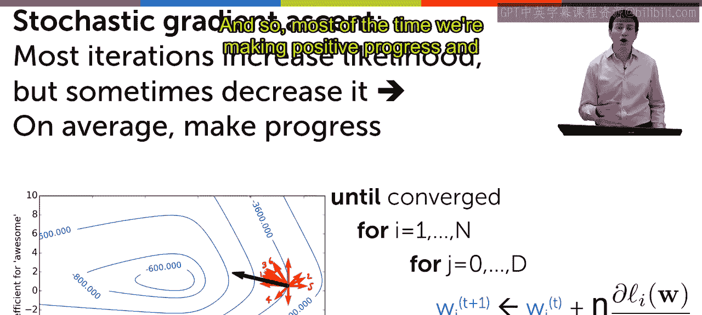

# 机器学习（分类，聚类和检索）：第3-4课：为什么随机梯度会有效 😊

在本节课中，我们将探讨随机梯度下降算法背后的核心思想。我们将理解，为什么仅使用单个数据点来计算梯度方向，而不是使用所有数据点，仍然是一个有效且实用的优化方法。

---

上一节我们介绍了梯度下降算法。本节中，我们来看看对算法所做的一个微小但重要的修改：从计算所有数据点的梯度，改为每次只计算一个数据点的梯度。这个修改感觉很大，但它为什么有效呢？让我们花点时间建立一些直观理解，这有助于我们理解算法在实际中的行为。

## 梯度下降的“最佳”方向

首先，回顾一下我们情感分析问题的参数空间。下图展示了仅考虑两个特征（“awful”和“awesome”的系数）时，对数似然函数的等高线图。

假设我们从点 **W_t** 开始。如果我们计算所有数据点的**精确梯度**，我们会得到从 **W_t** 移动到 **W_{t+1}** 的**最佳可能改进方向**。这是理论上我们能做的最好的事情。

然而，存在许多其他方向也能改进目标函数（即提高似然值或模型质量）。例如，如果我们选择图中另一个方向，并到达某个参数 **W'**，这仍然是可行的，因为它仍然在“上山”——我们仍在增加似然值。换句话说，**W'** 的似然值将大于 **W_t** 的似然值。因此，事实上，任何能带你上山的方向都是好的，梯度方向只是其中**最好的**那个。

## 梯度的构成与随机梯度的直觉

梯度方向是每个数据点贡献的总和。具体公式如下：

**精确梯度 = Σ_{i=1}^{N} [对数据点 (x_i, y_i) 的贡献]**

在上图中，每一条红线代表一个数据点 **(x_i, y_i)** 对梯度的贡献。有趣的是，**大多数贡献都指向“上山”的方向**（如图中靠前的红线）。所以，如果我随机选择这些贡献中的任何一个，我大概率会朝着一个能取得进展的方向前进。

当然，也存在一些“坏”的方向（如图中靠后的红线），选择它们会导致负向进展（似然值下降）。但关键在于：**平均而言，大多数方向是好的**。这就是随机梯度下降有效的原因。

## 随机梯度下降的工作原理

在随机梯度下降算法中，我们每次只随机选取一个数据点，计算该点贡献的方向，并沿着这个方向迈出一小步。

以下是算法运行的直观过程：
1.  第一步，我们可能选取数据点1，并取得一些正向进展。
2.  第二步，我们可能选取数据点2，这次可能产生负向进展。
3.  第三步，我们选取数据点3，再次取得正向进展。
4.  第四步，选取数据点4，正向进展。
5.  如此继续……

虽然偶尔会选到“坏”的方向导致暂时后退，但**大多数时候我们都在取得正向进展**。从整体和长期来看，模型的似然值是在不断改善的。算法通过大量的小步，在噪声中曲折但坚定地向上攀登。

---

本节课中我们一起学习了随机梯度下降有效的核心直觉。我们明白了精确梯度是最佳方向，但它由许多数据点的贡献组成，其中大多数贡献本身也是“上山”的好方向。随机梯度下降通过每次随机采用其中一个方向，虽然步调有噪声且不稳定，但长期平均效果是正向的，最终能引导我们找到较好的解。这种用计算效率换取一定噪声的策略，在实践中被证明是非常成功的。