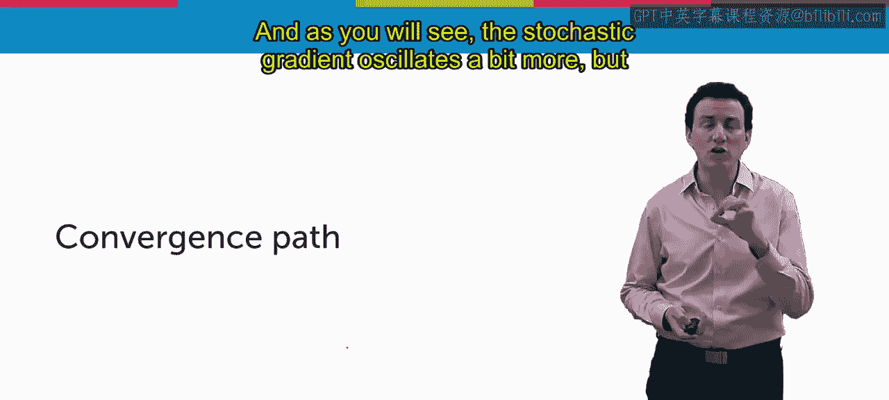
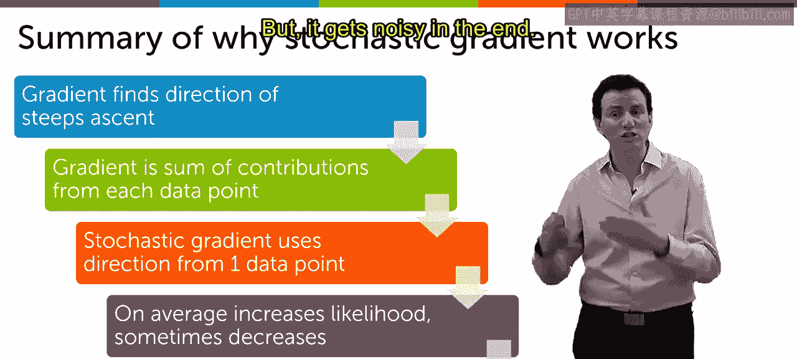

# 华盛顿大学《机器学习（分类，聚类和检索，第3-4课⧸共4课）｜Machine Learning》中英字幕 p112 111_收敛路径.zh_en -BV1Sr421F7N7_p112-

。

Next， let's visualize the path the gradient takes as opposed to stochastic gradient。

 what I call the conversion paths， and as you'll see， the stochastic gradient osciatess a bit more。

 but gets you close to that optimal solution。

So just like before in the black line I'm showing the path of gradient and you see that that path is very smooth and it does very nicely in the red line I'm showing you the path of storcchastic gradient。

 you see that this is a noisier path。It does get us to the right solution， but one thing to note。

 though， is that it doesn't conversion stop like gradient does， it oscillates around the optimal。

And this is going to be one of the practical issues that we're going to address when we talk about how to get schastic gradient into work in practice。

But it's a significant issue。Another view of stochastic gradient oscillating around the optimum can be viewed in the plot。

 the one we've been using for quite a while， and you see that gradient is smoothly making progress。

 but stochastic gradient has this noisy curve as it makes progress and as it converges its oscillating around the optimum。

Let's summarize gradient asscent looks for the direction of greatest improvement in the steepest asscent direction and does that by summing over all possible data points。

😊，Sttochastic gradient， on the other hand， tries to find some direction which usually makes progress。

 So for example， I picking one data point to estimate the gradient and on average。

 it makes a ton of progress。And because of that， it tends to converge much faster。

 but it's noisier at the optimum， so even in that simple example we've been using today。

 it's over 100 times faster than gradient to converge， it's much， much faster to converge。😊，But。It。

 you know， it gets noisy at the end。

