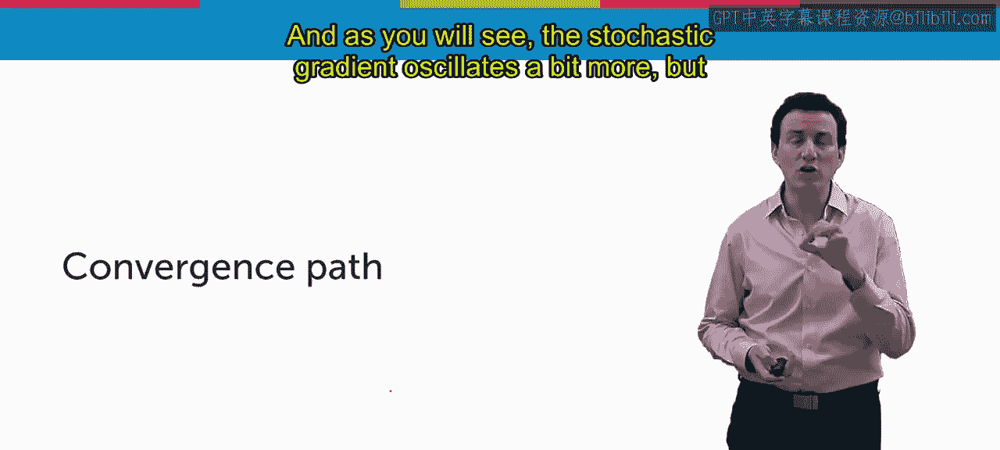
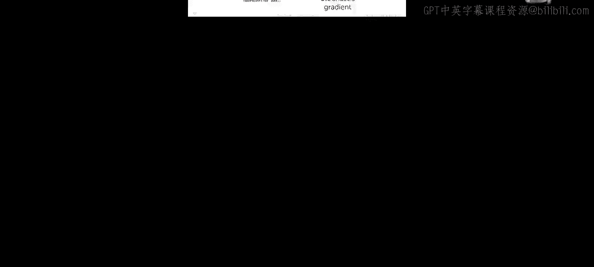
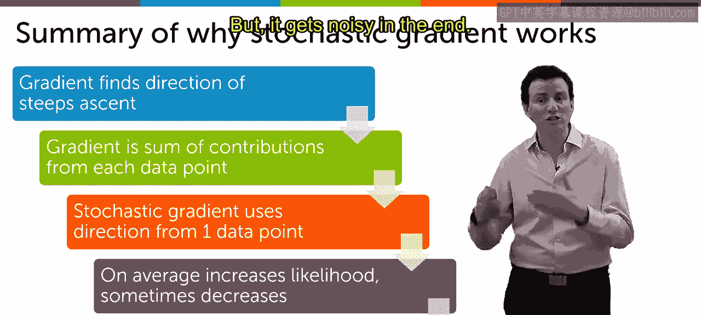

机器学习（分类，聚类和检索）：第3-4课：收敛路径 🧭

在本节课中，我们将学习梯度下降与随机梯度下降在优化过程中的收敛路径有何不同。我们将通过可视化对比，理解两者在寻找最优解时的行为差异，并总结它们各自的优缺点。

上一节我们介绍了梯度下降与随机梯度下降的基本概念，本节中我们来看看它们在实际优化过程中的收敛路径。

### 可视化收敛路径

接下来，让我们可视化梯度下降与随机梯度下降所采取的路径，我称之为收敛路径。你将看到，随机梯度下降的路径振荡更多，但它能让你接近最优解。

与之前一样，黑色线条表示梯度下降的路径。你可以看到这条路径非常平滑，表现良好。红色线条表示随机梯度下降的路径。你可以看到这是一条噪声更多的路径。它确实能将我们带到正确的解附近，但需要注意的一点是，它不像梯度下降那样完全停止收敛，而是在最优解附近振荡。

当我们讨论如何在实践中应用随机梯度下降时，这将是我们需要解决的实际问题之一，而且是一个重要问题。

### 目标函数曲线视图

随机梯度下降在最优解附近振荡的另一种视图，可以在我们使用了很久的这张图中看到。你可以看到梯度下降在平滑地取得进展，而随机梯度下降在取得进展和收敛时，其曲线是带有噪声的，并在最优解附近振荡。

以下是两种方法在目标函数值变化曲线上的表现对比：
*   梯度下降曲线平滑下降。
*   随机梯度下降曲线呈噪声状下降并最终在最优值附近振荡。

### 核心概念总结

现在，让我们总结一下梯度下降与随机梯度下降的核心机制。

梯度上升（下降）寻找最陡上升（下降）方向以取得最大改进，其实现方式是对所有可能的数据点进行求和。其更新公式的核心部分是计算整个数据集的梯度：
`gradient = sum_over_all_data_points( gradient_for_each_point )`

随机梯度下降则试图找到一个通常能取得进展的方向。例如，通过随机选取一个数据点来估计梯度。平均而言，它能取得巨大进展。正因如此，它的收敛速度往往快得多，但在最优解附近噪声更大。

以下是两种方法特点的简要对比：
*   **收敛速度**：随机梯度下降快得多（在今天的简单例子中，它比梯度下降快100倍以上）。
*   **收敛行为**：梯度下降平滑收敛；随机梯度下降在终点处变得嘈杂（振荡）。

本节课中我们一起学习了梯度下降与随机梯度下降的收敛路径。我们通过可视化对比看到，梯度下降路径平滑，而随机梯度下降路径噪声大、振荡多，但收敛速度显著更快。理解这些差异有助于我们在实际应用中根据需求选择合适的优化算法。