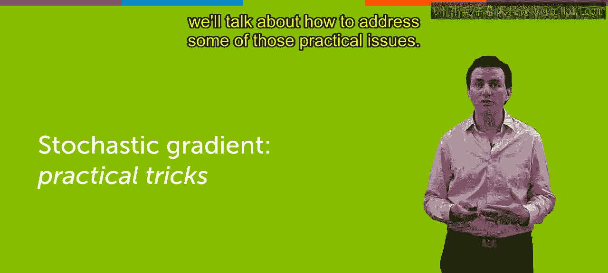
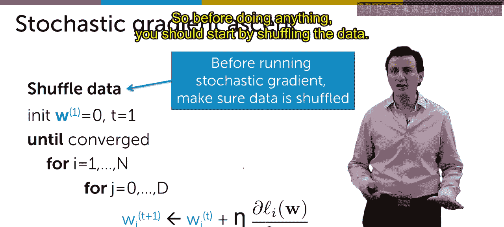

# 华盛顿大学《机器学习（分类，聚类和检索，第3-4课⧸共4课）｜Machine Learning》中英字幕 p113 112_在运行随机梯度前打乱数据.zh_en -BV1Sr421F7N7_p113-

。

You've heard me hint about this a lot today and the practical issues of stochastic gradient are pretty significant。

 so for most of the remaining of the module， we're going to talk about how to address some of those practical issues。

😊。

Let's take a moment to review the schastic gradient algorithm。

 we initialize our parameters our coefficients of some value let's say all0。

 and then until conversions we go one data point at a time and one feature at a time and we update the coefficient of that feature by just computing the gradient at that single data point。

So adding a contribution of each data point one at a time So we're scanning down the data updated data parameters or data point at a time。

 for example， I see my first data point here， zero awesomesome to offers sentiment minus-1 I make an update which pushes me towards predicting minus-1 to this data point now if the next data point is also negative I'm going to make another kind of negative push the third one is negative and make another negative push and so on and so one worry one thing bad thing that can happen with stochastic gradient is if your data is implicitly sorted in a certain way So for example。

 all the negative data points are coming before all the positives they can introduce some bad behaviors to the algorithm bad practical performance and so we worry about this a lot and it's really significant。

So because of that， before you start running stochastic gradient。

 you should always shuffle the rows of the data， mix them up。

So that you don't have this long regions of say， negatives before positives or young people before other people or people who live in one country versus people who live in another country。

 you want to mix it all up。So what that means from the context of the stochastic gradient algorithm that we just saw is just add a line at the beginning where you shuffle the data。

 so before doing anything you should start by shuffling the data。

