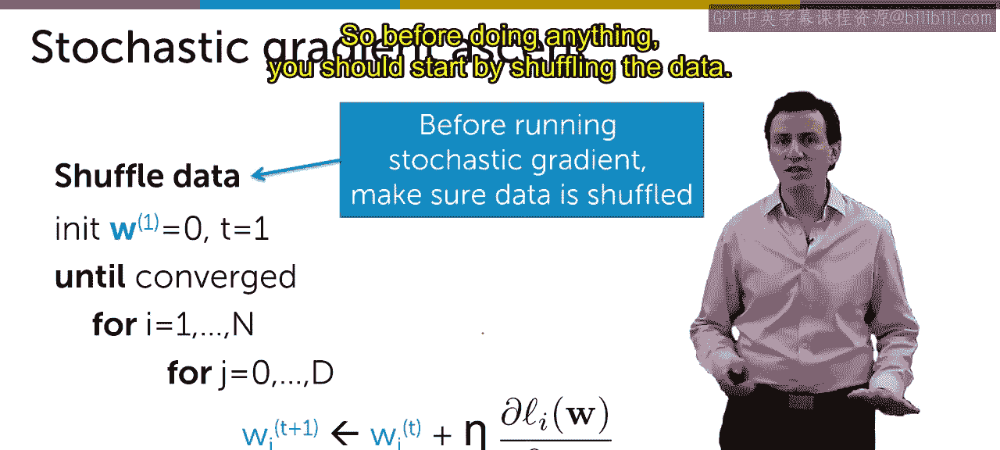

# 机器学习（分类，聚类和检索）：第3-4课：在运行随机梯度前打乱数据


在本节课中，我们将要学习随机梯度下降算法中的一个重要实践步骤：打乱数据。我们将探讨为什么这个步骤至关重要，以及如何正确实施它。

## 概述


随机梯度下降是一种高效的优化算法，但在实际应用中存在一些需要注意的问题。其中，数据顺序对算法性能的影响是一个关键问题。本节我们将详细讨论这个问题及其解决方案。

## 回顾随机梯度下降算法

上一节我们介绍了随机梯度下降的基本概念，本节中我们来看看其具体算法步骤。

随机梯度下降算法的步骤如下：
1.  初始化参数（例如系数）为某个值，比如全0。
2.  在达到收敛条件前，每次处理一个数据点和一个特征。
3.  通过计算该单个数据点的梯度来更新该特征的系数。

这意味着我们逐个数据点地扫描数据，并逐个更新参数。例如，处理第一个数据点后，根据其预测误差更新参数；接着处理第二个数据点，再次更新，依此类推。

## 数据顺序带来的问题

然而，这种逐个处理的方式存在一个潜在风险：如果数据本身是按照某种特定方式隐式排序的，算法可能会表现出不良行为。

例如，假设所有负样本数据点都排在所有正样本数据点之前。在算法运行时，它会连续多次收到负样本，从而连续多次向负方向更新参数。这可能导致参数更新路径出现偏差，影响算法的实际性能和收敛速度。

这种情况在实际数据中很常见，比如数据可能按时间、年龄、地区或其他属性排序。

## 解决方案：打乱数据

为了解决数据顺序带来的问题，在开始运行随机梯度下降算法之前，必须始终打乱数据的行顺序。

打乱数据的目的是混合所有数据点，避免出现长时间连续的同类样本区域（例如连续的负样本或正样本，或来自同一地区的人群）。我们希望数据是充分混合的。

从算法实现的角度来看，这意味着需要在随机梯度下降循环开始之前，增加一行代码来打乱数据。

**代码示例：**
```python
# 在开始随机梯度下降前，打乱数据顺序
shuffled_data = original_data.sample(frac=1).reset_index(drop=True)
# 然后使用 shuffled_data 进行后续的随机梯度下降迭代
```

## 总结



本节课中我们一起学习了随机梯度下降算法中一个关键的实践步骤：打乱数据。我们了解到，数据的原始顺序（如按标签排序）会导致参数更新出现偏差，从而影响算法性能。因此，在运行随机梯度下降之前，务必先随机打乱数据集，这是确保算法稳定性和效果的重要预处理操作。