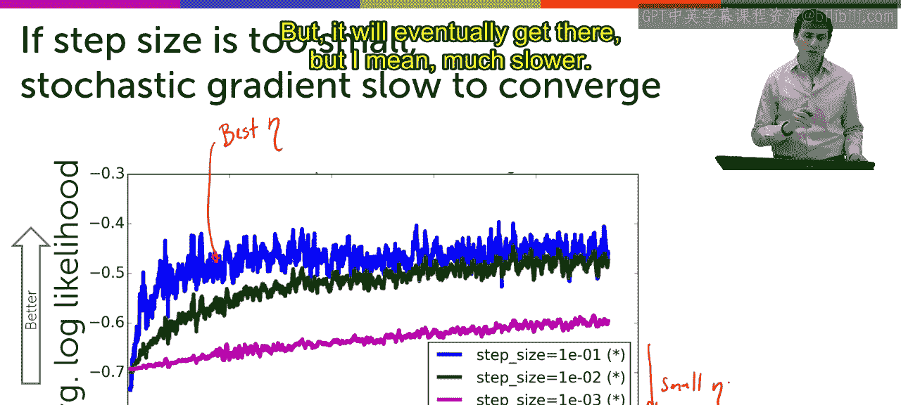
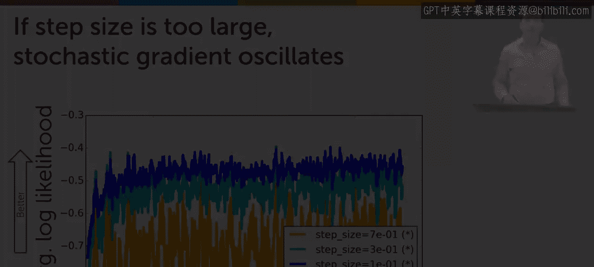
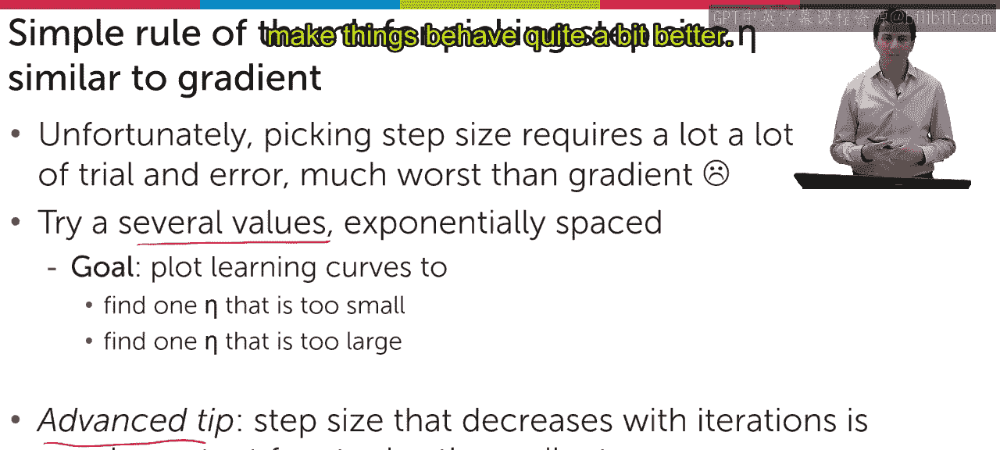
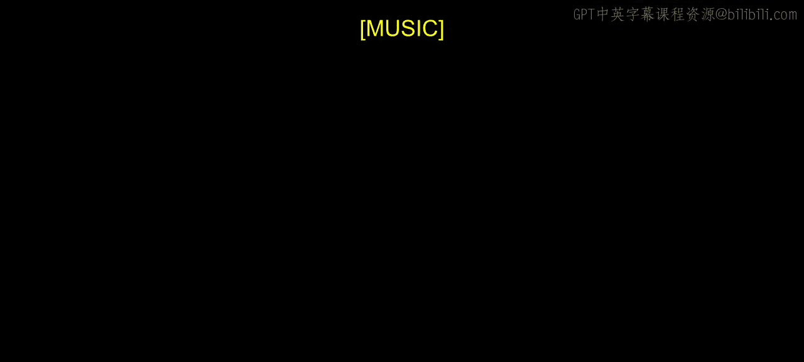

# 华盛顿大学《机器学习（分类，聚类和检索，第3-4课⧸共4课）｜Machine Learning》中英字幕 p114 113_选择步长.zh_en -BV1Sr421F7N7_p114-

。

The second question around schastic gradient is how do you pick the step size ata？

And this is a significant issue just like it is with gradient， both of them。

 it's kind of annoying it's a pain to figure out how to pick that coefficient atum。

 but it turns out that because of the oscillation stochastic gradient。

 picking ata can be even more annoying。😊，Much more annoying。

So if go back to our data set when we've been using it， I've showed you this blue curve many times。

 This was the best Eta that I could find the best step size。 Now， if I were to pick smaller。

Step sizes， so smaller As。It will behave kind of like elect regular gradient。

 it will be slower to converge， and you'll see also less oscillations。

 but it'll eventually get there will be much slower， so we worry about that a bit。

On the other hand， if in using the best。Step size。 We try to use a larger step size。Because。

We thought， you we can make more progress more quickly。

 you'll see these crazy oscillations and the ocillations are much worse than you observe with gradient and I showed you with gradient and so you have to be really careful that if you pick it at too large。

 things can behave extremely erratically。😊，And， in fact， if you pick the step size very， very large。

You can end up with behaviors like this。 So this black line here was an ether that was way too large。

That's a technical term here that we like to use。And in this case， the solution is not even close。

To anything we got， even with bad athers with lots of oscillations。

 the ones I showed in the previous slide， it's a huge gap。

 and so Ata too large needs really bad behavior in stochastic gradient。

The rule of thumb that we describe for gradient， for picking Eta is basically the same as the one for picking。

Step size for schastic gradient， the same as for gradient。 but unfortunately。

 it requires much more trial and error。 So it's even more annoying。

 And so you might spend a lot of time in the trial and error even though it's100 times fast converge。

 It's possible you spend 100 times more effort trying to find the right step size。 just be prepared。

 but you know we just try several values exponentially space from each other。

 and try to find somewhere between an eta that's too small and an Eta that is too big。

 and then find one is just right。 And I mentioned this in a gradient section。

 but for schastic gradients even more important for those who end up exploring this further。

 there's an advanced step where you make the step size decrease over iterations。 And so， for example。

 you might have an eta that depends on what iteration in and often you set it to something like some constant here。

8 to 0， divided by。The iteration number T。Ittereration number。 And this approach tends to。

Reduce noise and make things behave quite a bit better。

