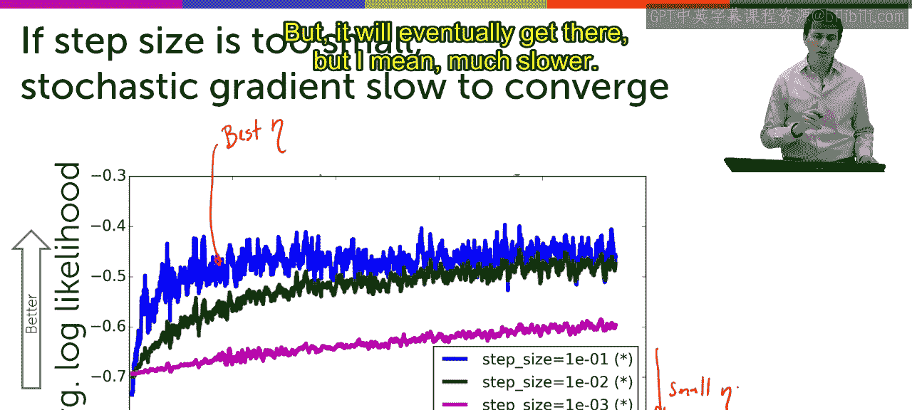
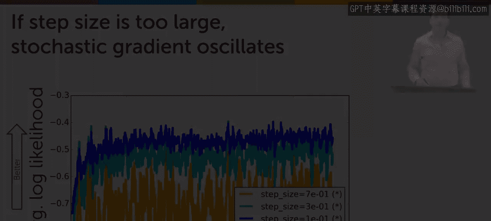
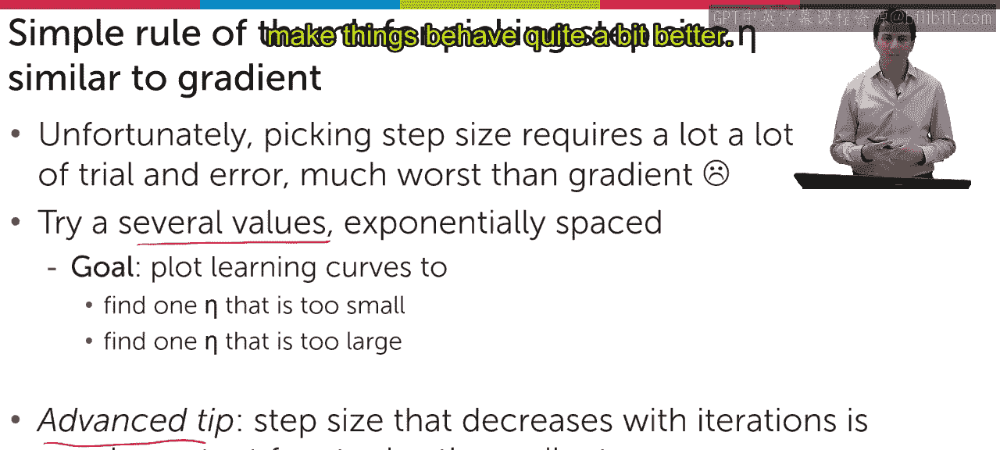

# 机器学习（分类，聚类和检索）：第3-4课：选择步长

在本节课中，我们将要学习随机梯度下降中一个关键且具有挑战性的环节：如何选择步长（学习率）。步长的选择直接影响算法的收敛速度与稳定性，是实践中的一项重要技巧。

## 步长选择的重要性与挑战

上一节我们介绍了随机梯度下降的基本原理，本节中我们来看看如何为其选择合适的步长。步长，通常用符号 **η** 表示，决定了每次参数更新的幅度。与普通梯度下降类似，步长选择不当会导致问题，但由于随机梯度下降固有的振荡特性，这个问题变得更加棘手和令人困扰。

## 步长过小或过大的影响

以下是不同步长选择对算法行为的影响：

*   **步长过小**：如果选择的步长 **η** 过小，算法收敛速度会非常缓慢。虽然振荡会减少，但需要更多迭代次数才能达到最优解附近。
*   **步长适中**：存在一个最佳的步长范围，能够使算法以相对较快的速度收敛，同时保持可控的振荡。
*   **步长过大**：如果步长 **η** 过大，算法会产生剧烈且不稳定的振荡。这种振荡比普通梯度下降中观察到的要严重得多。在极端情况下，参数更新会完全失控，导致解严重偏离最优值，甚至无法收敛。

## 选择步长的经验法则

选择随机梯度下降步长的经验法则与普通梯度下降基本相同，但通常需要更多的试错过程。尽管随机梯度下降收敛更快，但寻找合适步长所花费的精力可能成倍增加。

以下是选择步长的一般步骤：

1.  准备一系列呈指数级间隔的 **η** 候选值（例如 0.001, 0.01, 0.1, 1）。
2.  在小规模数据或早期迭代中测试这些值。
3.  观察训练误差或目标函数值的下降曲线。
4.  目标是找到一个介于“过小”（下降太慢）和“过大”（剧烈振荡或不收敛）之间的“刚刚好”的步长。

## 进阶技巧：衰减步长

对于希望深入探索的学习者，有一个进阶技巧是让步长随着迭代进行而衰减。这种方法有助于减少噪声，使算法行为更加稳定。

一种常见的衰减策略是将步长设置为迭代次数的函数，例如：

**η_t = η_0 / t**

其中，**η_t** 是第 **t** 次迭代时的步长，**η_0** 是初始步长，**t** 是当前的迭代次数。这种策略能确保在初期快速进展，在后期精细调整。

本节课中我们一起学习了为随机梯度下降选择步长的方法。我们了解到步长选择至关重要，过小会导致收敛缓慢，过大会引起剧烈振荡甚至发散。实践中的核心方法是进行系统的试错，以找到一个平衡点。此外，我们还介绍了一种让步长随时间衰减的进阶策略，以提升算法稳定性。掌握这些技巧对于成功应用随机梯度下降算法至关重要。