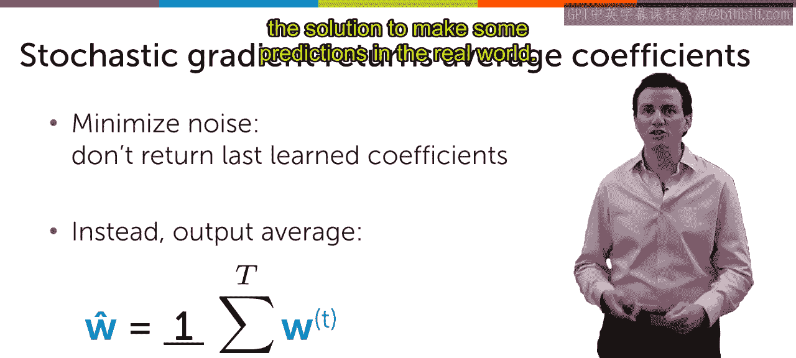
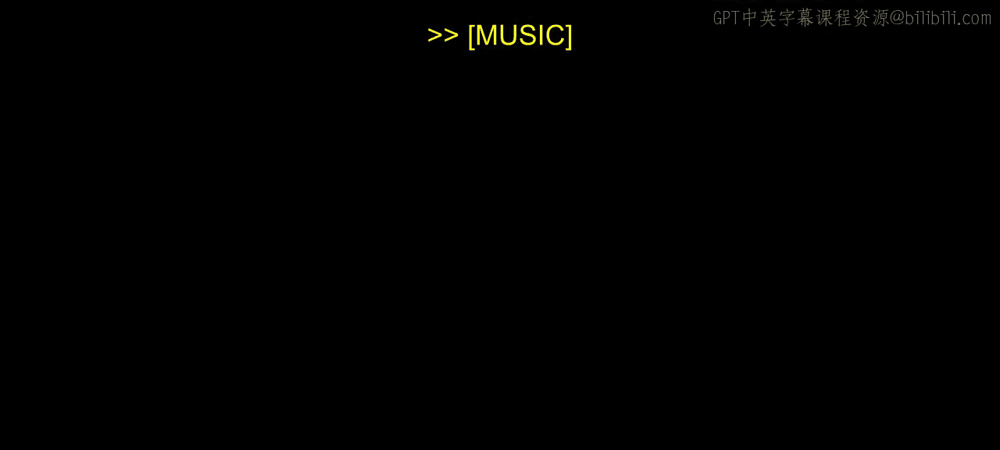

# 华盛顿大学《机器学习（分类，聚类和检索，第3-4课⧸共4课）｜Machine Learning》中英字幕 p115 114_不要相信最后的系数.zh_en -BV1Sr421F7N7_p115-

。

As we saw in our plots， stochastic gradient tends to oscillate around the optimum。

 and so you should never trust that last parameter it finds， unfortunately。

Graient will eventually stabilize on the optimal solution。

 So even though it takes 100 times longer or more， like we' shown in this example。

 So if you look at X axis is100 times more time to converge。

You get there and you feel really good when you get there schastic gradient when you think a converge is really that it's oscillating around the optimum and that can lead to bad practical behavior。

So for example here I'm just giving some numbers， a W at iteration 1000 might look really。

 really bad， but maybe W at iteration 1005 looked really。

 really good and needs some kind of approach to minimize the risk of picking a really bad one or a really good one。

😊，And。There is a very simple technique which works really well in practice and theoretically is what you should do。

 so all the theorems require something like this and what it says is when you're putting W hat。

 your final set of coefficients， you don't use the last value W T capital T。

 you use the average of all the values that you've computed。

 all the coefficients that computed along the way。😊。

So what I'm showing here is what the algorithms should the output as it's fitting the solution to make some predictions in the real world。

