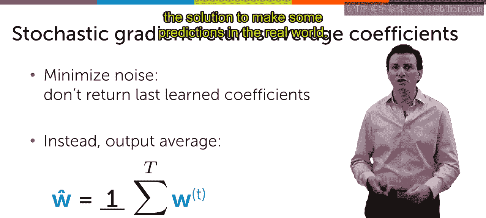

# 机器学习（分类，聚类和检索）：第3-4课：不要相信最后的系数

在本节课中，我们将要学习随机梯度下降法的一个关键特性：它在最优解附近振荡。因此，我们不能简单地信任算法最后找到的参数。我们将介绍一种简单而有效的技术——参数平均法，来获得更稳定、更可靠的最终模型参数。

## 随机梯度下降的振荡现象

上一节我们介绍了随机梯度下降的基本原理，本节中我们来看看它在收敛过程中的一个具体行为。

正如我们在图表中所见，随机梯度下降倾向于在最优解附近振荡。因此，你永远不应该信任它找到的最后一个参数。

## 批量梯度下降与随机梯度下降的对比

相比之下，批量梯度下降最终会稳定在最优解上。即使它花费的时间要长得多，比如在这个例子中显示的需要100倍甚至更长的时间（注意X轴的时间尺度），但当你到达那里时，你会感觉非常好。

而随机梯度下降，当你认为它收敛时，实际上它只是在最优解附近振荡。这种行为可能导致糟糕的实际应用效果。

## 振荡带来的实际问题

以下是振荡行为可能导致的具体问题：

例如，这里给出一些数值说明，在第1000次迭代时的参数 **W** 可能看起来非常糟糕，但也许在第1005次迭代时的 **W** 看起来又非常好。因此，我们需要某种方法来最小化选中一个非常糟糕的参数或一个非常好的参数的风险。

## 解决方案：参数平均法

幸运的是，存在一种在实践中效果非常好、在理论上也应该被采用的简单技术。所有的相关定理都要求类似的做法。

该技术指出：当你确定最终系数 **W_hat** 时，不要使用最后一个值 **W_T**（T是最终迭代次数），而应该使用你在整个过程中计算过的所有值的平均值，即所有计算过的系数的平均。

用公式表示，最终的参数 **W_hat** 应为：
**W_hat = (1/T) * Σ_{t=1}^{T} W_t**

这里展示的是算法在拟合解决方案、以便在现实世界中进行预测时，应该输出的内容。

## 总结

本节课中我们一起学习了随机梯度下降法在最优解附近振荡的特性，并理解了为何不能直接信任其最后迭代得到的参数。我们介绍了一种有效的解决方案——参数平均法，即取所有迭代过程中参数的平均值作为最终模型参数。这种方法在理论上得到支持，在实践中也被证明能显著提升模型的稳定性和可靠性。