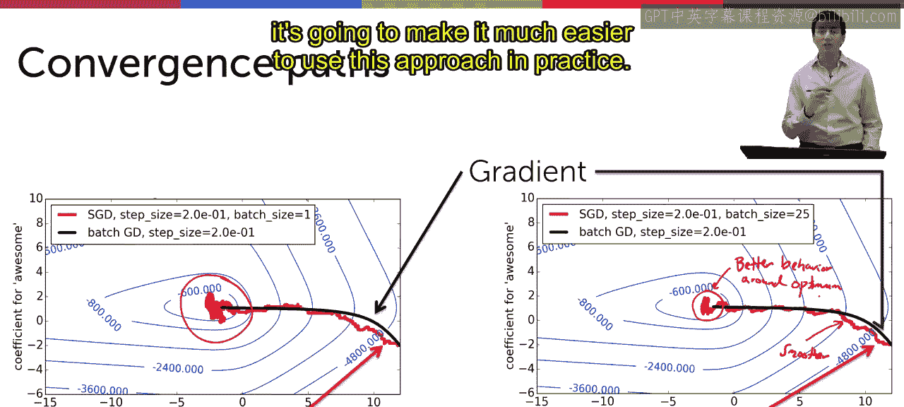
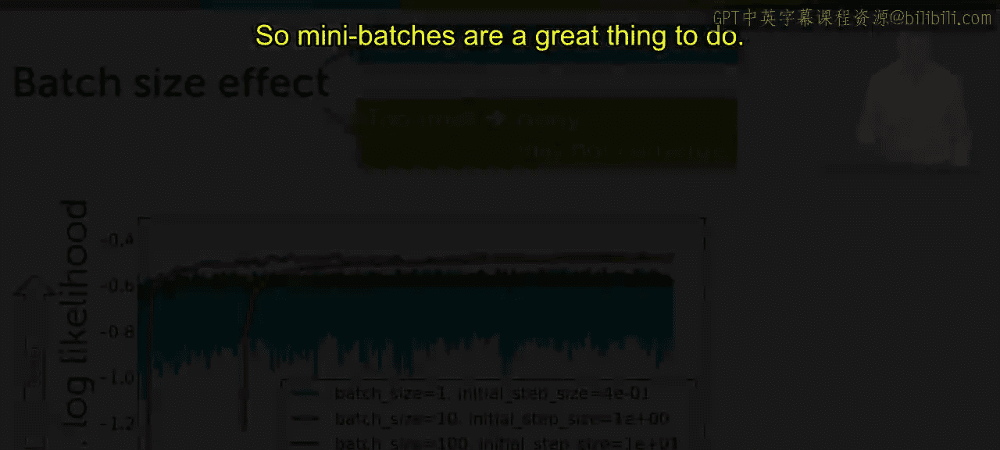
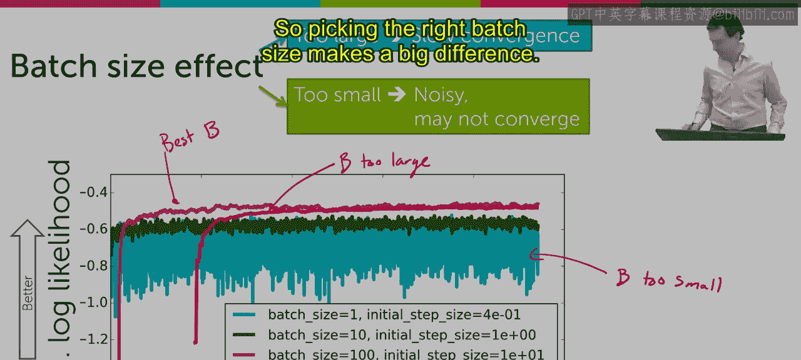
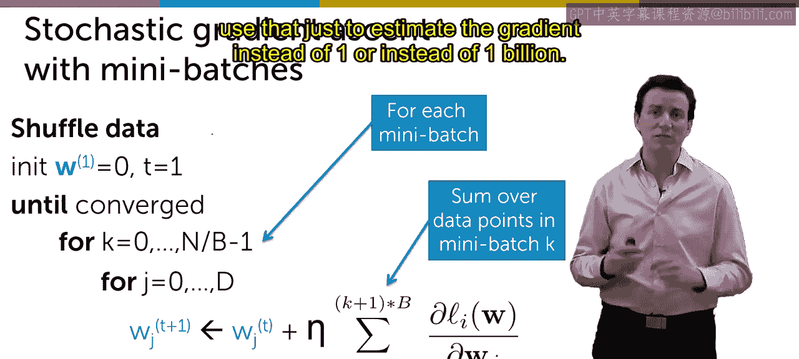

# 华盛顿大学《机器学习（分类，聚类和检索，第3-4课⧸共4课）｜Machine Learning》中英字幕 p116 115_可选：从数据批次中学习.zh_en -BV1Sr421F7N7_p116-

。

The next few sections of this module are going to talk about more practical issues with。

schastic gradient， which you need to address for implementing those algorithms I've made the next few sections optional because it can get really tedious to go through all these practical details。

 you've now already got a sense of how finicky can be there's many other practical details I'm going to make those sections optional So the first one is that learning from one data point is just way too noisy usually use a few data points。

😊，And this is called mini batches。So really we've illustrated two extremes so far we did a certain gradient where you make a full password data and you use end data points for every update of your coefficients。

 and then we talked about stochastic gradient where you look at just one data point when you're making updates on coefficients and the question is is there something in between where you look at B bait data points。

 say 100 and that's called mini batches， it reduces noise increases stability and it's the right thing to do and 100 is a really good number to use by the way？

😊，Here I'm showing the conversion paths of on the same problem we've been looking at。

Comparing batch size of one with batch size of 25。 And here you observe two things。 First。

 the batch size of 25 makes the conversion path smoother。Which is a good thing。

But the second thing to observe， which is even more interesting is when you get around the optimum。

 by size of1 really oscillates around the optimum， well， by size of 25 it oscillates better。

 so it has better behavior around the optimum。And that better behavior is going to make it much easier to use this approach in practice。

 so mini batch is a great thing to do。

So now we've introduced one more parameter to be tuned in this socast gradient algorithm。

 this is the batch size B， if it's too large， then it behaves just like gradient， for example。

 if you use batch size of n， it's exactly the gradientcent algorithm so in this case the red line here is with batch size too large。

If the batch size is too small， you have bad oscillation or bad behavior overall。Too small。

 in this case， it doesn't converge very well。 But if you pick the the best。But size B。

 you have very nice behavior， quickly get to a great solution and you stay around it。

So picking the right box size makes a big difference。

So let's go back to a simple stochastic gradient algorithm and modify it to introducing notion batch sizes so instead of looking one data point at a time。

 we're going to look at one batch at a time and if the batch size is size of B we have n over B batch sizes for data set of size n you know。

😊，If we have a billion data points and batch size 100 is a billion over 100 of those。😊。

And now we go batch by batch， but instead of considering one data point at a time in the computation of the gradient。

 we now consider the B data points in that mini batch and the equation here just shows you the math behind basically the obviously of just taking 100 data points and use that estimate the gradient instead of one or instead of1 billion。

🎼。