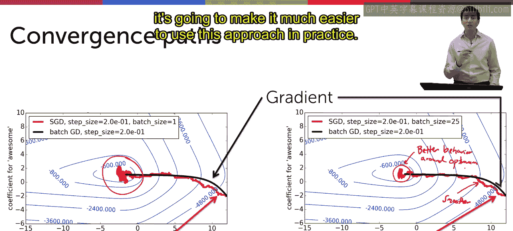
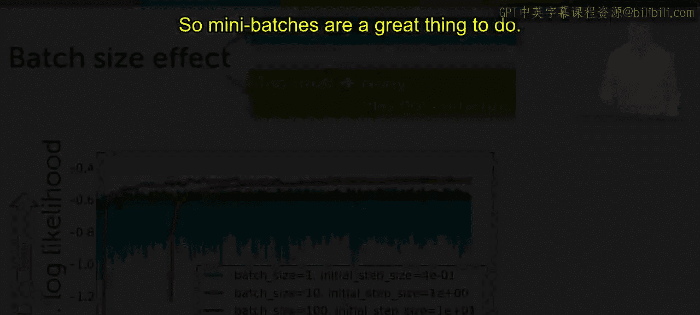
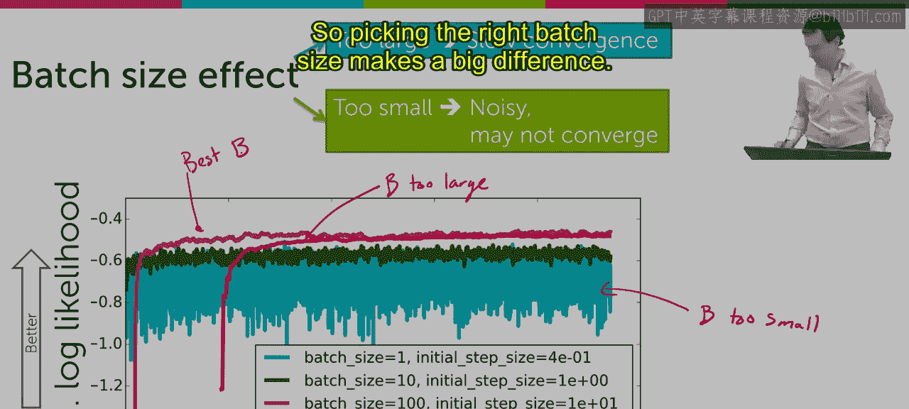
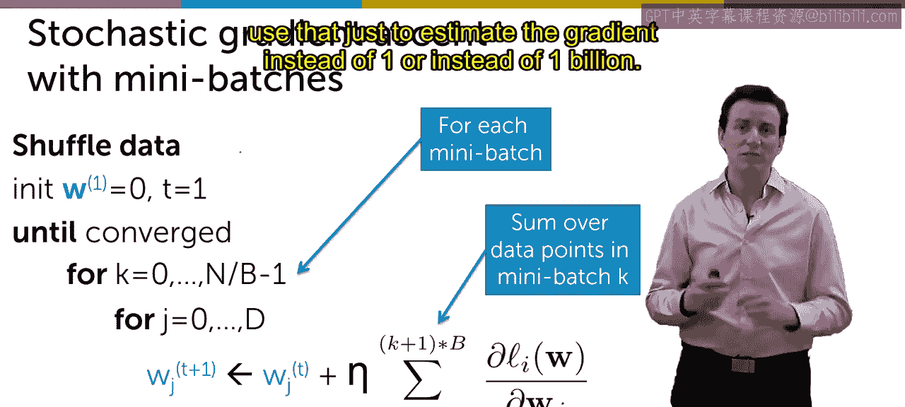

# 机器学习（分类，聚类和检索）：第3-4课：可选：从数据批次中学习


在本节中，我们将探讨随机梯度下降算法中的一个重要实践技巧：使用数据批次进行学习。我们将了解为什么仅使用单个数据点可能存在问题，以及如何通过处理一小批数据点来获得更稳定、更高效的优化过程。

上一节我们介绍了基本的随机梯度下降，本节中我们来看看如何通过处理多个数据点来改进它。

## 为什么使用批次？

仅使用一个数据点进行学习通常会产生过多的噪声。通常，我们会使用几个数据点，这被称为**小批次**。

到目前为止，我们已经说明了两种极端情况：
*   **批量梯度下降**：使用全部 `N` 个数据点来更新系数。
*   **随机梯度下降**：仅使用**一个**数据点来更新系数。

那么，是否存在一种折中方案，让我们每次查看 `B` 个数据点（例如100个）呢？这就是**小批次**方法。它能减少噪声，提高稳定性，是一种正确的做法。顺便提一下，100是一个非常好的批次大小数值。

下图展示了我们在研究同一问题时，批次大小为1和批次大小为25的收敛路径对比：





从中我们可以观察到两点：
1.  批次大小为25的收敛路径更加平滑，这是一件好事。
2.  更有趣的是，当接近最优解时，批次大小为1的路径会在最优点附近剧烈振荡，而批次大小为25的路径振荡更小，行为更好。这种更好的行为使得该方法在实践中更易于使用。因此，使用小批次是一个极佳的选择。

## 选择批次大小的重要性

现在，我们在随机梯度算法中引入了一个需要调整的新参数：**批次大小 `B`**。


以下是选择不同批次大小的影响：
*   **如果 `B` 太大**：它的行为会类似于批量梯度下降。例如，如果使用批次大小 `B = N`，那它就完全是批量梯度下降算法。在下图中，红线代表批次大小过大的情况。
*   **如果 `B` 太小**：会产生不良的振荡或整体表现不佳。在下图中，批次大小太小导致收敛效果不理想。
*   **如果选择了合适的 `B`**：你会获得非常好的行为，能快速得到一个优秀的解并稳定在其附近。

因此，选择合适的批次大小会产生巨大的影响。



## 算法实现：引入批次概念

现在，让我们回到简单的随机梯度算法，并通过引入批次大小的概念来修改它。


我们不再一次查看一个数据点，而是一次查看一个批次。对于一个大小为 `N` 的数据集，如果批次大小为 `B`，那么我们将有 `N / B` 个批次。例如，如果我们有10亿个数据点，批次大小为100，那么就有 `1,000,000,000 / 100` 个批次。

我们逐个批次进行处理。在计算梯度时，我们现在考虑该小批次中的 `B` 个数据点，而不是单个数据点。下面的公式展示了其背后的数学原理：本质上是使用这 `B` 个数据点来估计梯度，而不是使用1个或10亿个数据点。

**小批次梯度更新公式：**
```
对于每个批次（包含 B 个数据点）：
    梯度估计 = (1/B) * Σ(对于批次中的每个数据点 i 计算其梯度)
    系数更新 = 旧系数 - 学习率 * 梯度估计
```



## 总结


在本节课中，我们一起学习了随机梯度下降的一个重要改进：**小批次学习**。我们了解到，使用单个数据点更新参数噪声过大，而使用全部数据点计算成本又太高。小批次方法通过每次使用一小批数据（如100个）来估计梯度，在计算效率和稳定性之间取得了良好的平衡。它能带来更平滑的收敛路径，并在最优点附近表现出更稳定的行为，是实践中非常推荐使用的技巧。