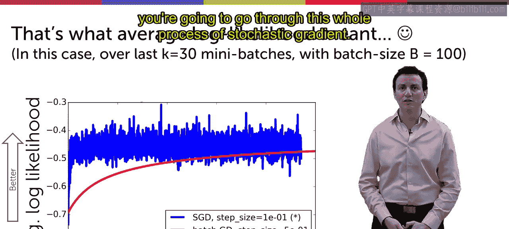
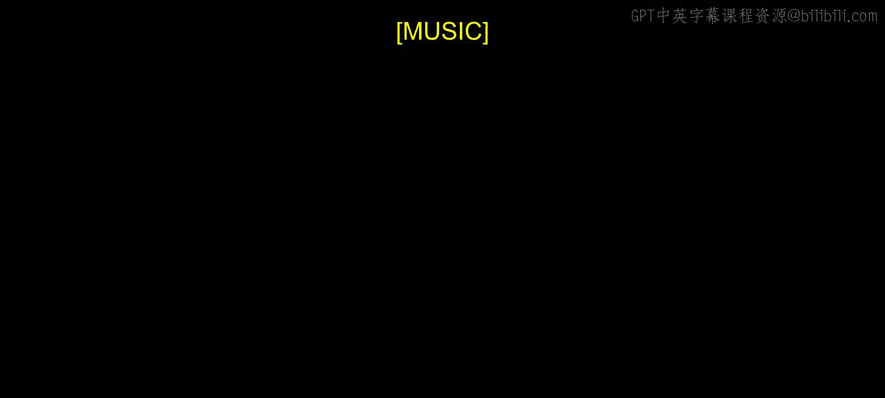

# 华盛顿大学《机器学习（分类，聚类和检索，第3-4课⧸共4课）｜Machine Learning》中英字幕 p117 116_可选：测量收敛性.zh_en -BV1Sr421F7N7_p117-

。

The second practical issue we're going to talk about is how do you measure conversions for schastic gradient If you have to look at all the data points to figure out that I've conged。

 then the whole process is going to be pointless meaningless so we need to think about new techniques of measuring conversions This again is going to be an optional section it's very practical for those who actually want to use and implement a really practical schastic gradient algorithm。

One way to think about it is how did I actually make this plot。

 here's a plot where tochastic gradient gets to the optimum。😊，Before a single passover data。

 while greatly undertaking 100 or more passes over the data。

If to get one point in this plot I had to compute the whole likelihood over the entire dataset that would require me for every little blue dot to make a pass over the entire dataset。

 which make the whole thing really slow if I had to make a passover data to compute the likelihood might as always just use full gradient and not have this noisy problems and so we need to rethink how we're going to compute conversions。

 how we're going to plot that we're making progress。And here there'll be a really。

 really simple trick， really easy， really beautiful that we can do。

 So I'm showing here the schastic gradient ascent algorithm for logistic regression。

 the one that we've been using so far。 So I go data point by data point and I compute the contribution to the gradient。

 which is this par the thing I'm calling partial J。😊。

Now if I wanted to compute the log likelihood of the data to see what my quality was。

 how well I'm doing， I would have to compute the following equation for data point I if the data point were a positive data point。

 I take the log of y cos+1 given X and the current parameters。Clinical coefficient。And。

If the data points were negative， Yi equals minus1。

 then I need to take the log of the probability of y equals minus1。

 which turns out to be log of1 minus the probability y equals plus1。And so here's a beautiful thing。

 the thing that I need to compute the likelihood for a data point。

Is exactly the same as the thing that I needed to compute the gradient。And so I've already computed。

 I can compute the contribution and likelihood of this one data point。😊，Which is great。

 I can't do it for everybody， but I can do it for one data point。😊，So， every iteration。T。

 I can compute the likelihood of a particular data point。

 I can't use that to measure conversions because I could do well one data point class perfectly。

 but not for others， so it would be a very noisy thing。😊，But if I want to compute how well I'm doing。

 let's say after 75 iterations， what I can do is look at the last few data points， how well I did。

 and the likelihood for those data points average it out and then create a smoother curve。

And so for every time step， I want to keep an average。

 It's called a moving average of the last few likelihoods in order to measure conversions。

So the plot here， the plot that I've be showing to you now can tell you truth in advertising what it actually was。

😊，The blue line here was not straight up gradient。 It was mini batches of size 100。

 which is a great number to use， still converge much faster than gradient。 And to draw the blue line。

 I average the likelihood over the last 30 data points。So thats how I build a plot。

 and this is how you would have to build a plot if you're going to go through this whole process of schastic gradient。

