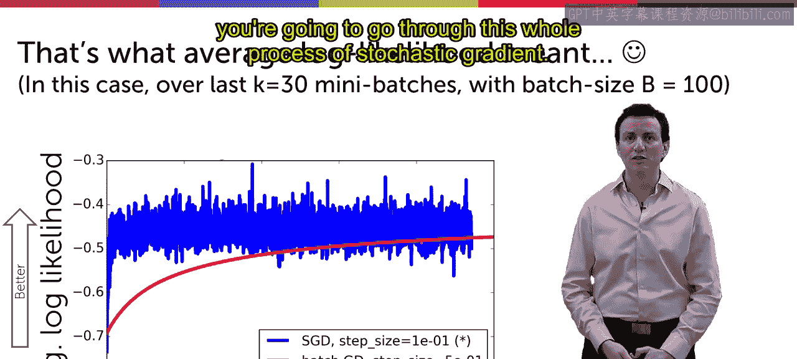

# 机器学习（分类，聚类和检索）：第3-4课：可选：测量收敛性 📈

在本节中，我们将探讨一个非常实际的问题：如何测量随机梯度下降算法的收敛性。如果每次都需要遍历整个数据集来计算收敛情况，那么使用随机梯度下降的意义就不大了。因此，我们需要新的技术来高效地评估算法是否正在向最优解前进。

上一节我们讨论了随机梯度下降的基本原理，本节中我们来看看如何在实际操作中监控其收敛过程。

## 如何测量收敛性？

在讲解具体方法前，我们先看一个现象。下图展示了随机梯度下降在**单次遍历数据前**就接近最优解，而批量梯度下降可能需要**100次或更多次**遍历才能达到类似效果。

这里存在一个矛盾：如果为了绘制上图中每一个蓝点（代表每次迭代的状态），我们都必须计算整个数据集的似然度，那就意味着每次迭代都要完整遍历一次数据。这会使整个过程变得非常缓慢，失去了随机梯度下降“高效”的优势。我们几乎可以直接使用完整的批量梯度下降了。因此，我们需要重新思考如何计算和展示收敛进度。

## 一个简单而巧妙的技巧

接下来，我们将介绍一个非常简单、有效且巧妙的方法。我们以逻辑回归的随机梯度上升算法为例，这是我们一直在使用的算法。该算法逐个处理数据点，并计算其对梯度的贡献，我们称之为 `partial_J`。

现在，如果我们想计算数据的对数似然度以评估当前模型的质量，我们需要为每个数据点计算以下公式：
*   如果数据点是正例（`y_i = +1`），则计算 `log( P(y=+1 | x, w) )`。
*   如果数据点是负例（`y_i = -1`），则计算 `log( 1 - P(y=+1 | x, w) )`。

这里有一个美妙之处：**计算单个数据点似然度所需的公式，与计算该数据点梯度贡献的公式核心部分是相同的**。这意味着，在每次迭代 `t` 中，当我们为当前数据点计算梯度更新时，我们已经**顺便**计算出了该数据点的似然度。

这很棒，因为我们虽然不能为所有数据点计算（那样成本太高），但可以为当前处理的这一个数据点计算。

## 从单点似然到平滑曲线

然而，我们不能直接用单个数据点的似然度来衡量整体收敛性，因为可能偶然对某个点分类很好，但对其他点不好，这样得到的信号会非常嘈杂。

为了更平滑、更可靠地衡量进度，我们可以这样做：在每次迭代时，我们不仅计算当前数据点的似然度，还维护一个**最近若干个数据点似然度的移动平均值**。例如，如果我们想评估第75次迭代后的表现，可以查看最近处理的几十个数据点的似然度，并计算它们的平均值。

通过这种方式，我们可以构建一条平滑的曲线来反映算法性能的整体趋势，而不是受单个数据点噪声影响的剧烈波动。

以下是实现这一过程的关键步骤：

1.  **初始化**：设定移动平均窗口的大小（例如，最后30个数据点）。
2.  **迭代计算**：在每次随机梯度下降迭代中，计算当前数据点的似然度。
3.  **更新平均值**：将这个新的似然度值加入移动平均序列，并移除最旧的值（如果序列已满），然后计算新的平均值。
4.  **绘制图表**：将每次迭代得到的移动平均值绘制出来，即可得到反映收敛趋势的平滑曲线。

## 实例说明

最后，让我们揭秘之前展示的图表是如何绘制的。图中的蓝线并非基于完整的梯度计算，而是使用了**大小为100的小批量**数据，这仍然比批量梯度下降收敛得快得多。而为了绘制这条蓝线，我计算了**最后30个数据点似然度的移动平均值**。

这就是构建收敛性图表的方法，也是你在实施整个随机梯度下降过程中需要采用的方法。

---

**本节课总结**：我们一起学习了如何高效地测量随机梯度下降算法的收敛性。核心在于利用**计算梯度时已得到的中间结果**来获取单点似然度，并通过计算**最近若干数据点似然度的移动平均值**来构造一条平滑的收敛曲线，从而在避免遍历整个数据集的前提下，有效监控算法的训练进度。这是一个既实用又巧妙的技术。