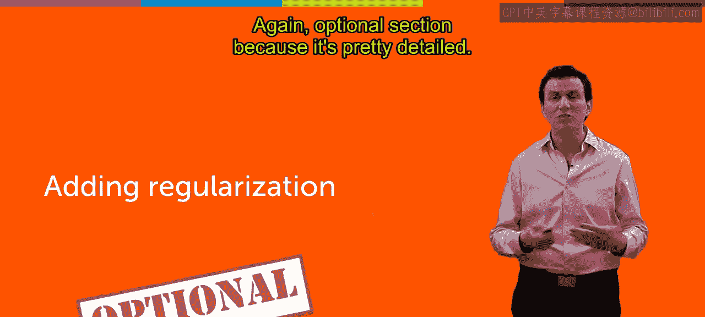
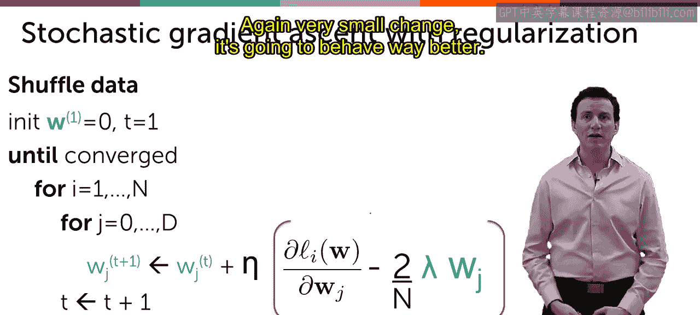
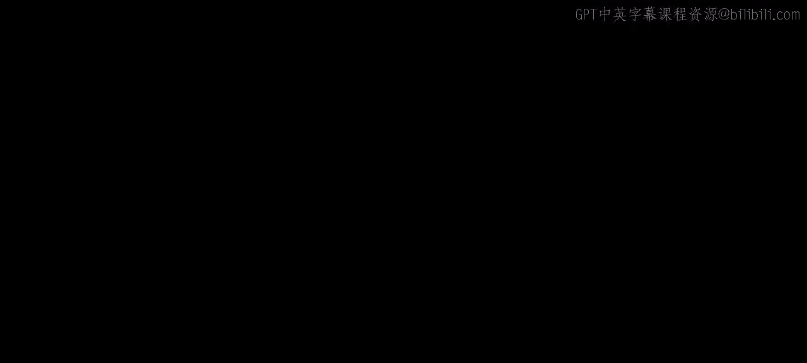

# 华盛顿大学《机器学习（分类，聚类和检索，第3-4课⧸共4课）｜Machine Learning》中英字幕 p118 117_可选：添加正则化.zh_en -BV1Sr421F7N7_p118-

。

We're now down to our final practical issue of schastic gradient。

 which again is going to be an optional section and the question is how do we introduce regularization。

 what impact it has on the updates and this is going to be pretty significant if you want to implement yourself in a general way。

Again， optional section because。

Pre detailed。So let's remind ourselves of the regularized likelihood。

 so we have some total quality metric that depend on our fit of our data。

 which is the log likelihood and some measure of the complexity of the parameters。

 which in our case here we're using W squared， the L2 norm of the parameters。😊。

And we wanted to compute the gradient of this regularized light to make some progress and avoid overfitting。

So the total derivative is the derivative of the first term the quality。

 which is the sum over the data points of the contribution to each data point。

 the thing that got really expensive。😊，And the contribution of the second one。

 once we introduced that parameter lambda to trade off the two things， talked about this a lot。

 the contribution is minus2 lambda Wj。And we derived this update during an earlier module on regularized logistic regression。

Now this is how we do straight up gradient updates with regularization。

 The question is what do we do when we want to do stochastic gradient with regularization？😊。

So if you remember stochastic gradient， we just said you take the contribution for a single data point and if we added up those contributions。

 we get exactly the gradient， this is why it worked because the sum of the stochastic gradients equal the gradient。

😊，And so to maintain that， we need to think about how to set up the regularization term such that the sum of the stochastic gradients also is equal to the gradient。

And one way to think about this is that we take the regularization and divide it by n so in practice you want to do this。

 you want to say that the total derivative for stochastic gradient is the contribution data point minus2 over n lambda Wj。

😊，And so if you were to add this up， you get back to the full gradient。

So with regularization now the algorithm stays the same but the contribution of data point is its gradient minus2 over n lambda Wj that's the contribution from the regularization part if you're using mini batches you would add up that B times so you had the sum of the contributions from each data point and then you'll be 2 B over n lambda WJ。

😊，So this is how we take care of regularization， again。

 very small change is going to behave way better in practice。

。

