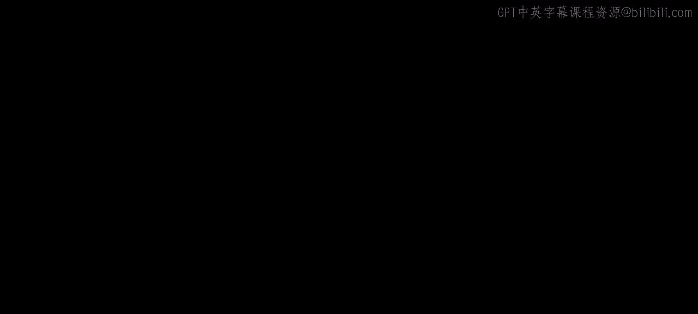

# 机器学习（分类，聚类和检索）：第3-4课：可选：添加正则化 🧠

在本节中，我们将探讨如何在随机梯度下降算法中引入正则化。正则化是防止模型过拟合的关键技术，理解其在随机梯度更新中的处理方式对于实现一个健壮的机器学习算法至关重要。

---

上一节我们介绍了随机梯度下降的基本原理，本节中我们来看看如何将正则化项整合到随机梯度更新的框架中。

首先，让我们回顾一下带正则化的目标函数。在逻辑回归等模型中，我们通常优化一个由两部分组成的总体目标：衡量数据拟合程度的对数似然，以及衡量参数复杂度的正则化项。具体公式如下：

**总目标 = 对数似然 - λ * 参数复杂度**

其中，λ 是一个权衡两项重要性的超参数。当我们使用 L2 正则化时，参数复杂度通常用参数向量 **w** 的 L2 范数的平方来表示，即 **||w||²**。

为了通过梯度下降优化这个总目标，我们需要计算其梯度。总梯度由两部分组成：
1.  对数似然部分对每个数据点的梯度贡献之和。
2.  正则化部分对参数的梯度贡献。

对于 L2 正则化，正则化部分对第 j 个参数 w_j 的梯度贡献是 **-2λ w_j**。因此，在标准（批量）梯度下降中，每次更新会用到所有数据点的梯度之和以及这个正则化项。

---

那么，在随机梯度下降中该如何处理正则化呢？随机梯度下降的核心思想是，每次更新只使用一个（或一小批）数据点的梯度来近似整个数据集的梯度。为了保证这种近似的有效性，我们需要确保所有随机梯度贡献的总和等于完整的梯度。

以下是实现这一点的关键步骤：

为了在随机梯度更新中保持这种一致性，我们需要将正则化项也“分摊”到每个数据点上。一种标准的做法是，将正则化项的梯度贡献除以数据点的总数 **n**。

因此，对于单个数据点的随机梯度更新，其总梯度贡献变为：
**单个数据点的梯度贡献 = 该数据点的似然梯度 - (2λ / n) * w_j**

这样，当我们对所有 n 个数据点的随机梯度贡献进行求和时，正则化部分的总和恰好是 **-2λ w_j**，与批量梯度下降中的正则化梯度完全一致。

---

如果使用小批量梯度下降，处理方式也类似。假设小批量的大小为 **B**，那么在该小批量上的更新中，正则化项的贡献需要调整为：
**小批量正则化贡献 = - (2Bλ / n) * w_j**

这相当于将这个小批量视为 B 个独立数据点，每个点贡献 **(2λ / n) * w_j**，然后求和。

综上所述，在随机梯度下降中引入正则化只需要对更新规则做一个微小的调整：将正则化系数 λ 缩放为 **λ / n**（对于单个数据点）或 **Bλ / n**（对于小批量）。这个调整确保了随机梯度期望与全批量梯度一致，是实践中实现带正则化随机梯度下降的推荐方法。

---

本节课中我们一起学习了如何在随机梯度下降中整合正则化。核心在于调整正则化项的权重，使其在随机更新中能被正确“分摊”，从而保证优化过程的收敛性和防止过拟合的效果。记住这个简单的缩放规则，你就可以在自己的实现中轻松加入正则化了。