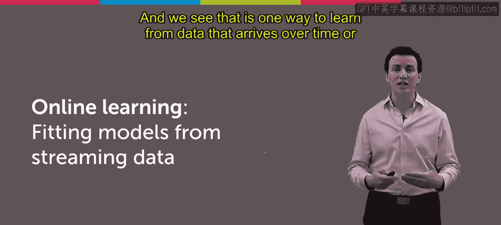
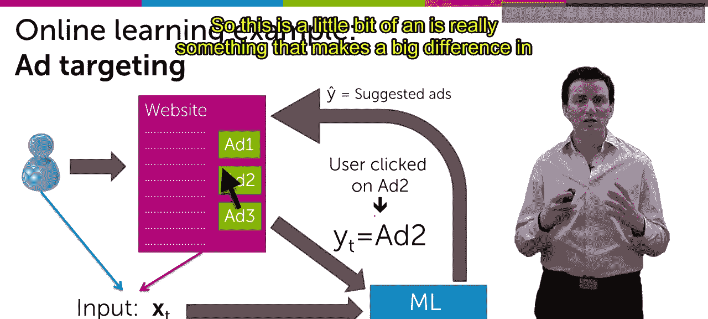
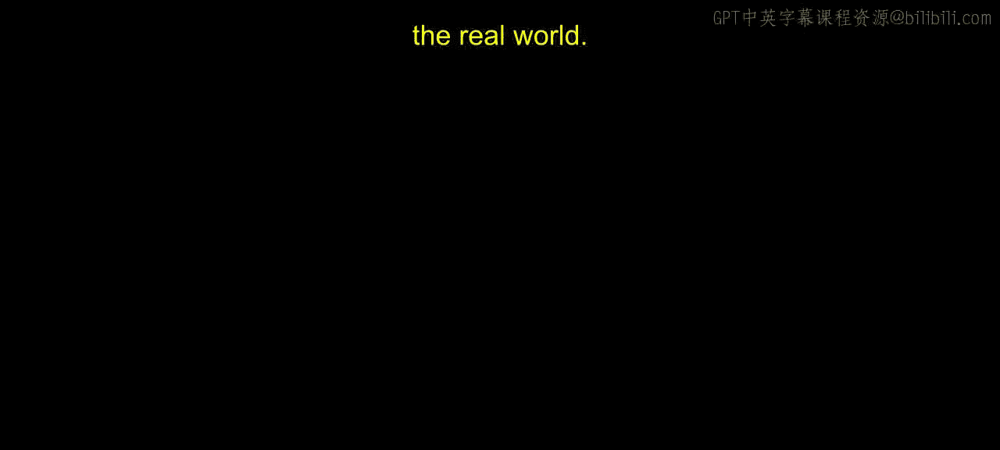

# 华盛顿大学《机器学习（分类，聚类和检索，第3-4课⧸共4课）｜Machine Learning》中英字幕 p119 118_在线学习任务.zh_en -BV1Sr421F7N7_p119-

。

Now we've seen stochastic gradient， which is really exciting， simple algorithm。

 simple modification to gradient， which really speeds up in practice。

 has many practical challenges and we talked about several of those and how to address them。

 but now I would like to step back and think about a broader question what's called online learning of how do we learn from streaming data and we see that stochastic gradient is one way to learn from data thats over time or streaming data。

😊。

That's to find the idea of online learning。But first， let's look at what we've been doing so far。

 what we've been doing so far in this course and in the regression course is what's called batch learning I'm given a full data set and I'm going to run some learning algorithm over this data set maybe be gradient and do mini paths over the data and finally output my best guess my best estimate for the coefficient I'm going to call that WHt and we're done that's batch learning。

😊，Online learning is something different actually what you' all doing here is online learning but that's a different kind of online learning what we're talking about here is online machine learning and in online machine learning data arrives over time one data point at a time so for example as well see next a serving ads on webage is an example where things arriving one data point at a time and so that's where data is coming in in the machine learning algorithm sees a little tranche of that data one little bit let's say a time step one。

😊，Takes it in and make some estimate of the coefficient， say W hat1。

And then time step2 it see another little bit of the data and makes another estimate of the coefficients。

 W hat 2， and at time step3， it makes another estimate W hat 3。

 time step 4 is a little more data and makes an estimate W hat 4。

 so every time step is making a new estimate so you can make new predictions。😊。

To better around the ideas， let's look at a really practical real world example of where online learning makes a huge difference。

 and it's on ad targeting。 So let's say you navigating the web and you hit a particular website What's happening behind the scenes when you're shown ads Well。

 some information about you like your age or the websites you've visited and some information about the website like the text of the website are fed into machine learning algorithm that's going to use some set of coefficients W hat T to figure out what's the best ads to show you and we're gonna to call that why hatt suggested ads and might show you a1 a two a 3 and so on。

😊，And you're looking at the website， you're like， who。

 that's a really interesting ad and you go and you click on that too。😊，Well， when you click on add2。

 the machine learning algorithm figures out that you click on add2 and assigns YT the true label for what it should on our website to be add2。

 that's what you clicked on and then the machine learning algorithm takes that new YT and updates its coefficients from WHT to WHT plus1。

And what we've described so far is really how odd systems work a lot of them work in practice。

 so this is a little bit of an obstruction which is really something that makes a big difference in the world world。

😊。

