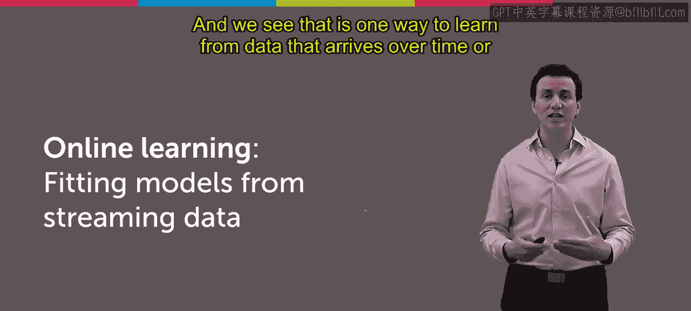
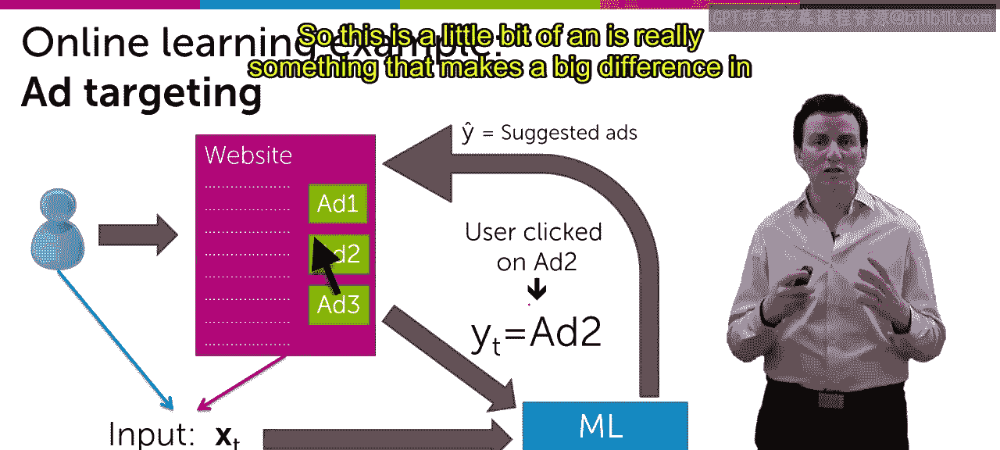

# 机器学习（分类，聚类和检索）：第3-4课：在线学习任务 🎯

在本节课中，我们将要学习**在线学习**的概念。我们将回顾之前学习的**批量学习**，并对比介绍数据随时间到达的**在线学习**模式。我们将通过一个实际的广告定向投放例子，来理解在线学习如何工作及其重要性。

---

## 从批量学习到在线学习 🔄

上一节我们介绍了随机梯度下降，这是一种对梯度下降的简单修改，在实践中能显著加速计算，但也带来了一些挑战及其应对方法。

现在，让我们退一步，思考一个更广泛的问题：如何从**流式数据**中学习？我们将看到，随机梯度下降正是处理随时间到达或流式数据的一种方法。

这就是**在线学习**的核心思想。但首先，让我们看看到目前为止我们一直在做什么。

在本课程以及回归课程中，我们一直在进行的是**批量学习**。我获得一个完整的数据集，然后运行某个学习算法（可能是梯度下降，或在数据上进行小批量处理），最终输出我对系数的最佳估计，我们称之为 **W_hat**。完成后，学习过程就结束了。这就是批量学习。

在线学习则有所不同。实际上，你们在这里所做的也是一种在线学习，但那是另一种类型。我们这里讨论的是**在线机器学习**。在在线机器学习中，数据是随时间到达的，一次一个数据点。

例如，我们接下来会看到，在网页上投放广告就是一个例子，事情一次只到达一个数据点。因此，数据是不断流入的，机器学习算法每次只看到一小部分数据。

*   在时间步1，它接收一小部分数据，并对系数做出一个估计，比如 **W_hat1**。
*   然后在时间步2，它看到另一小部分数据，做出另一个系数估计 **W_hat2**。
*   在时间步3，它做出另一个估计 **W_hat3**。
*   时间步4，它获得更多一点数据，做出估计 **W_hat4**。

所以，每个时间步都在生成一个新的估计，从而可以做出新的预测。

---

## 一个实际案例：广告定向投放 📈

为了更好地理解这些概念，让我们看一个在线学习发挥巨大作用的、非常实际的现实世界例子：**广告定向投放**。

假设你正在浏览网页，访问了一个特定的网站。当你看到广告时，幕后发生了什么？

一些关于你的信息（比如你的年龄或访问过的网站）以及关于网站本身的信息（比如网站文本）会被输入到一个机器学习算法中。这个算法将使用一组系数 **W_hat_T** 来确定向你展示哪些广告最好。我们称算法建议的广告为 **y_hat**，它可能会向你展示广告A1、A2、A3等等。

你看着网站，心想：“哇，那个广告真有意思！”于是你点击了广告A2。

当你点击广告A2时，机器学习算法会得知你点击了A2，并将 **y_T**（即它本应在网站上展示的广告的真实标签）分配为A2——这就是你点击的内容。

然后，机器学习算法会利用这个新的 **y_T**，将其系数从 **W_hat_T** 更新到 **W_hat_{T+1}**。

我们到目前为止描述的，实际上正是许多广告系统在实践中的工作方式。这虽然是一个简化的抽象，但确实是现实世界中产生巨大影响的事物。

---

## 总结 📝

本节课中我们一起学习了**在线学习**。我们首先回顾了**批量学习**，然后引入了数据流式到达的**在线学习**概念。通过**广告定向投放**的具体案例，我们看到了在线学习如何实时接收数据、做出预测、根据反馈（如用户点击）更新模型，从而不断适应变化的环境。随机梯度下降是实现这种在线更新的一种有效方法。理解在线学习对于处理实时数据流和构建自适应系统至关重要。