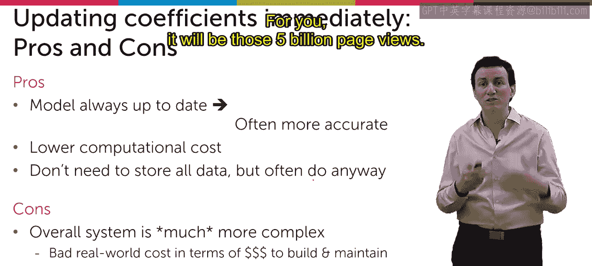

# 华盛顿大学《机器学习（分类，聚类和检索，第3-4课⧸共4课）｜Machine Learning》中英字幕 p120 119_使用随机梯度进行在线学习.zh_en -BV1Sr421F7N7_p120-

。

And this is an example of online learning problem， data is arriving over time， you see an input XI。

 and you need to make a prediction why hat I， so the input might be text on web page information about you and why HatI might be a prediction about what ads you might click on。

And then given what happens in the real world， whether youre click on an ad in which case Yt might be add2。

 or you don't click on anything， in which case Yt will be none of the above， no a was good for you。

 whatever that is it gets fed into machine learning algorithm that improves its coefficient so it can improve its performance over time。

And the question is how do we design a machine learning algorithm that behaves like this。

 what's a good example of a machine learning algorithm that can improve its performance over time in an online fashion like this？

And it turns out that we've seen one， schastic gradient。

 schastic gradient is an algorithm that can be used for online learning， so let's review it。

 you give in some initial set of coefficients so everything is equal to0 every time step you get some input X I。

 you can make a prediction Y hat T based on your current estimates of the coefficients。😊。

And then you're given a true label YT。And you want to feed those into an algorithm while stochastic gradient will take those inputs and use it to compute the gradient。

 and then just updated the coefficients， so WJT plus1 is going to be WJ T plus8ta times the gradient which is computed from this observed quantities in the real world。

So online learning is a different kind of learning that we haven't talked all about in the specialization。

 but it's really important in practice， so when data arrives over time and you need to make a decision right away of what to do with it。

 but based on that decision you're going to get some feedback and you're going to update the parameters immediately and keep going。

This online learning approach where you're updating in the parameters immediately as you see some information in the real world can be extremely useful。

 so for example your model is always up to date it's always based on the latest data。

 latest information in the world， you can have lower computational costs because you can use techniques like schastic gradient that don't have to look at all the data in fact you don't even have to store all the data if it's too massive。

😊，However， most people do store the data because they might want to use it later。

 So that's a side note， but you don't have to。However。

 it has some really difficult practical properties。

 so the system that you have to build the actual design of how data interacts with the world and where parameters get stored。

 the coefficients get stored all that it's really complex and complicated it's hard to maintain if you have oscillations in your machine learning algorithm it can do really stupid things and nobody wants their website to do stupid things and they don't really trust those machinery schastic reading updates necessarily and sometimes it can give you bad predictions so in practice most companies don't do something like this。

 what they do is they save their data for a little while and update their models with the data from the last hour or from the last day or for the last week it's very common so it's very common for example。

 for a large。Like retailer to every night change its recommender system and run a big service every night to do that and you can think about that as the extreme version of mini batches that we talked about earlier in this module but now the batches。

 the whole data from the whole day for YouTube will be those 5 billion page views。

