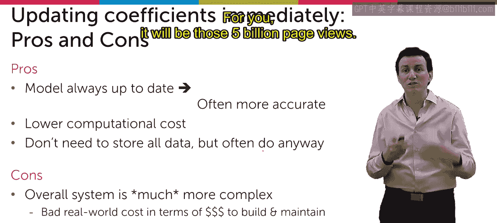

# 机器学习：第3-4课：使用随机梯度进行在线学习

在本节课中，我们将要学习一种称为“在线学习”的机器学习范式。我们将探讨其核心概念、工作原理，并重点介绍随机梯度下降算法如何作为在线学习的一个有效工具。

## 概述

在线学习是一种处理随时间到达的数据流的学习方法。在这种模式下，模型需要即时对新数据点做出预测，并根据真实世界的反馈立即更新自身参数。这与传统的批量学习（一次性处理所有数据）形成对比。

## 在线学习问题示例

上一节我们介绍了在线学习的基本概念，本节中我们来看看一个具体的应用场景。

数据随时间到达。你看到一个输入 **X_t**，需要做出预测 **ŷ_t**。例如，输入可能是网页上的文本或关于你的信息，而 **ŷ_t** 可能是对你可能点击哪个广告的预测。

然后，根据真实世界发生的情况（例如，你点击了广告2，则 **y_t** 为“ad2”；或者你什么都没点击，则 **y_t** 为“无”），这个真实标签 **y_t** 会被反馈给机器学习算法。算法利用这个反馈来改进其系数，从而随时间提升性能。

## 适用于在线学习的算法

那么，如何设计一个能像这样随时间改进性能的机器学习算法呢？一个好的例子是什么？

事实证明，我们已经见过一个这样的算法：**随机梯度下降**。

随机梯度下降是一种可以用于在线学习的算法。我们来回顾一下它的流程。

首先，给定一个初始系数集（例如，全部设为0）。在每个时间步 **t**，你会获得一个输入 **X_t**。你可以基于当前的系数估计值做出预测 **ŷ_t**。

然后，你会得到一个真实标签 **y_t**。你希望将这些信息输入一个算法。随机梯度下降将接收这些输入，并用它们来计算梯度，然后立即更新系数。更新公式如下：

**w_j(t+1) = w_j(t) + η * gradient_j(t)**

其中，梯度是根据从现实世界观察到的量（**X_t**, **y_t**, **ŷ_t**）计算得出的。

## 在线学习的优势与挑战

在线学习是本专项课程中尚未深入讨论的一种不同类型的学习，但在实践中非常重要。当数据随时间到达，并且你需要立即决定如何处理它时，基于该决策你将获得一些反馈，并立即更新参数，然后继续处理后续数据。

这种在观察到现实世界信息后立即更新参数的方法非常有用。以下是它的主要优势：

*   **模型实时性**：模型始终基于最新的数据和世界信息，保持最新状态。
*   **计算成本低**：你可以使用像随机梯度下降这样的技术，它不需要查看所有数据。事实上，如果数据量过大，你甚至不需要存储所有数据。

然而，在线学习也带来了一些实际挑战：

*   **系统复杂性**：构建实际系统（包括数据如何与世界交互、参数存储在哪里等）非常复杂，难以维护。
*   **性能波动风险**：如果你的机器学习算法出现振荡，它可能会做出非常糟糕的决策。没有人希望他们的网站做出愚蠢的行为，并且他们不一定完全信任这些即时的随机梯度更新。
*   **预测风险**：有时它可能给出糟糕的预测。

因此，在实践中，大多数公司并不完全采用这种严格的在线学习模式。他们通常会将数据保存一小段时间（例如最近一小时、一天或一周的数据），然后使用这些数据批量更新模型。这种做法非常普遍。

例如，一个大型零售商可能每晚更新其推荐系统，并运行一个大型服务来完成此任务。你可以将其视为我们在本模块前面讨论过的“小批量”学习的极端版本，只不过这里的“批量”是一整天的全部数据（例如，对YouTube来说，可能是50亿次页面浏览的数据）。

## 总结

本节课中我们一起学习了在线学习的概念。我们了解到，在线学习适用于数据流式到达、需要即时预测和更新的场景。随机梯度下降算法是实现在线学习的一个核心工具，它通过逐个数据点地更新模型参数来适应新信息。虽然在线学习具有模型实时和计算高效的优势，但其系统复杂性和潜在的性能波动使得许多公司在实践中采用折衷的“近线”学习方式，即定期使用近期数据批量更新模型。理解这种学习范式有助于我们根据实际应用需求选择合适的机器学习策略。