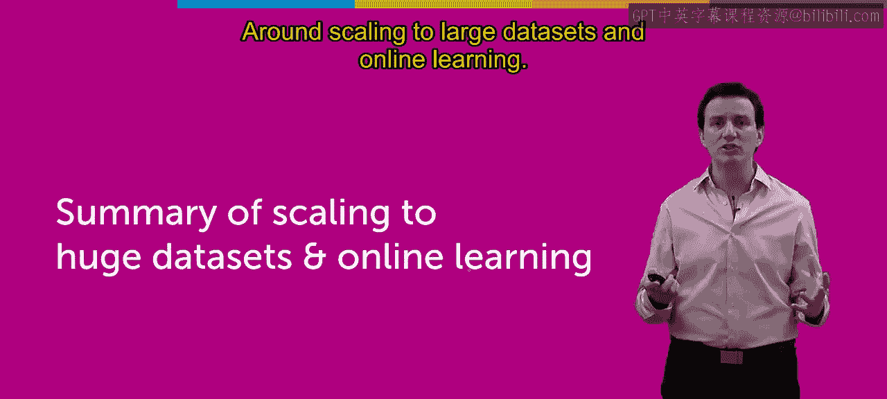
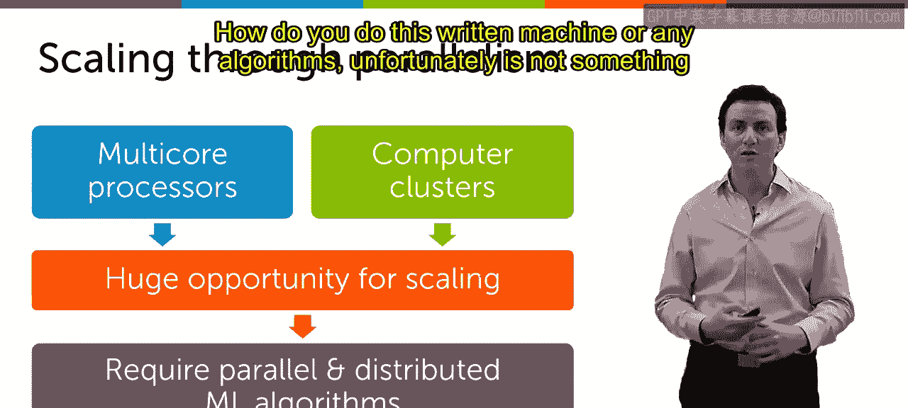
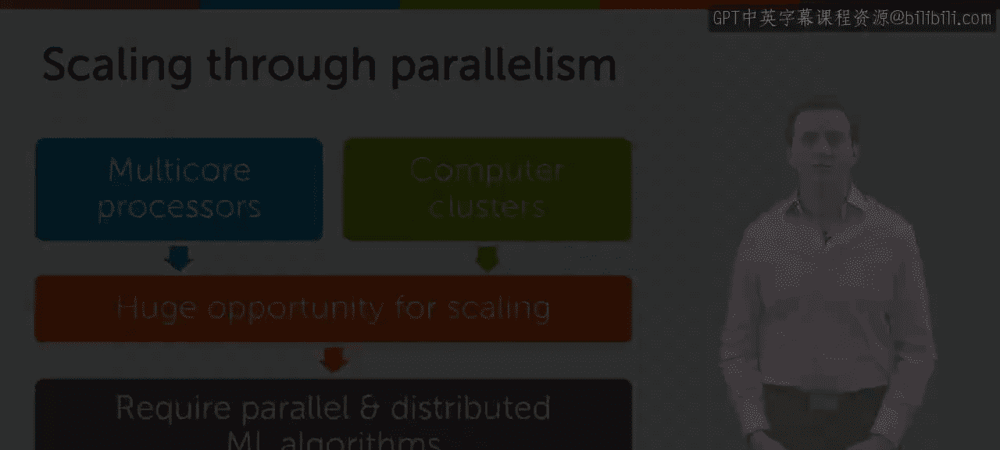
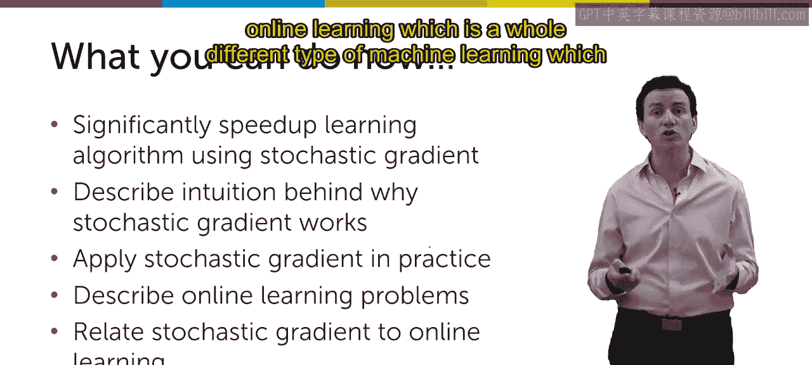

# 华盛顿大学《机器学习（分类，聚类和检索，第3-4课⧸共4课）｜Machine Learning》中英字幕 p121 120_通过并行化扩展到超大数据集：模块回顾.zh_en -BV1Sr421F7N7_p121-

。

Let's take a final minute to summarize what we've seen in today's module around scaling to large data sets and online learning。

Now we use sastic gradient to scale to large data sets。

 but this is not the only approach that's used， in fact a lot of scaling that we do is about dealing with multi corere processors so the fact that processors have multiple cores and you can do parallel computation。

And then using large computers， clusters with tens of machines， hundred machines， thousand machines。

 hundred000 machines and so on。 And this requires new kinds of machine learning algorithms。

 which are called distributed and parallel algorithms that can be spread out over 1000 machines。

 This is a very important topic is actually what a lot of my personal research is about how do you do distributed machine learning algorithms。

 But unfortunately， not something that we're gonna have time to cover in in the current course。

As a summary， we've seen that a small modification of your gradientcent algorithm can yield an incredible improvement in the overall running time of the approach。

 and that makes a huge difference in practice。 There are many practical challenges associated with schastic gradient。

 but is extremely useful and the same kind of techniques that we saw here can also be used for online learning。

 which is a whole different type of machine learning， which is also of great practical significance。

😊。

