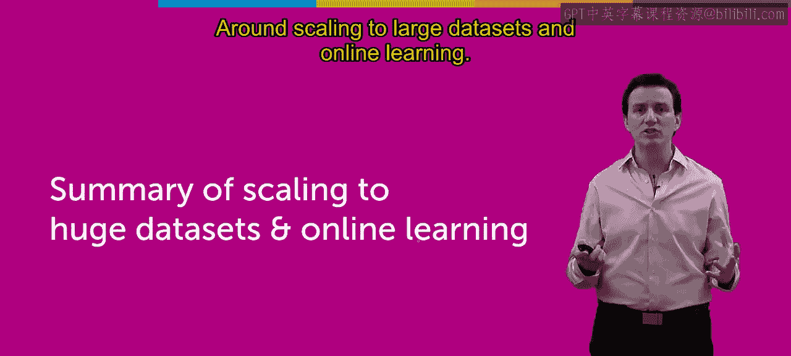
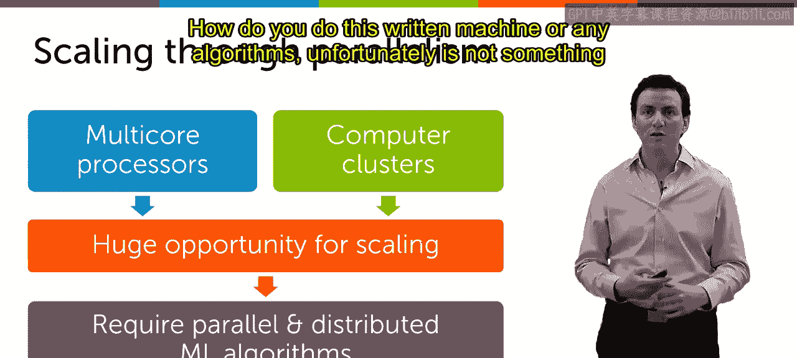
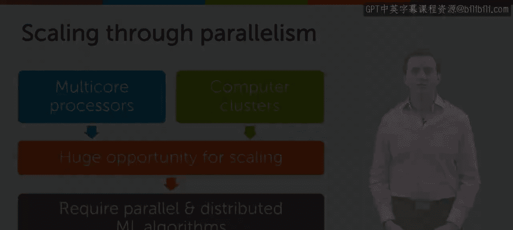
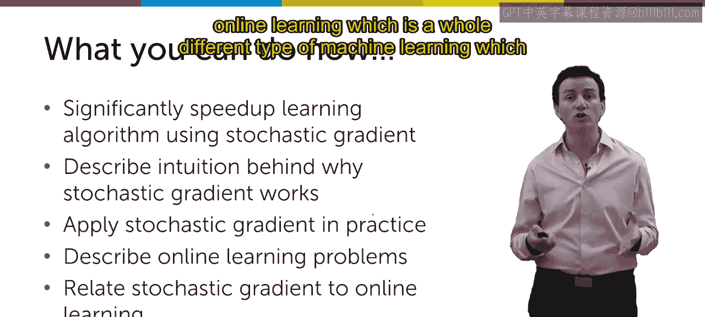

# 机器学习：第3-4课：通过并行化扩展到超大数据集：模块回顾

在本节课中，我们将总结关于扩展到大型数据集和在线学习的核心内容。我们回顾了随机梯度下降如何解决大规模数据问题，并简要探讨了更高级的并行与分布式计算方法。

上一节我们介绍了随机梯度下降，本节中我们来看看其他扩展机器学习算法到超大规模数据集的方法。

## 并行与分布式计算

随机梯度下降是扩展到大型数据集的一种方法，但这并非唯一途径。实际上，许多扩展工作涉及利用多核处理器进行计算。现代处理器通常拥有多个核心，这使得并行计算成为可能。

此外，我们还可以使用大型计算机集群，这些集群可能包含数十台、数百台、数千台甚至数十万台机器。这要求我们使用新型的机器学习算法。

以下是这类算法的关键特点：

*   **分布式与并行算法**：这类算法可以分布在数千台机器上运行。
*   **研究重要性**：这是一个非常重要的研究领域，也是我个人研究的重点，即如何设计分布式机器学习算法。
*   **课程限制**：遗憾的是，在当前课程中我们没有时间深入探讨这个主题。

## 核心收获总结

本节课中我们一起学习了随机梯度下降及其扩展方法。

总结来说，我们对梯度下降算法进行的小幅修改，可以带来整体运行时间的惊人提升，这在实践中意义重大。虽然随机梯度下降伴随许多实际挑战，但它极其有用。

此外，我们在此看到的同类技术也可应用于**在线学习**。在线学习是一种完全不同类型的机器学习，同样具有重大的实践意义。