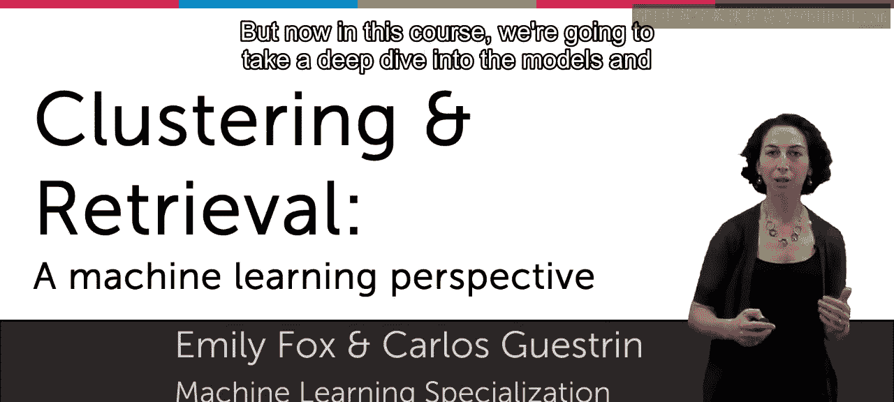
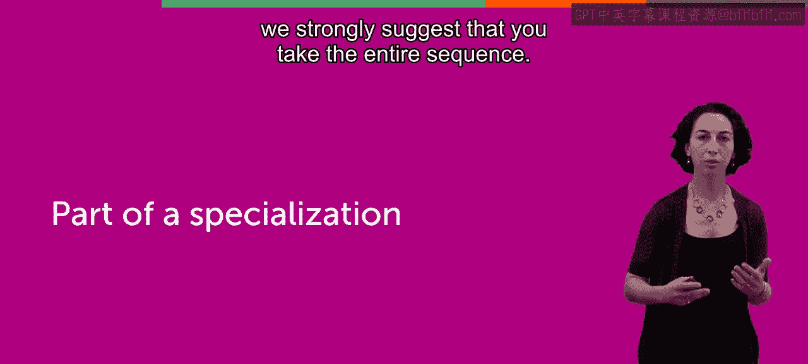
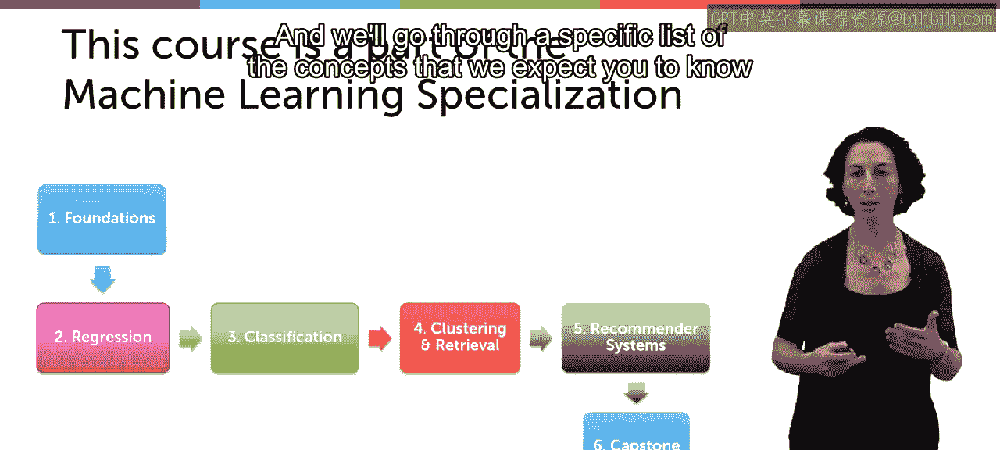
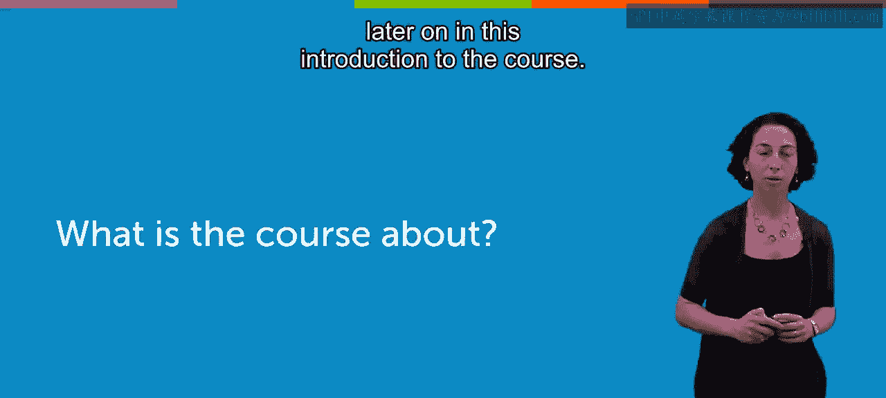
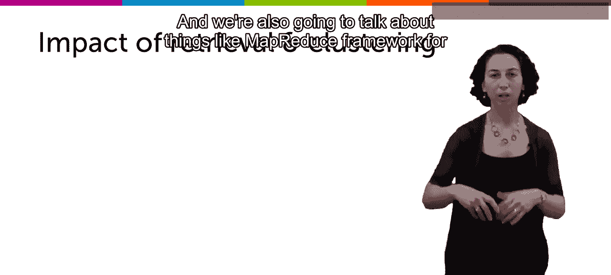
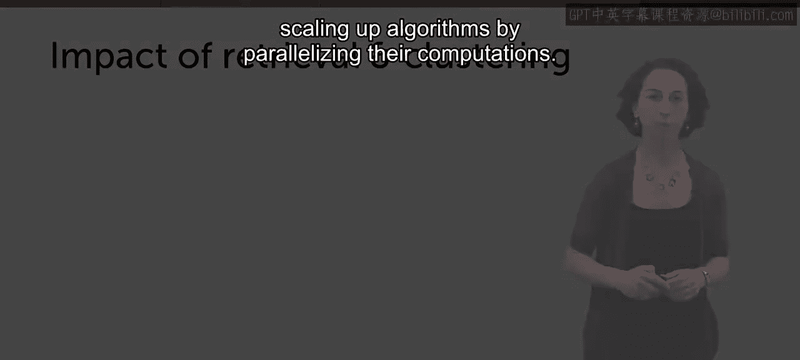

# 华盛顿大学《机器学习（分类，聚类和检索，第3-4课⧸共4课）｜Machine Learning》中英字幕 p122 0_欢迎并介绍聚类和检索任务.zh_en -BV1Sr421F7N7_p122-

。

Welcome to the clustering and Retrieval course of the Ma learninging specialization and as we're going to see。

 clustering and Retrieval are both widely used and broadly applicable tools。

 these tools can be used for anything from finding similar products to the one that you're currently browsing to discovering groups of patients with related medical conditions。

And in the Foundations course， we provided a high level introduction to the concepts of clustering and retrieval。

 but now in this course we're going to take a deep dive into the models and algorithms。

This course is part of a specialization that was designed to be taken in a specific sequence。

 so although you can take this course as a standalone course to get the experience that we intended。

 we strongly suggest that you take the entire sequence。

In particular in the Foundations course， we provided a high level overview of the concepts that were going to be covered throughout the entire specialization。

Then we went into much more detailed courses on regression and classification and in those courses we learned general machine learning concepts that are going to appear again in this course on clustering and retrieval。

 and we'll go through a specific list of the concepts that we expect you to know later on in this introduction to the course。

But first， let's provide an overview of what this course is about。

And remember that in the Ma Learning Foundations course。

 we said that machine learning was about extracting intelligence from data。Well。

 in the first part of this course， the machine learning method that we're going to be going through is nearest neighbor search for retrieval task。

 so in particular here the inputs are going to be the features of a specific query point。

 as well as the features of all other data points in a specific data set。

And then the output is going to be the nearest neighbor to the query point being the point within this entire data set that's most similar to this query point。

 So what's needed for our nearest neighbor search is to search over all these other data points and compute the similarity to these data points or their distances and then return the one that's closest。

 So as a running example that we're going to use throughout this course。

 let's imagine that we have a whole bunch of documents and somebody's reading a specific document。

 So this is this query article in gray here。 And let's say that the user likes this article。

 And we want to retrieve another article that's similar that they might also like。

 So this would be the task of finding the nearest neighbor。

 but maybe we also want to retrieve a set of nearest neighbor。

 So a set of similar documents to display to this user。

And we're going to be providing this search over all these other documents to retrieve these nearest neighbors just based on the text of the documents。

 so just based on the features of our data points。And we see retrieval applications almost everywhere。

 so perhaps we have some image and want to find a set of similar images。

 or maybe we're shopping for some product， and we want to be provided with a set of other similar items that we might want to consider instead。

Or like we've discussed， maybe we're reading some article and want to read a related article on a topic。

 and this kind of idea appears in a lot of streaming context where you might be listening to a song。

 watching a movie or watching a TV show， and you want to be provided with a set of other songs or movies or TV shows that you might also be interested in。

Or perhaps you're a user on some social network， and based on features of you as your user。

 you want to be presented with other people that you might want to connect with。So in general。

 this idea of retrieving similar items。Can be a really， really powerful tool。

 and throughout this course we're going to discuss ways to provide this type of search。

Then in the second part of the course， we're going to turn to clustering as our machine learning method。

 and here our inputs are features associated with each of our data points within a data set。

 and the outputs are going to be cluster labels associated with each of these data points。

 where the goal of the clustering method is to discover these disjoint sets of data points。

And we're going to look at a couple case studies when we're talking about clustering。

 but one of them is going to be the same idea of a document retrieval task where we have an entire corpus of documents。

 and here though， as opposed to our simple retrieval setting where we're just performing nearest neighbor search。

 our goal is to discover a structured representation of this input space。

 so a structured grouping of our corpus into groups that might relate to things like topics present in this corpus。

And just like we saw for retrieval， clustering has applications almost everywhere as well。

So maybe when we're doing image search， we don't just want to take a given image and provide a set of related images。

 but we might want to actually structure our data where we're going to discover groups of related images。

Or maybe we want to discover groups of Coursera learners like yourselves。

 where based on features of the user and past behavior on Coursera。

 we can find users who are related to one another and might have similar interests and use this to better target courses to the learners。

So these very simple ideas of retrieval and clustering actually have very。

 very significant impact in the world and are very much taken for granted。

 You just go on to your app or your device and you search for something And you just assume， okay。

 of course， is going to be able to provide a set of other things that might be related to the given query that you've made or maybe we can very easily just discover from data that we've seen。

 What are related groups of people or items。 Well， how do we actually do this。

 So this is what this course is about and we're also going to touch upon how we do this at scale。😊。

And throughout this course， like always， we're going to learn general machine learning concepts that are very useful。

 for example， in this course we're going to talk about the task of unsupervised learning and we're also going to talk about things like mapreuce framework for scaling up algorithms by parallellyzing their computations。

