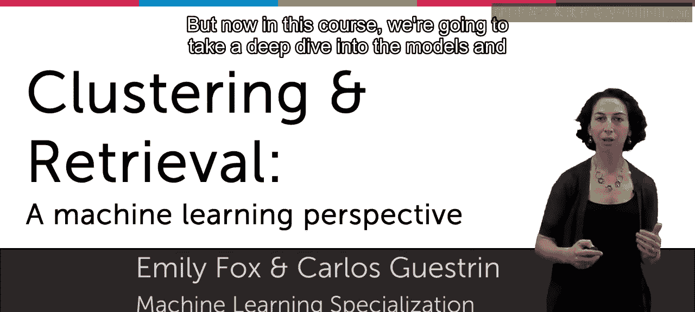
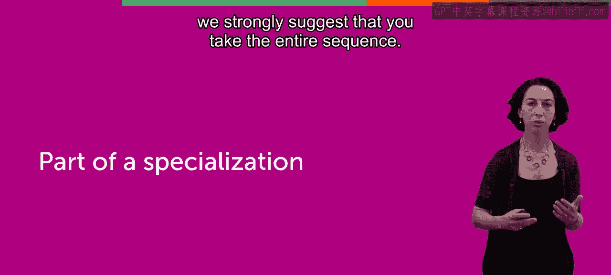
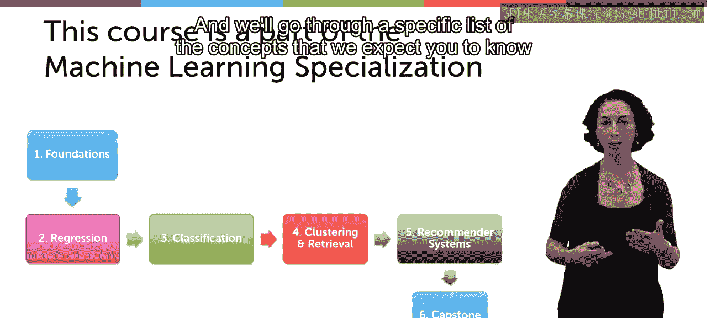
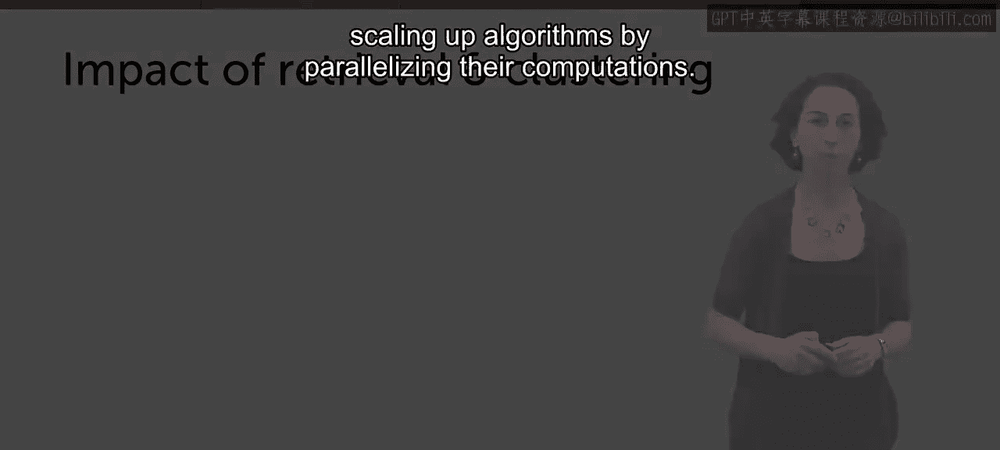

# 机器学习（分类，聚类和检索）：第3-4课：欢迎并介绍聚类和检索任务 😊

在本课程中，我们将深入学习聚类和检索这两种广泛应用的机器学习工具。我们将探讨它们的基本概念、模型与算法，并通过实际案例理解其应用。

## 概述

聚类和检索是机器学习中两种强大且普遍使用的工具。它们可用于多种场景，例如寻找与当前浏览商品相似的产品，或发现具有相关医疗状况的患者群体。在基础课程中，我们已对聚类和检索的概念进行了高层介绍。现在，我们将深入探讨其背后的模型与算法。

## 课程结构与预备知识

本课程是一个专项课程的一部分，该系列课程设计为按特定顺序学习。虽然您可以单独学习本课程，但为了获得预期的完整学习体验，我们强烈建议您按顺序学习整个系列。

具体来说，在基础课程中，我们概述了整个专项课程将涵盖的概念。随后，我们在回归和分类课程中深入学习了更详细的内容。这些课程中介绍的通用机器学习概念，将在本聚类与检索课程中再次出现。在本介绍的后半部分，我们会列出您需要预先了解的核心概念列表。

## 第一部分：检索任务与最近邻搜索

首先，让我们概述本课程的主要内容。请记住，在机器学习基础课程中，我们提到机器学习是关于从数据中提取智能。

在本课程的第一部分，我们将要学习的机器学习方法是用于检索任务的**最近邻搜索**。具体而言，输入将包括一个特定查询点的特征，以及数据集中所有其他数据点的特征。输出将是查询点的**最近邻**，即整个数据集中与该查询点最相似的点。

进行最近邻搜索需要遍历所有其他数据点，计算它们与查询点的相似度或距离，然后返回最接近的那个点。

我们将使用一个贯穿本课程的示例：假设我们拥有大量文档，而用户正在阅读其中一篇特定文档（即此处的灰色查询文章）。假设用户喜欢这篇文章，我们希望检索另一篇他们可能也喜欢的相似文章。这就是寻找最近邻的任务。但有时，我们可能希望检索一组最近邻，即一组相似的文档展示给用户。

我们将仅基于文档的文本（即数据点的特征）在所有文档中执行此搜索以检索这些最近邻。检索应用几乎无处不在：例如，我们可能有一张图片，希望找到一组相似的图片；或者我们在购物时，希望获得一组其他可能考虑购买的相似商品；又或者，正如我们讨论的，在阅读文章时希望阅读相关主题的文章。这种想法也出现在许多流媒体场景中，例如听歌、看电影或电视剧时，系统会推荐一组您可能也感兴趣的其他歌曲、电影或电视剧。又或者，作为社交网络的用户，基于您的用户特征，系统会推荐您可能希望连接的其他用户。

总的来说，**检索相似项**的理念是一个非常强大的工具。在本课程中，我们将讨论提供此类搜索的方法。

## 第二部分：聚类任务

在本课程的第二部分，我们将转向作为机器学习方法的**聚类**。这里的输入是数据集中每个数据点关联的特征，输出将是与每个数据点关联的**聚类标签**。聚类方法的目标是发现这些互不相交的数据点子集。

在讨论聚类时，我们将研究几个案例。其中之一将再次使用文档检索任务的场景：我们拥有整个文档语料库。然而，与仅执行最近邻搜索的简单检索设置不同，这里的目标是发现输入空间的一种结构化表示，即将语料库结构化为可能与语料库中存在的主题相关的分组。

与检索一样，聚类也几乎无处不在。例如，在进行图像搜索时，我们可能不仅想根据给定图像提供一组相关图像，还可能希望实际构建数据结构，以发现相关的图像组。或者，我们可能希望发现像您这样的Coursera学习者群体，基于用户特征和在Coursera上的过往行为，找到彼此相关、兴趣相似的用户，并利用此更好地为学习者推荐课程。

因此，检索和聚类这些看似简单的理念，实际上在现实世界中具有非常重大的影响，并且常常被视为理所当然。您只需打开应用程序或设备搜索某物，就理所当然地认为系统能够提供一组与您的查询相关的其他内容；或者我们可以轻松地从所见数据中发现相关的人群或物品组。那么，我们究竟如何做到这一点呢？这正是本课程要探讨的内容，我们还将涉及如何大规模地实现这些方法。

## 本课程将涵盖的通用概念

与以往一样，在整个课程中，我们将学习非常有用的通用机器学习概念。例如，在本课程中，我们将讨论**无监督学习**任务，并探讨诸如**MapReduce框架**等通过并行化计算来扩展算法规模的方法。

## 总结

本节课我们一起学习了聚类与检索课程的概述。我们了解到，检索任务的核心是**最近邻搜索**，其目标是找到数据集中与查询点最相似的点或一组点。而聚类任务的目标是为数据点分配标签，以发现数据中内在的群组结构。这两种方法在推荐系统、信息检索和数据分析等领域有广泛应用。在接下来的课程中，我们将深入探讨实现这些任务的具体算法与技术。