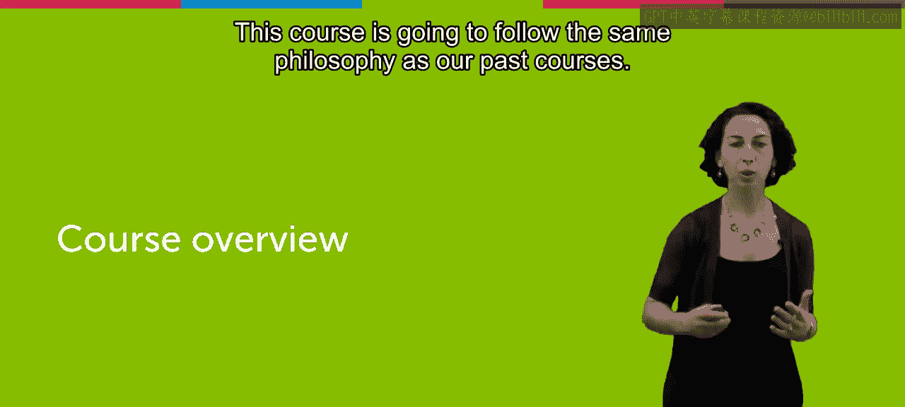
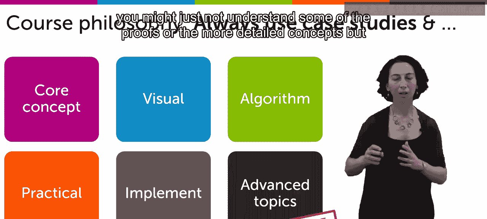
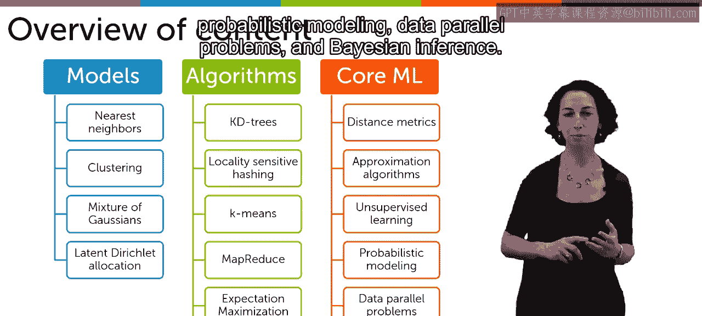
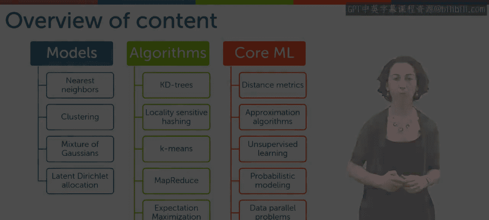

# 华盛顿大学《机器学习（分类，聚类和检索，第3-4课⧸共4课）｜Machine Learning》中英字幕 p123 1_课程概览.zh_en -BV1Sr421F7N7_p123-

。

This course is going to follow the same philosophy as our past courses。 In particular。

 we're going to use case studies to motivate the key concepts that we're going to teach。

 but there are a number of other key features that define the way we teach our courses in the specialization。

 In particular， we teach a set of core machine learning concepts。

 and we do so both through our case studies， as well as using visual aids to very dramatically guide the process。

And then in these courses， following on from the Foundations course。

 we're going to go into details on the algorithms of the methods provided in the course。

And we're not just going to provide a laundry list of methods that people use for clustering and retrieval。

 We're going to focus in on the methods that we feel are most widely used。

 the most practical algorithms out there。 and the ones that give us the most skills for learning other algorithms that might exist now or in the future。

 And throughout this course， you're going to get hands on experience with implementing these methods。

And not only are you going to implement these methods。

 but you're going to do so on these real world applications。

 so you're going to get actual experience of deploying these machine learning algorithms on datas that are things one might actually consider out there in the world。

And through this process， you're going to just gain a lot of intuition about the methods and their potential limitations and strengths。

And finally， we also teach a set of advanced concepts in this course that we mark as optional。

 so these are videos that if you're interested in watching some of the details that are under the hood and some of the things that we're going to describe。

 you can watch these videos， but if you prefer not to that's totally fine you're going to get a very。

 very thorough overview of clustering and retrieval you'll still be able to implement and deploy these methods。

 but you might just not understand some of the proofs or some of the more detailed concepts。

 but this content is here for those that are interested in it。

Well， more specifically in this course we're going to go through a number of different models like nearest neighbors for search。

 we're going to talk about clustering as a high levelve task an unsupervised learning task。

 and we're going to talk about probabilistic models for performing clusters。

 clustering like mixture models and then we're going to talk about a more intricate probabilistic model called latent Deishly allocation。

Then we're going to go through a number of algorithms associated with these models like KD trees as an efficient data structure for performing our nearest neighbor search。

 locality sensitive hashing， K means as a way of doing our clustering， as well as map or。

 which we mentioned is a means of parallellyzing our algorithms to scale them up。

 expectation maximization for inference in our mixture models and finally give sampling for inference in our latent dely allocation model。

And importantly， throughout the course we're going to cover a number of fundamental machine learning concepts that extend beyond just the concepts of clustering and retrieval。

 we're going to talk about distance metrics， we're going to talk about approximation algorithms。

 unsupervised learning probabilistic modeling data parallel problems and Bayesian inference。

 so really a wide range of concepts covered in this course。

🎼。

