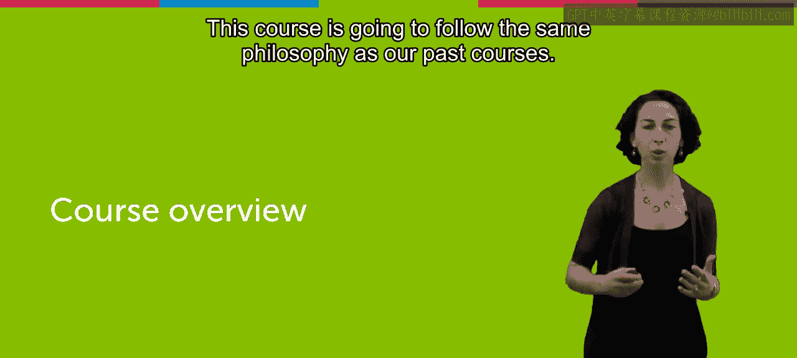
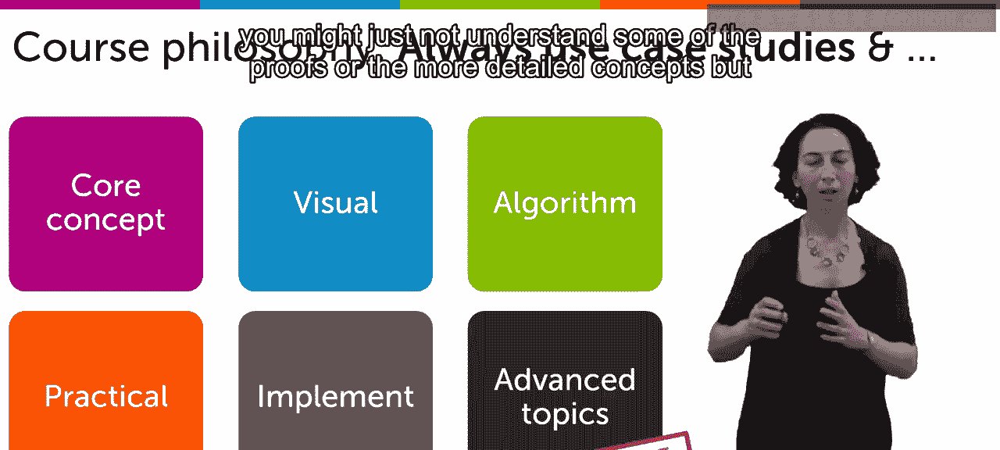
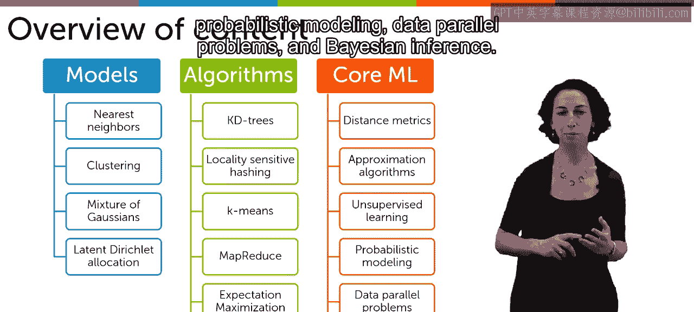
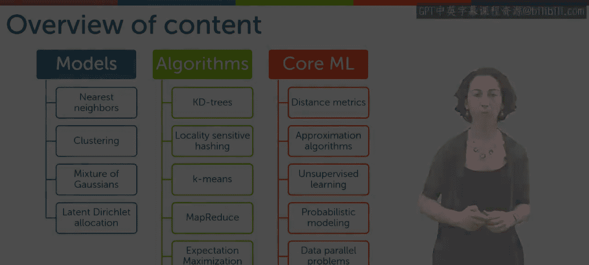

# 机器学习（分类，聚类和检索）：第1课：课程概览 🎯

在本节课中，我们将要学习华盛顿大学机器学习专项课程中关于分类、聚类和检索部分的整体教学理念、核心内容与课程特色。我们将了解这门课程如何通过案例研究、可视化辅助和实践项目来传授核心的机器学习概念与算法。

## 课程教学理念

本课程将延续我们过往课程的教学哲学。

具体而言，我们将使用**案例研究**来引出并讲解我们将要教授的关键概念。此外，我们的专项课程教学方式还由一系列其他关键特征所定义。

我们教授一套**核心的机器学习概念**，并且我们既通过案例研究，也通过使用**可视化辅助工具**来非常生动地引导学习过程。

## 课程深度与实践

在这些课程中，我们将延续基础课程的内容，深入讲解课程中提供的各种方法的算法细节。

我们不会仅仅提供一个用于聚类和检索的“方法清单”。我们将重点聚焦于我们认为**应用最广泛、最实用的算法**，以及那些能为我们提供最多技能、以便学习现在或将来可能存在的其他算法的内容。

在整个课程中，你将获得**动手实现这些方法**的实践经验。

你不仅将实现这些方法，而且将在**真实世界的应用场景**中实现它们。因此，你将获得在实际可能遇到的世界数据上部署这些机器学习算法的真实经验。

通过这个过程，你将积累大量关于这些方法的直觉，了解它们潜在的局限性和优势。

最后，我们还会在本课程中教授一套标记为**可选**的高级概念。这些是视频内容，如果你有兴趣了解一些底层细节和我们即将描述的一些内容，你可以观看这些视频。但如果你选择不看，也完全没有问题。你仍然将获得关于聚类和检索非常全面、透彻的概述，并且仍然能够实现和部署这些方法，只是可能不理解某些证明过程或更详细的概念。这部分内容是为那些对此感兴趣的学员准备的。

## 核心内容与算法

更具体地说，在本课程中，我们将学习多种不同的模型。

我们将讨论用于搜索的**最近邻模型**。我们将把**聚类**作为一个高级任务、一个无监督学习任务来讨论。我们将讨论用于执行聚类的**概率模型**，例如混合模型。然后，我们将讨论一个更复杂的概率模型，称为**潜在狄利克雷分配**。

接着，我们将学习与这些模型相关的一系列算法。

以下是本课程将涵盖的主要算法：
*   **KD树**：一种用于执行高效最近邻搜索的数据结构。
*   **局部敏感哈希**：另一种高效的近似最近邻搜索技术。
*   **K均值**：一种执行聚类的方法。
*   **MapReduce**：我们提到过，这是一种并行化算法以扩展其规模的手段。
*   **期望最大化**：用于在我们的混合模型中进行推断。
*   **吉布斯采样**：用于在我们的潜在狄利克雷分配模型中进行推断。

重要的是，在整个课程中，我们将涵盖一系列超越聚类和检索概念本身的**基础机器学习概念**。

我们将讨论**距离度量**、**近似算法**、**无监督学习**、**概率建模**、**数据并行问题**以及**贝叶斯推断**。因此，本课程确实涵盖了非常广泛的概念。

## 总结

本节课中，我们一起学习了本课程的整体框架。我们了解到，这门课程将通过**案例驱动**和**实践导向**的方式，深入讲解聚类、检索及相关领域的核心模型（如最近邻、混合模型）与关键算法（如K均值、EM算法）。课程不仅注重动手实现，还涵盖了从距离度量到贝叶斯推断等一系列重要的机器学习基础概念，为初学者构建了坚实而全面的知识体系。