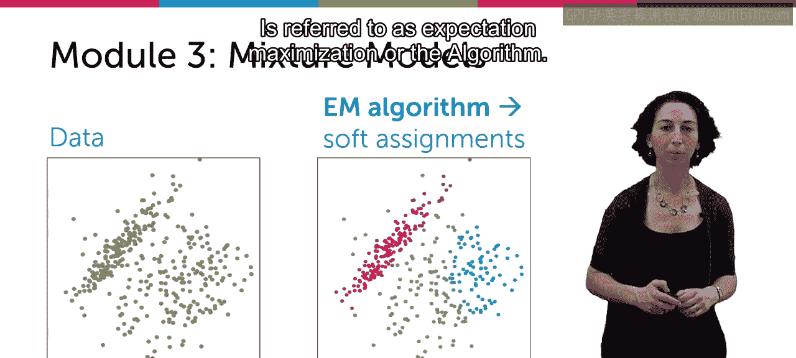
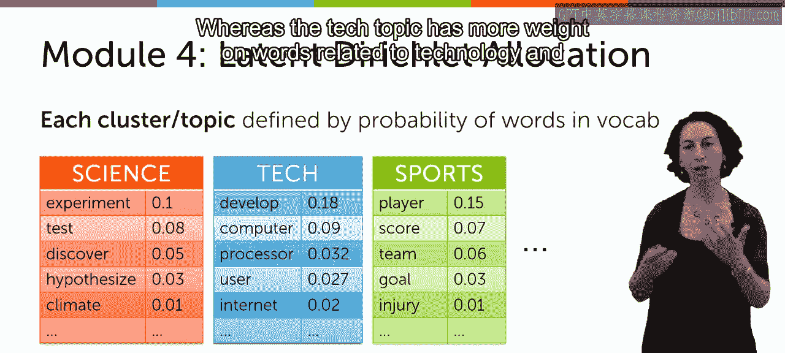

# 华盛顿大学《机器学习（分类，聚类和检索，第3-4课⧸共4课）｜Machine Learning》中英字幕 p124 2_逐模块涵盖的主题.zh_en -BV1Sr421F7N7_p124-

。

Let's now dig into a more detailed description of this course content。

So the course overview that we just talked about is going to be presented in four different modules in this course。

 and so let's step through each of these modules and discuss what we'll present at a high level。

So in our first module， we're going to discuss this document retrieval task。

 where there's some document that a person's reading。

 and we want to search over all these other documents to find a similar one that they might also be interested in reading。

And to do this， we're going to talk about nearest neighbor search where we compute the distances between our query article and every other article out there and then retrieve the document that's closest。

 The one with the smallest distance。 Well， there are a couple key components of doing this nearest neighbor search。

 One of them is， how are we going to represent our document。 And the second is。

 how are we going to compute the similarity between documents or the distance between them。

Because both how we represent our data as well as how we compute these distances really。

 really influences what we think of as a nearest neighbor。

 and we're going to go through various choices for each of these components and talk about some of the tradeoffs that are made。

Then we're going to turn to how to scale up nearest neighbor search to really large data sets。

 because our brute force approach of computing distances to every single data point in our data is computationally really。

 really intensive for just performing one nearest neighbor query。

 So instead we're going to talk about a really cool data structure called kd trees that allows us in the context of nearest neighbor search to prune out a large portion of the search space when we're going to compute our nearest neighbor。

 Well， at least it can often do that， though you can get unlucky。But kd trees， although very cool。

 don't work very well in highdial spaces。 So if you think of our document and having a very large vocabulary and that our document representation is going to be based on the size of that vocabulary。

 kd trees no longer seem like that attractive of an approach for doing our nearest neighbor search。

 So instead， we're going to talk about ways to do approximate nearest neighbor search using something called locality sensitive hashing。

 because one of the concepts we're going to teach in this course is the fact that in a lot of applications。

 we don't actually care about providing the exact nearest neighbor。

 but maybe one that's pretty close to that is good enough。

And when we're willing to accept that type of approximation。

 we can do things much more efficiently in some cases。Then in the second module。

 we're going to turn to this idea of clustering where here our goal is going to be to discover groups of related articles just based on the content of the articles themselves。

 so this is going to be an example of an unsupervised learning task。

And the first algorithm we're going to present for performing this type of clustering is K means。

 where the goal of K means is to minimize the sum of the square distances between data points and a set of learned cluster centers。

And so we can think of this just as a partitioning of our data set。

Where we're making hard assignments of data points to specific clusters。 and again。

 this is an example of an unsupervised learning algorithm because we're just taking the inputs themselves and trying to learn this structure from them without having any output labels。

 We don't know the cluster labels of any of our data points in this data set。

Then later in the second module， we're going to turn to trying to scale up K meanss to large dataset sets using something called MaRduce。

 where MaRduce is a framework for paralyzing operations over a number of different machines。

 and we're going to discuss the general MaRduce framework that can be used just in a wide range of different settings。

 as well as its specific application to K meanss。Then in our third module。

 we're going to turn to probabilistic models for performing clustering。

 and the goal here is to capture uncertainty in the cluster assignments that we're making。

So for example， maybe there's an article where it's not really clear is it about science or is it about world news or really we don't have these labels so is it more related to the group of articles about that have content about science or the group of articles that have concepts about world news without these labels being shown and so there are some articles that it might not really be clear exactly what assignment to make and we want the algorithm to present us with this uncertainty instead of just providing a hard assignment of a document to a given cluster。

And one thing we can do with this type of output is help us learn a user's preference over a set of different topics。

 because if we have feedback from the user about articles that they liked or didn't like。

 and we also have the uncertainty of what cluster that article was associated with。

 we can put both of these pieces of information together to have a better description of what impact the feedback from the user should have over our learned preference on topics from that user。

And the probabilistic model that we're going to use for clustering is called a mixture model and here when we're thinking about assigning data points to clusters。

 it's not just the cluster center that's going to come into play like in K means。

 but also the shape of the cluster and here， again， unlike in K means。

 we're not going to make hard assignments of data points to clusters。

 we're going to make what are called soft assignments。

 where data points can have weights in multiple clusters where those weights are based on our uncertainty about the assignment of the data point to the cluster。

So the goal here is to go from a set of unlabeled data points like these this gray cloud of points shown here to a set of colored points。

 But now instead of making hard assignments， there's going to be an entire spectrum of colors representing the allocation of data points to clusters and the uncertainty in that。

 So， for example， if you look at the points line between this blue and green cluster。

 there's a point there are points that have this shading somewhere in between those two colors。

 meaning there's uncertainty about whether those observations are assigned to the blue cluster or the green cluster。

 and likewise between the green and fusia clusters。

And the algorithm we're going to go through for inferring these soft assignments of data points to clusters is referred to as expectation maximization or the EM algorithm。

And finally， in our fourth module， we're going to describe a more intertricate probabilistic model for analyzing documents。

 and this is called latent Deerly allocation or LDA。And to motivate the ideas behind LD。

 let's look at a specific document shown here， and what we see is that this document has a bunch of science related words。

 so maybe based on the content of this document， we might group this article with other documents that are also about science related topics。

 but this article also has a lot of tech related words。

 so maybe a better description is to group this article with the tech article。

 but instead this document is really about science and technology。

And that's exactly what LDA allows us to do， it allows us to provide what's called mixed membership where a given document is allowed to belong to multiple different topics and not only is a document associated with multiple topics。

 but LDA provides the relative proportion of these topics in this document。In particular。

 every topic within the LDA model is described as a distribution over the words in the vocabulary。

And so what we see is that maybe the science topic has more weight on science related words。

 whereas the tech topic has more weights on words related to technology and likewise for sports and so on。

But the crazy thing is we're going to be doing this in a completely unsupervised manner。

 We're just going to be providing the words of a document and this for all documents in the corpus。

 so we have a bunch of bunch of words for every document in the corpus and just from that alone。

 we're going to infer these topic specific distributions over the vocabulary as well as the document specific proportions of topics in that document。

And so we're going to go through exactly how we can extract this kind of information。

 but what we see is this is another example of discovering structure in data in this unsupervised manner。

