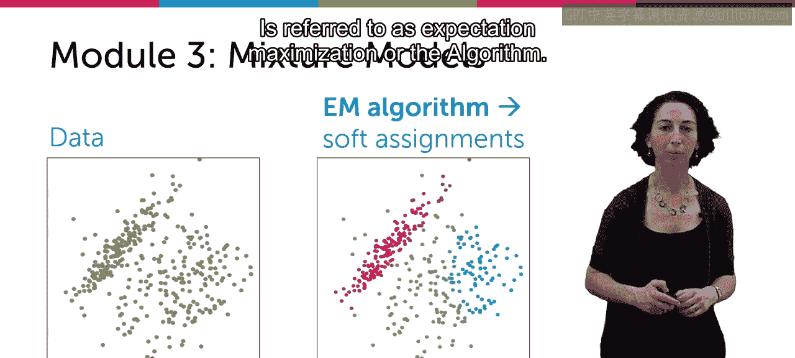
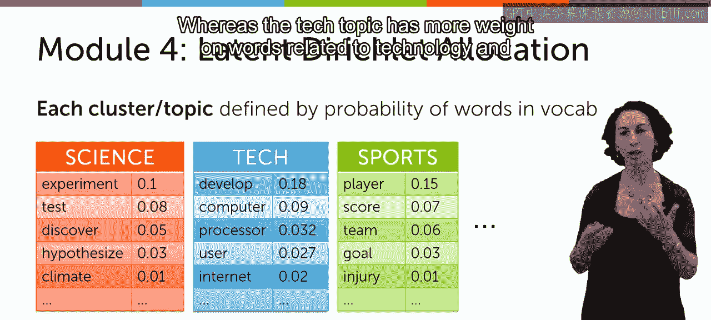

# 机器学习（分类，聚类和检索）：第1章：课程内容详解 🧭

在本节课中，我们将详细解析华盛顿大学《机器学习（分类，聚类和检索）》课程的核心内容。课程将分为四个模块，系统性地介绍文档检索、聚类分析以及概率模型等关键主题。

## 模块一：文档检索与最近邻搜索 📄

上一节我们概述了课程结构，本节中我们来看看第一个模块的具体内容。该模块将围绕**文档检索**任务展开。其核心场景是：当用户正在阅读一篇文档时，我们希望从海量文档库中搜索并找到内容相似的文档，以推荐给用户。

为实现此目标，我们将重点介绍**最近邻搜索**。其基本思想是：计算查询文档与库中所有其他文档之间的距离，然后返回距离最小的文档（即最近邻）。执行最近邻搜索有两个关键组成部分：

以下是执行最近邻搜索的两个核心组成部分：
1.  **文档表示**：如何将文档转化为计算机可以处理的数学形式。
2.  **相似度/距离计算**：如何定义并计算两个文档表示之间的相似度或距离。

文档的表示方式以及距离的计算方法，共同决定了我们最终找到的“最近邻”是什么。我们将探讨这些组成部分的不同选择，并讨论其中的权衡。

接下来，我们将探讨如何将最近邻搜索扩展到超大规模数据集。因为对每一个查询都计算其与数据集中所有点的距离，这种暴力方法的计算成本极高。

因此，我们将介绍一种名为 **kd树** 的巧妙数据结构。在最近邻搜索的上下文中，kd树允许我们在搜索过程中“剪枝”，即排除掉搜索空间中的一大部分数据点，从而加速查询。当然，在某些情况下也可能“运气不佳”，但通常它能显著提升效率。

然而，kd树在高维空间中表现不佳。考虑到文档通常基于大型词汇表进行表示，维度会非常高，此时kd树就不再是一个有吸引力的选择。

于是，我们将转向讨论**近似最近邻搜索**，使用一种名为**局部敏感哈希**的技术。本课程将传达的一个重要概念是：在许多实际应用中，我们并不严格要求找到**精确的**最近邻，找到一个**足够接近的**近似最近邻通常就足够了。当我们接受这种近似时，在某些情况下可以极大地提升搜索效率。

## 模块二：聚类与K均值算法 🔍

在了解了如何寻找相似文档后，本节我们将转向**聚类**的概念。聚类的目标是根据文章自身的内容，自动发现其中相关的文章组。这是一个典型的**无监督学习**任务。

我们将介绍的第一个聚类算法是 **K均值算法**。K均值的目标是**最小化数据点与其所属簇中心之间的平方距离之和**。其核心公式可以表示为：

**目标：** `minimize Σ Σ ||x - μ_k||²`，其中外层求和遍历所有簇 `k`，内层求和遍历属于簇 `k` 的所有数据点 `x`。

我们可以将其理解为对数据集的一种“硬”划分，即每个数据点被明确地分配到某一个特定的簇中。重申一下，这是一种无监督学习算法，因为我们只使用输入数据本身，在没有输出标签的情况下，试图从中学习出结构。

随后，在模块二的后半部分，我们将探讨如何使用 **MapReduce** 框架来将K均值算法扩展到海量数据集。MapReduce是一个用于在多台机器上并行化操作的框架。我们将讨论通用的MapReduce框架（其适用于多种场景），以及它在K均值算法上的具体应用。

## 模块三：概率模型与混合聚类 🎲

上一节我们介绍了进行“硬分配”的K均值聚类，本节中我们来看看能够捕捉不确定性的概率模型。在聚类任务中，我们的目标是捕捉**簇分配中的不确定性**。

例如，可能有一篇文章，我们不太确定它应该属于“科学”类还是“世界新闻”类。在没有真实标签的情况下，我们可能希望算法能呈现出这种不确定性，而不是简单地将文档硬性分配到一个给定的簇中。

这种输出结果的一个用途是，可以帮助我们学习用户对一系列不同主题的偏好。如果我们拥有用户对某些文章的喜欢/不喜欢反馈，同时我们也知道这些文章与哪些簇相关联的**不确定性**，我们就可以将这两部分信息结合起来，更好地描述用户反馈应如何影响我们对该用户主题偏好的学习。

我们将用于聚类的概率模型称为**混合模型**。在这里，决定数据点分配到哪个簇时，起作用的不仅仅是像K均值中那样的簇中心，还包括簇的**形状**。同样，与K均值不同，我们不会对数据点进行硬分配，而是进行**软分配**。数据点可以在多个簇中拥有权重，这些权重基于我们对该数据点属于该簇的不确定性。

我们的目标是从一堆未标记的数据点（如图中灰色的点云）出发，得到一组带有颜色的点。但现在，颜色代表的是数据点分配到各簇的分配比例及其不确定性，呈现为一个完整的色彩光谱。例如，在蓝色和绿色簇之间的点，其颜色是这两种颜色的中间色调，意味着我们不确定这些观测点应分配给蓝色簇还是绿色簇。

我们将用于推断数据点到簇的软分配的算法称为**期望最大化算法**，简称 **EM算法**。

## 模块四：潜在狄利克雷分配模型 📊

最后，在第四个模块中，我们将介绍一个用于分析文档的更复杂的概率模型，称为**潜在狄利克雷分配**，简称 **LDA**。

为了理解LDA背后的思想，让我们看一个具体的文档。我们发现这篇文档包含大量与科学相关的词汇，因此基于内容，我们可能将其与其他科学类文章归为一组。但这篇文章也有很多与技术相关的词汇，所以更好的描述或许是将其归入技术类文章。实际上，这篇文章**同时关乎科学和技术**。

这正是LDA允许我们做的事情：它允许我们提供一种**混合成员关系**，即一篇文档可以同时属于多个不同的主题。不仅如此，LDA还能提供这些主题在该文档中的**相对比例**。

具体来说，LDA模型中的每个主题都被描述为词汇表上单词的一个概率分布。例如，科学主题在科学相关词汇上权重更高，而技术主题在技术相关词汇上权重更高，体育主题同理。

但令人惊叹的是，我们将以**完全无监督**的方式进行这一切。我们仅提供文档中的单词（对于语料库中的所有文档都是如此），仅凭这些信息，我们就能推断出：
1.  这些特定主题在词汇表上的分布。
2.  每篇文档中各个主题的特定比例。

我们将详细讲解如何提取这类信息。可以看到，这是另一个以无监督方式发现数据中结构的绝佳例子。

## 总结 📝

本节课中，我们一起学习了本课程四个核心模块的详细内容：
1.  **文档检索与最近邻搜索**：从基础方法到应对大规模数据的近似搜索技术。
2.  **聚类与K均值**：经典的硬划分聚类方法及其并行化扩展。
3.  **概率模型与混合聚类**：引入不确定性，使用混合模型和EM算法进行软分配聚类。
4.  **潜在狄利克雷分配**：更复杂的概率模型，用于发现文档的混合主题结构。

这些内容构成了从基础相似性检索到高级无监督主题发现的一条完整学习路径。