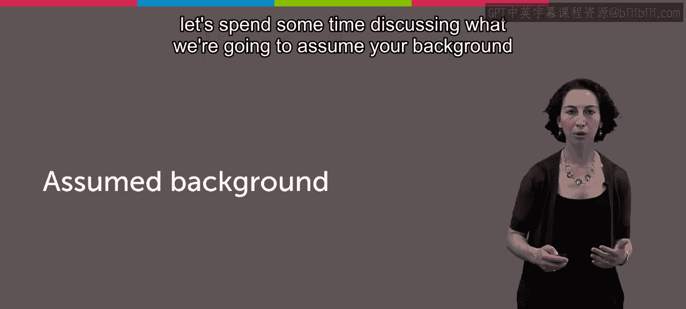
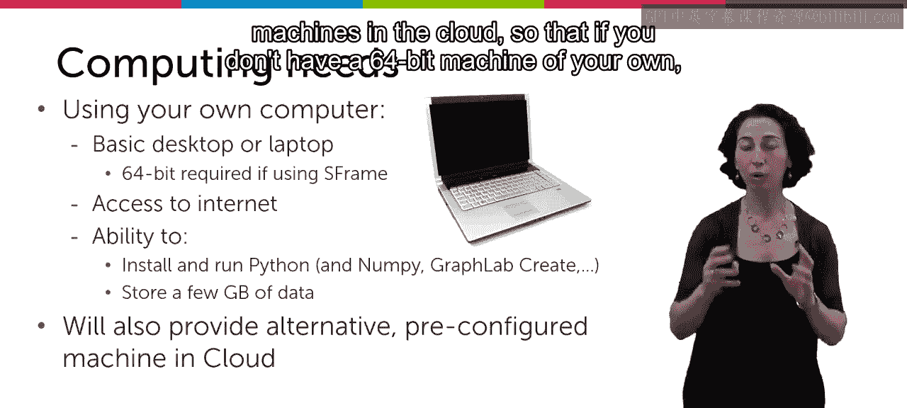
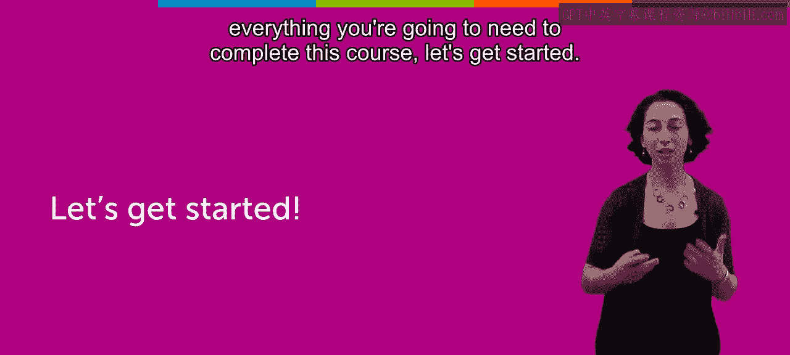

# 华盛顿大学《机器学习（分类，聚类和检索，第3-4课⧸共4课）｜Machine Learning》中英字幕 p125 3_假定的背景知识.zh_en -BV1Sr421F7N7_p125-

。

Now that we've discussed what this course is going to be about。

 let's spend some time discussing what we're going to assume your background knowledge is to successfully complete this course。

 Well， there are a number of concepts we're going to assume that you've seen in the previous courses in this specialization。

 So， for example， in the foundations course， we went through a lot of the high-level concepts that we're going to present in this specific course。

 about clustering and retrieval， but also about how we think about machine learning in terms of what are inputs and what are outputs of machine learning methods and how do we think about analyzing these outputs。

 And we also built up a lot of programming and data manipulation skills in this foundations course。

And then in the regression course， we went through a lot more detail on how we think about features representing the inputs to our algorithms and what the outputs are and how to examine those outputs and assess different things about performance。

 and we talked about basic statistical concepts like mean and variance that we're going to see many times in this course。

 And also we covered basic machine learning concepts like what is a machine learning algorithm。

 And then we went through specific optimization algorithms that we're going to allude to in this course like coordinate asscent。

 And we talked about issues in terms of model complexity。

 like overfitting and how to cope with that using regularization。

 And these are all ideas that we're going to refer to throughout this course。

 and we're going to assume that you already know to some degree。

 Then coming out of the classification course。 There are a number of things that are really crucial to the content that we're going to cover here like distributions in conditional distributions and maximum likelihood estimation。

 And then there are a couple things that I'm going to。just to draw analogies。

 but aren't that critical， like ideas of linear classifiers， multiclass classification and boosting。

So if you haven't taken the past courses and some of these concepts maybe only have a fuzzy idea about。

 I'd strongly encourage you to go back to these other courses and at least watch the videos related to these topics。

Then in terms of math background， there's not going to be much of an emphasis on calculus like there was in the past two courses。

 but we're still going to assume that， you know， some basic linear algebra like what is a vector。

 what is a matrix， how do you think about multiplying matrices And I think that's basically it for the linear algebra part。

 But in this course， we're also going to turn to some probabilistic concepts building off the things that you saw in the classification course。

 So we're going to assume that， you know fundamental laws of probability like probability some to one or they're bounded between zero and1。

 we're going to assume that you know what is a distribution and how do you think about a conditional distribution And we're going to walk through these concepts and teach them to you at the level that you need to know them for this course。

 but it's definitely going to be helpful if you have some of that background coming in。

And in terms of programming experience， we've tried to make this course as open as possible to people having different preferences for different programming languages。

 but we're going to encourage people to use Python。Although it's not required， for example。

 for all of the assignments， we're going to provide starter code in Python， so of course。

 if you're a Python user， it's going to be easier for you to complete the assignments。

But I want to emphasize that the point of everything we're teaching in this course is to teach you fundamental machine learning concepts and not specific implementation details。

 though of course we want you to get handson experience with implementing the methods。

But I want to say that if you completed the foundations course and hopefully the regression and classification courses as well。

 you should be set for the skill level needed to complete the assignments in this course。

And if we think back to the foundations course， we relied very heavily on pre-empplement algorithms like those available in GraphLb C。

 because the point of that course was just to understand the input and output of machine learning algorithms and we didn't get into the details of what's under the hood in each one of these algorithms。

But this course， we're going to take a deep dive into the algorithmic details so much so that you should be able to implement them in any language of your choice。

And you're going to get practical experience with doing this in this course。

 we're going to ask you to actually implement these methods for everything except in the last module where we go through the more advanced concept of latent deishly allocation。

 where actually we do teach you everything you need to know to implement the methods。

 but we're not actually going to ask you to do so in the assignment。

So to describe the assignments a little bit more， we're going to follow the same structure that we did in the regression and classification courses。

 where in general the structure is going to be that first we're going to go through an exploration of the methods using a pre implemented algorithm。

So that we can understand the methods in more detail and solidify the concepts without getting bogged down in specific implementation details or potential issues with bugs in our code。

But once we've solidified these concepts， then we're going to turn to actual implementations that you're going to write。

And finally， the computing needs are the same as in other courses of this specialization。

 where there are a couple choices， one is that you have your own machine。

 and if you're going to use S frames， which we encourage you to to do the different data manipulations。

 then you need to have a 64 bit machine。Other than that。

 it can be a fairly basic desktop or laptop that you have。 You're also， of course。

 going to need access to the internet so that you can watch these lovely videos。

 as well as download the assignments and upload your implementations to the Courra interface and you're also going to need the ability to install and run Python and to store a few gig of data。

 But as an alternative， we're also going to provide some preconfigured machines in the cloud so that if you don't have a 64 B machine of your own。

 you can still complete this course。

Okay， so now that we've gone through what this course is about and everything you're going to need to complete this course。

 let's get started。

