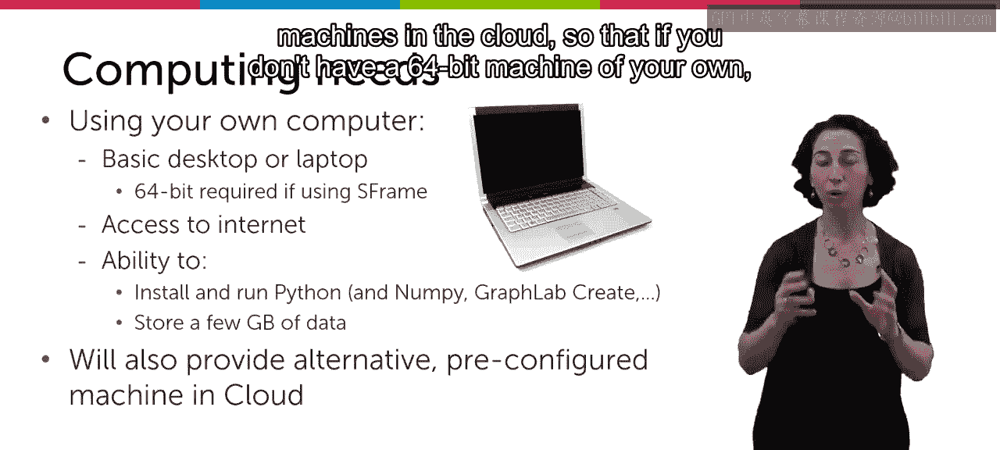
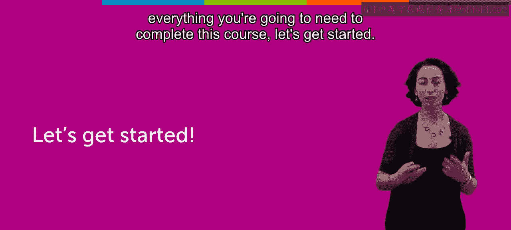

# 机器学习（分类，聚类和检索）：第3-4课：假定的背景知识 📚

在本节课中，我们将介绍成功学习本课程所需具备的背景知识。我们将回顾本专项课程前期课程中的关键概念，并说明本课程对数学和编程基础的要求。

---

上一节我们介绍了课程的整体内容，本节中我们来看看学习本课程需要哪些预备知识。我们假定你已经学习了本专项课程的前期课程，并掌握其中的核心概念。

以下是前期课程中与本课程相关的重要知识点：

*   **机器学习基础课程**：我们学习了机器学习的高级概念，包括聚类、检索，以及如何理解机器学习方法的输入、输出和分析。同时，我们也建立了编程和数据操作的基本技能。
*   **回归课程**：我们深入探讨了如何用特征表示算法输入、理解输出、评估性能，并介绍了均值、方差等基本统计概念。此外，还涵盖了机器学习算法的基础概念、坐标下降等优化算法，以及过拟合和正则化等模型复杂度问题。
*   **分类课程**：条件分布和最大似然估计等概念对本课程至关重要。线性分类器、多类分类和提升法等概念，我们也会进行类比引用。

如果你没有学习过前期课程，或对某些概念只有模糊印象，强烈建议你回顾相关课程的视频内容。

---

在数学背景方面，本课程不会像前两门课那样强调微积分，但仍需掌握一些基本的线性代数知识。

以下是需要了解的线性代数概念：

*   向量（Vector）是什么
*   矩阵（Matrix）是什么
*   如何进行矩阵乘法（Matrix Multiplication）

此外，本课程将建立在分类课程的基础上，引入一些概率概念。我们将假定你了解概率的基本法则，例如概率总和为1，且值在0到1之间。我们也会讲解分布和条件分布的概念，但如果你已有相关背景知识，将大有裨益。

---

在编程经验方面，我们尽量让课程对不同编程语言偏好者开放，但鼓励使用Python。

以下是关于编程的说明：

*   所有作业都将提供Python起始代码，因此使用Python会更容易完成。
*   本课程的重点是教授基础的机器学习概念，而非具体的实现细节，但会要求你动手实现方法。
*   如果你已完成基础课程（以及回归和分类课程），就具备了完成本课程作业所需的技能水平。

与基础课程主要依赖GraphLab Create等预实现算法不同，本课程将深入探讨算法细节，使你能够用任何选择的语言实现它们。你将在本课程中获得实际动手经验。

---

关于课程作业的结构，我们将遵循与回归和分类课程相同的模式。

以下是作业的一般结构：

1.  **概念探索**：首先使用预实现的算法探索方法，以深入理解概念，避免陷入具体的实现细节或代码调试问题。
2.  **实际实现**：在巩固概念后，你将动手编写算法的实际实现。

最后一个模块关于潜在狄利克雷分配（Latent Dirichlet Allocation）的高级概念时，我们会教授实现所需的所有知识，但作业中不要求实际编码实现。

---

最后，计算需求与本专项其他课程相同。

以下是计算环境的选择：

*   **自有机器**：如果你使用自己的电脑，并计划使用SFrame（我们鼓励用于数据操作），则需要一台64位机器。除此之外，一台普通的台式机或笔记本电脑即可。你还需要能连接互联网以下载作业、上传代码，并能安装运行Python以及存储几GB的数据。
*   **云端机器**：我们也提供了云端预配置的机器。如果你没有自己的64位机器，仍然可以完成本课程。

---

本节课中，我们一起回顾了学习本课程所需的背景知识，包括前期课程的核心概念、必要的数学和编程基础，以及课程作业的结构和计算环境要求。现在，让我们正式开始学习吧！