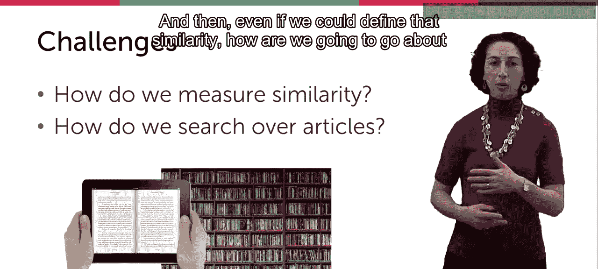
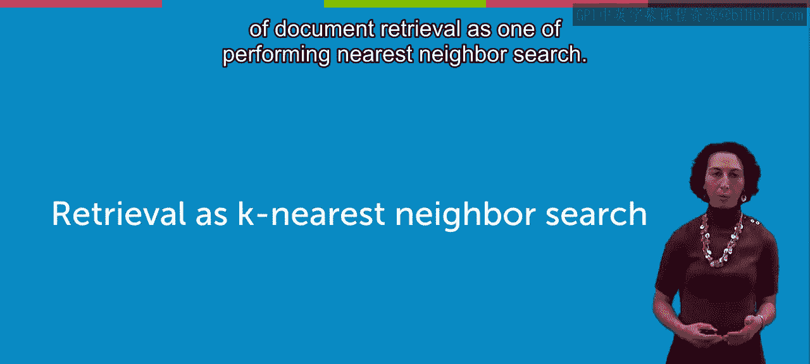
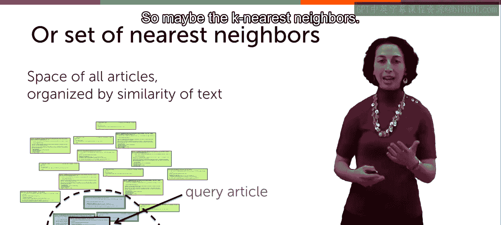

# 华盛顿大学《机器学习（分类，聚类和检索，第3-4课⧸共4课）｜Machine Learning》中英字幕 p126 4_检索作为k近邻搜索.zh_en -BV1Sr421F7N7_p126-

。

In this module， we're going to cover nearest neighbor search for retrieving documents of interest。

 And this is a topic that we covered in the first course of the specialization。

 But now we're going to take a deeper dive。 And in particular。

 we're going to discuss in greater detail things like how do you represent your documents and how do you think about defining your distance functions and what are the implications of the different choices that you might make there and a new topic that we're going to cover in this module relative to the first course is think about how are we going to scale up nearest neighbor search to large collections of documents。

So to start with， let's just remember this task of retrieving a document of interest。

And remember that we're sitting here and we're reading our book or our Kindle or iPad or whatever this is。

 and actually this is probably Carlos reading this because this is an article about soccer or he might say football。

And a goal， though， is to retrieve another article that might be of interest to this reader。

But there are lots and lots of articles out there。 So how are we going to think about measuring the similarity between this article that we have and all these other articles that we might want to present to this reader。

 And then even if we could define that similarity， how are we going to go about searching this big space of possible articles to present。

Well， the first thing we're going to do is we're going to cast this task of document retrieval as one of performing nearest neighbors search。

So to begin with， let's imagine that we take all of the articles out there that we're going to be searching over and let's imagine that we could arrange them in space based on their similarity to one another。

 So that's what this picture here illustrates。And then we're going to get a query article。

 so this is the article that the person is currently reading and we're going to think about trying to find which of these other articles is closest。

 most similar to this article that the person' is reading。So to do this。

 the first step is we need to compute the distance between this query article and all other articles out there。

Then having computed all of these distances， we simply search for the article that has the smallest distance to the query article。

 And we call that the nearest neighbor。 And that's the article that we're going to retrieve and present to this user as the next possible article they might be interested in in reading。

Or as an alternative to this what's called one nearest neighbor approach that I just described。

 we might want to present the reader with a set of possible articles。

 so maybe the K nearest neighbors。 and that's a more general formulation of this retrieval task。

