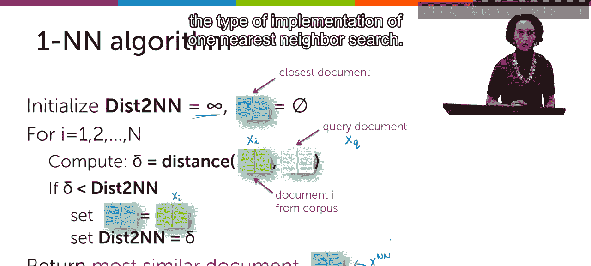

# 华盛顿大学《机器学习（分类，聚类和检索，第3-4课⧸共4课）｜Machine Learning》中英字幕 p127 5_1-NN算法.zh_en -BV1Sr421F7N7_p127-

。

Okay， well， let's start by formalizing this one nearest neighbor algorithm。

So when we're doing one year's neighbor search， we're going to assume that we have some query article。

 which we're going to denote by xq。So that's the article that the person's reading。

 And then we're going to assume that we have some corpus of documents。

 So these are all other articles out there that we're going to search over。

And we're going to denote this by x1， x2 all the way up to Xn。

 so we're assuming here that we have capital N documents。

And the output of this algorithm is going to be the most similar article。 So in particular。

 it's the article whose distance is smallest relative to our query article。

 And we're going to denote this。Returned article as X nearest neighbor， so formally。

X nearest neighbor is defined to be the article that minimizes the distance。

Between our query article， X Q and any possible article。In the corpus。

 so we're going to minimize over all articles in the corpus。The distance between。

The article in the corpus that we're looking at in a query article。

 and then we're going to return the one whose distance is smallest。

 and that's the formal definition of our nearest neighbor。So algorithmically。

 the way we're going to go about this is we're going to define something that we call distance to nearest neighbor and to begin with we're going to initialize that to be infinite。

And we're going to。Have this blue document be our nearest neighbor found so far。

 and to begin with that's just going to be the empty set。

And then for every document in our corpus labeled one to capital N。

 we're going to compute the distance between our query article。 So this is X Q and the document。

The I document in the corpus， so that's Xi。And if that distance is less than the distance to the nearest neighbor that we've found so far。

 then we're going to set this blue， nearest neighbor document equal to X I。And likewise。

 we're going to set our distance to nearest neighbor equal to Delta。

 this new distance to the nearest neighbor。 Otherwise。

 we're just going to continue on searching through our other articles。 And when we finish this。

 what we're going to do is we're going to return this most similar document， this blue article here。

 which we called our X nearest neighbor。Okay， so this would be a more pseudocode for the type of implementation of one nearest neighbor search。

。

