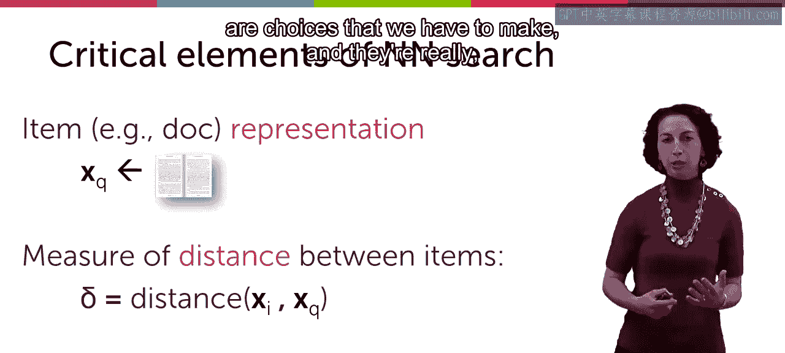
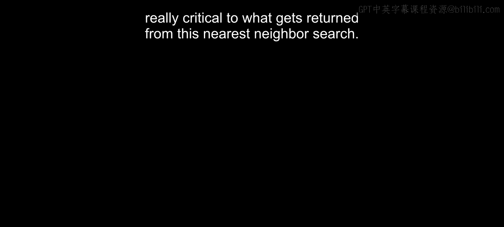

# 华盛顿大学《机器学习（分类，聚类和检索，第3-4课⧸共4课）｜Machine Learning》中英字幕 p128 6_k-NN算法.zh_en -BV1Sr421F7N7_p128-

。

Let's now turn to the more formal description of the Ca nearest neighbor algorithm。

 where instead of just returning， the nearest neighbor we're going to return a set of nearest neighbors。

Okay， so the setup here is just like in one nearest neighbor search。

 where we have our query article X Q and we have the same corpus of documents x1 to x capital N。

 but now instead of outputting just a single nearest document。

 we're going to output a list of K similar articles。So formally。

 what we're going to say is we're going to define a set of articles。X nearest neighbor。

 So this is going to be the set of articles， X nearest neighbor one all the way to X nearest neighbor K。

Where the definition of what falls into this set。Is that。For all。Articles， XI， not。Yeah。

Our nearest neighbor set。The distance。Between X I。And。X Q， our query article。

Is greater than or equal to the distance to the furthest， nearest neighbor in our set。

 So the maximum。Distance。Overall。These nearest neighbor articles。So this is for。I equals1。2 k。

The distance between。X nearest neighbor。 Actually， let me change it。 So it's not the same I。

 I'll say sub J。 So J equals1 to K x nearest neighbor J and our query article。Am。

So this is very intuitive it's just saying that。The definition of the k nearest neighbors is that any article that's not in your cave nearest neighbor set has a distance that's further than the distance to the furthest document within those can nearest neighbors。

 That's where the max comes in here。 Okay， so just like for one nearest neighbor。

 we can walk through our can nearest neighbor algorithm in terms of the pseudocode here。

 where just like in one nearest neighbor， we're going to define something that。

Records the distance to our nearest neighbor found so far， but in this case。

 we're going to have the distance to our K nearest neighbors found so far。

 So it's going to be a sorted list of the distances to the K closest articles found to a given point in the algorithm。

 And so to begin with， we're just going to assume that the first K documents or what we're going to start with as our K nearest neighbors and then we're going to improve upon those。

 So we're going to compute the distance between our query article and each of the K first articles in the corpus and we're going to sort those articles by their distances to create a sorted list。

And so that's what's going to be held in this distance to Can nearest neighbors and then within this little bookshelf thing here。

 this image represents a list of the sortrded document indices。

Then what we're going to do is for all the remaining documents in the corpus。

 so these are documents labeled K plus1 to capital N。

 We're going to compute the distance between that article and our query article。

And then if that distance is less than the distance to our k nearest neighbor， so。

Let me just write this down here to be clear distance to。Kith， nearest neighbor so。Fthest。

Nearest neighbor in our set。Then what we're going to do is we're going to search for the index where that distance falls into this sorted distance list。

 so we're going to say， okay， we know it's closer than our k nearest neighbor。

 but is it closer than our third nearest neighbor or second or first and then whatever index that is。

 we're going to shift the queue that we have for our nearest neighbors found so far。

 and we're going to insert this article that we just found into this priority queue。So in particular。

 we're going to take this index J， which index is。Where it falls in the priority queue and we're going to just remove the k nearest neighbor that's no longer in our set of k nearest neighbors now that we're inserting this new article。

And then we're going to shift the indices。 So what used to be labeled。

Indices J to k 1 are now going to be J2 k。 So to be clear。

 what used to be our K minus1 nearest neighbor now becomes our K nearest neighbor and so on all the way down to index J plus 1。

And then likewise， we， we shift our distances to these nearest neighbors。

 and then we simply insert this new article here。 So this is。Inserting new article。

So the distance to the J nearest neighbor is now Delta， this new distance which is computed。

 and we record the index of that article in the J。Element of this list here。Then at the end。

 after we've gone through and searched through all the articles in this corpus。

 we're going to return this little bookshelf list， this list of the K nearest articles that we found in the corpus。

So it's a pretty straightforward extension to the one nearest neighbor algorithm。

So walking through these algorithms， what we've seen is that there are really two critical choices that we need to make。

 One is， how are we going to represent our document， So we have this thing。 It's an article。

 It has a bunch of text， and somehow we need to translate into that into a quantitative representation X Q。

And the other thing that's really， really critical to the performance of the method is how are we going to compute the distance between two articles。

 And so both of these things， both the document representation。

 as well as how we compute distances between two documents are choices that we have to make。

 and they're really， really critical to what gets returned from this nearest neighbor search。

