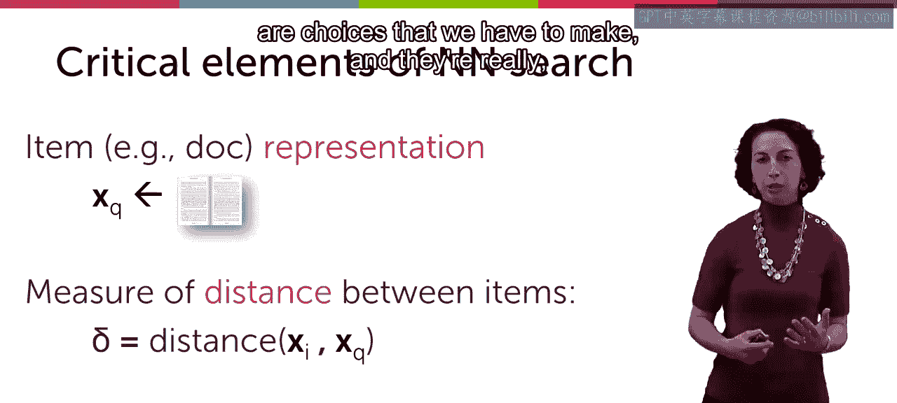
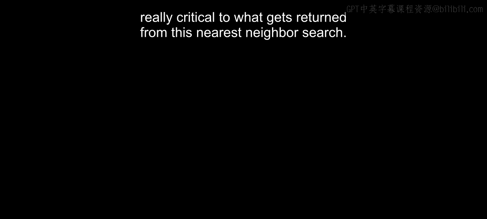

# 机器学习（分类，聚类和检索）：第3-4课：K近邻算法详解 🧠

在本节课中，我们将深入学习K近邻算法。我们将从单近邻算法扩展到更通用的K近邻算法，理解其形式化定义、伪代码实现，并探讨影响算法性能的关键设计选择。

## 算法概述

上一节我们介绍了单近邻算法，本节中我们来看看其扩展版本——K近邻算法。该算法不再只返回一个最相似的文档，而是返回一组K个最相似的文档。

## K近邻的形式化定义

我们有一个查询文档 \( X_Q \) 和一个包含 \( N \) 个文档的语料库 \( X_1 \) 到 \( X_N \)。算法的目标是输出一个包含K个最相似文档的列表。

我们定义K近邻集合为 \( X_{\text{nearest neighbor}} \)，其中包含文档 \( X_{\text{nearest neighbor 1}} \) 到 \( X_{\text{nearest neighbor K}} \)。

该集合的定义是：对于所有不在K近邻集合中的文档 \( X_I \)，其与查询文档 \( X_Q \) 的距离，都大于或等于集合中**最远**的那个近邻文档与查询文档的距离。

用公式表示，即对于所有 \( X_I \notin \{X_{\text{nearest neighbor 1}}, ..., X_{\text{nearest neighbor K}}\} \)，满足：
\[
\text{distance}(X_I, X_Q) \geq \max_{J=1}^{K} \text{distance}(X_{\text{nearest neighbor J}}, X_Q)
\]

直观地说，K近邻的定义是：任何不在你K近邻集合中的文章，其距离都比集合内最远文档的距离还要远。

## K近邻算法伪代码

与单近邻算法类似，我们可以用伪代码来描述K近邻算法的流程。不同之处在于，我们需要记录到目前为止找到的K个最近邻的距离，这是一个排序列表。

以下是算法的步骤：

1.  **初始化**：假设语料库中的前K个文档是初始的K近邻。
2.  **计算初始距离**：计算查询文档与这前K个文档中每一个的距离。
3.  **创建排序列表**：根据距离对这K个文档进行排序，形成一个排序列表（包含距离和对应的文档索引）。
4.  **遍历剩余文档**：对于语料库中剩余的文档（编号从 \( K+1 \) 到 \( N \) ）：
    *   计算该文档与查询文档的距离 \( \delta_{\text{new}} \)。
    *   如果 \( \delta_{\text{new}} \) 小于当前K近邻集合中**最远**邻居的距离（即第K近邻的距离）：
        *   在当前的排序距离列表中找到 \( \delta_{\text{new}} \) 应插入的位置索引 \( J \)。
        *   更新列表：将原列表中索引 \( J \) 到 \( K-1 \) 的元素向后移动一位（原第 \( K-1 \) 近邻变成第 \( K \) 近邻，依此类推）。
        *   移除原列表中第 \( K \) 近邻（现已被挤出K近邻集合）。
        *   在索引 \( J \) 的位置插入这个新文档及其距离 \( \delta_{\text{new}} \)。
5.  **返回结果**：遍历完所有文档后，返回最终得到的K个最近邻文档的索引列表。

这个算法是单近邻算法一个相当直接的扩展。

## 影响算法性能的关键选择

在分析这些算法的过程中，我们发现有两个关键选择直接影响算法的表现：

1.  **文档表示**：我们如何将一篇包含大量文本的文章，转化为一个定量的表示 \( X_Q \)。
2.  **距离计算**：我们如何计算两篇文档之间的距离。

这两个选择——文档表示方法以及文档间距离的计算方式——是我们必须做出的决策，它们对于近邻搜索返回的结果至关重要。

## 总结

本节课中我们一起学习了K近邻算法。我们从其形式化定义出发，理解了它如何返回一组而不仅仅是一个相似文档。接着，我们逐步分析了算法的伪代码实现，看到了它是如何通过维护一个排序列表来高效地找到K个最近邻的。最后，我们指出了决定算法有效性的两个核心设计要素：文档的向量化表示和距离度量方法。理解这些基础是应用和优化近邻搜索算法的关键。