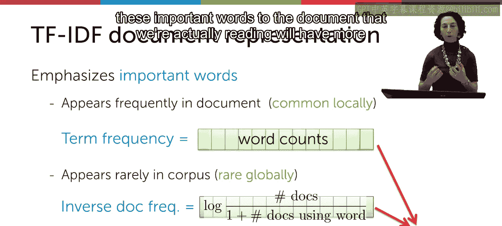

# 华盛顿大学《机器学习（分类，聚类和检索，第3-4课⧸共4课）｜Machine Learning》中英字幕 p129 7_文档表示.zh_en -BV1Sr421F7N7_p129-

。

To start with， let's talk about some choices we have for how to represent our document。

One really simple choice for representing the document is simply as a vector of word counts。

 So in particular， this is an example of a bag of words model where we take our document。

 has a bunch of words in it。 Let's assume that it's a really simple document and the only words it has is a following two sentences。

 So Carlos calls this sport football Emily calls this sport soccerer。And in this bag ofvo model。

 we just ignore the order of these words。 And we're simply going to count the number of instances of each word。

 And that's going to be our word count vector。 So here's our vector over our entire vocabulary。

 And maybe this is the index for Carlos。And maybe here， we have Emily。And here we have the。

And maybe there's soccer。And。football。And what else do we need， we need the word sport。And calls。

So let's see we have one count of the word Carlos。Two counts of the word the one count of the word Emily。

One count of soccer。Two counts of calls。Two counts of sport。And one count of football。

 So this would be our word count vector representation of this very simple document here。

But an issue with this very simple representation has to do with rare words。 So， for example。

 let's imagine that this document had。Lots of common words like the player field and goal。

 but there are only a few instances of some rare but important words like football and messy。

 so messy is one of the players in that article that Carlos was reading about and that really highlights something important and unique about that article and that might be of interest specifically to Carlos。

 more than just something like player field which might have to do with lots of other types of sports and lots of other types of settings So when we're thinking about doing distance calculations just based off of word counts。

 like raw word counts， these very common words that have high counts in these documents can dominate the calculation and this is especially bad when there are words like the and of and in really。

 really common words that are basically meaningless for the sake of assessing similarities of documents but when you're doing that distance computation it can totally swamp out。

These more important but rare words。So an alternative representation that we can consider is。TF IF。

 so term frequency。Inverse document frequency。 And so this again。

 is something that we talked about in the first course。

 but it''s important to review because this is a representation that we're going to work with very commonly here。

So TFIDF emphasizes important words in the following way。

It's going to emphasize words that appear very common locally and what that means is that they appear frequently in the document that the person is reading。

 but they appear rarely globally so in the entire corpus。

 it's pretty unique to see those words and so if we see both of those things together。

 that's definitely an important word in something that we should pick up on。So to quantify this。

This first term， appearing。Frequently locally， that term is the term frequency。 Okay。

 so that's simply our word counts for our article that we're reading or this query article。

 So we simply， again， go into this document， shake it up。

 Just count up all the words that appear in that document。

 And that's a representation of how often things appear locally。

 But then we're going to scale that by how often those words appear globally。

 We go to our entire corpus of。Of documents。 So every article out there and one common way to compute the inverse document frequency is the following form where you have the log of。

The number of documents that you're looking over， but importantly。

 divided by one plus the number of documents that use the given word。

 And that's the really key thing that's going to allow us to down weight words that appear frequently in many。

 many documents。Okay， so we have these two terms and。

We are faced with this trade off between local frequency and global rarity and what term frequency。

Inverse document frequency does is it simply multiplies these two factors together to get our T IDF representation。

So just to reiterate by looking at TFIDF vectors as the representation for our document。

 we're going to upweight rare words that appear often in the document that we're looking at but not in the corpus。

 and we're going to downweight words like the and of and all these things that probably appear in the document we're looking at but also appear in basically every other document out there。

And by doing this， when we go to do our distance calculations。

 these important words to the document that we're actually reading will have more significance when we're computing that distance。

。