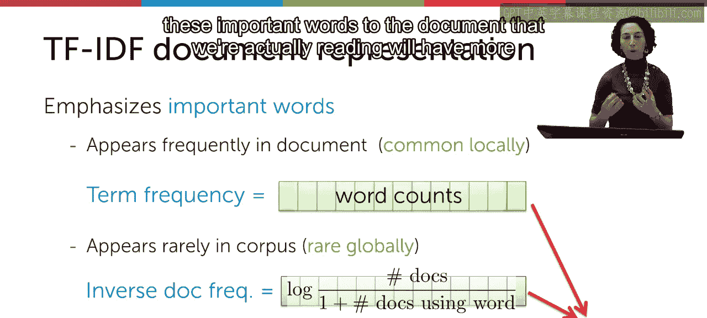

# 机器学习（分类，聚类和检索）：第3-4课：文档表示 📄

在本节课中，我们将要学习如何将文本文档转换为计算机可以理解和处理的数学形式，即文档表示。这是构建文本检索和分类系统的基础。我们将探讨两种核心的表示方法：词袋模型和TF-IDF模型。

---

## 词袋模型：简单的词频向量

首先，我们来讨论如何表示文档。一个非常简单的选择是直接将文档表示为一个词频向量。

具体来说，这是**词袋模型**的一个例子。在这个模型中，我们忽略文档中单词的顺序，只关心每个单词出现的次数。假设我们有一个非常简单的文档，只包含以下两句话：
> Carlos calls this sport football. Emily calls this sport soccer.

在词袋模型中，我们统计每个单词出现的次数，并将其作为我们的词频向量。以下是基于整个词汇表构建的向量：

*   Carlos: 1
*   the: 2
*   Emily: 1
*   soccer: 1
*   calls: 2
*   sport: 2
*   football: 1

因此，这个简单文档的词频向量表示就是上述的计数结果。

---

## 词袋模型的局限性：稀有词的重要性

然而，这种简单的表示方法存在一个问题，它与**稀有词**有关。

例如，假设一个文档包含大量常见词汇（如“the”、“player”、“field”、“goal”），但只包含少数几个稀有但重要的词汇（如“football”、“Messi”）。这些稀有词可能恰恰突出了这篇文章独特且重要的内容，对于像Carlos这样的用户来说，它们比那些在许多其他体育文章中都可能出现的常见词更有意义。

当我们仅基于原始词频进行距离计算时，这些在文档中出现次数多的常见词会主导计算结果。这对于像“the”、“of”、“in”这类几乎出现在所有文档中、但对评估文档相似性基本无意义的词来说尤其糟糕。它们会完全淹没那些更重要但出现频率较低的词。

---

## TF-IDF：权衡局部频率与全局稀有性

为了解决上述问题，我们可以考虑一种替代的表示方法：**TF-IDF**（词频-逆文档频率）。我们在第一门课程中讨论过它，但这里有必要回顾一下，因为它是我们将要频繁使用的一种表示方法。

TF-IDF通过以下方式强调重要词汇：
*   **强调在局部（当前文档）频繁出现的词。**
*   **强调在全局（整个语料库）中罕见的词。**

如果一个词同时满足这两个条件，那么它很可能是一个重要的词，我们应该在表示中突出它。

为了量化这一点：
1.  **词频**：衡量词汇在文档中出现的频率。这很简单，就是我们之前计算的文档词频。
    *   **公式**：`TF(word, document) = count(word in document)`
2.  **逆文档频率**：衡量词汇在整个语料库中的稀有程度。一个常见的计算方式是：
    *   **公式**：`IDF(word) = log( (总文档数) / (1 + 包含该词的文档数) )`
    *   这个公式的关键在于，它会降低那些在许多文档中都出现的词的权重。

TF-IDF表示法通过将这两个因子相乘，来权衡局部频率和全局稀有性：
*   **公式**：`TF-IDF(word, document) = TF(word, document) * IDF(word)`

通过使用TF-IDF向量作为文档的表示，我们可以：
*   **提升**那些在当前文档中常见、但在整个语料库中罕见的词的权重。
*   **降低**那些像“the”、“of”这类在当前文档和几乎所有其他文档中都出现的词的权重。

这样做之后，当我们进行距离计算时，那些对当前阅读文档真正重要的词将在计算中占据更显著的地位。

---

## 总结

本节课中，我们一起学习了两种关键的文档表示方法。
*   我们首先介绍了**词袋模型**，它通过简单的词频向量来表示文档，但容易受到常见词的干扰。
*   接着，我们探讨了**TF-IDF模型**，它通过结合词频和逆文档频率，能够更好地突出文档中独特且重要的词汇，从而为后续的相似性计算和检索任务提供更有效的表示。

理解这些表示方法是构建高效文本机器学习系统的重要第一步。