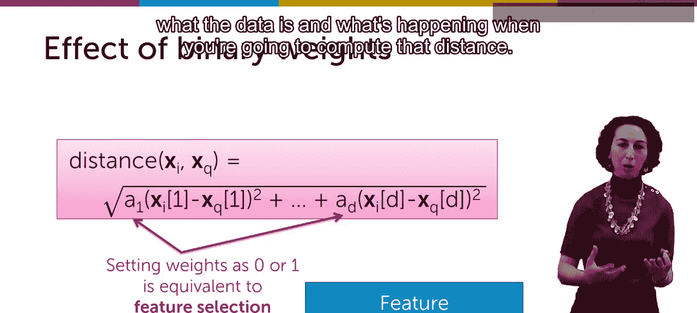

# 华盛顿大学《机器学习（分类，聚类和检索，第3-4课⧸共4课）｜Machine Learning》中英字幕 p130 8_距离度量：欧几里得距离和缩放欧几里得距离.zh_en -BV1Sr421F7N7_p130-

。

So this leads us straight into a discussion of how are we going to compute this distance between two given articles？

Well， when we're in 1 D， one really simple measure that we can use， it's just Euclidean distance。

 and hopefully this should be fairly familiar to you。

 but this really isn't going to be something of interest to us because this would be assuming that we just had in our example。

 just one word in our vocabulary and in almost all the scenarios that we're going to think about in this specialization。

 we're going to assume that we have multiple features or multiple different dimensions that we want to consider。

And in this case， things get really interesting there are lots of different distance functions we can think about using and just one example of ways in which we can do interesting things in multiple dimensions is we can think about weighting the different dimensions differently so we could think about putting different weights on different words in the vocabulary or different features that we might have。

 So， for example。If you go back to course two， when we're talking about regression。

 we're talking about predicting the price of a house。

We looked at using nearest neighbor regression to predict that house value and we said oh well。

 we could put different weights on the different attributes of the house。

 so maybe if we're thinking about what features are really important for predicting house values。

 things like number of bedrooms， number of bathroom， square footage of the house。

 those are really important， but maybe other things like number of floors or years renovated are less important to assessing that value。

Well， in our document example， there's a very similar analogy。

 So maybe when we're going to compute the similarity between two different articles。

 maybe we want to weight more heavily the title。 Maybe that's really， really informative。

 and much more so than the body of the article that can have a lot of noise in these words that are。

Kind of hard to account for likewise， if there's an article that has an abstract like a scientific article。

 that might also be more informative than the main body of the article。

So these are both the examples where you might want to specify weights that are different across the different features that you have。

Another case where you might want to weight different features differently is in scenarios where one of your features varies just a little bit across the different observations you have。

 but the other feature varies widely So this can be because one of the features is in a different unit than the other feature or it could just be that there's a lot of variance in that dimension。

 So in these cases， what would happen is if you go to just compute something like Euclidean distance waitinging both of these features equally。

 Well， the one where you get these big changes might dominate these little changes but really in practice it might be that these little changes in feature one that we have here are as important as a larger change in feature 2 that feature that varies more widelyly across the different observations。

 So in this case， there are a couple things that people tend to do。 and they both relate to scale。

The feature by some measure of the spread of observations。

 So one way that you could account for the spread is simply to take。For feature J。

 take every observation of in that column， so you take your every row remembers a different observation。

 each column is a different feature， so you take an entire column of your data matrix and you scale it by the maximum over all values in that column minus the minimum over all values in that column and you do that for every observation in that column。

An alternative is to scale by one over the variance of all observations。Of that feature。

So all of these are cases where we introduce weights across our different features when we're going to compute our distance。

 so formally we can think about computing what's called scaled Euclidean distance。

 where it looks very much like standard Euclidean distance in multiple dimensions。

 but now across each one of our different dimensions we have a different weight on that dimension。

 which I'm indicating here with these AI， so A1 all the way to AD and so these are the weights on the different features and what they represent is the relative importance of these different features。

And one example of how you could think about setting the weights It' just as binary weights。

 zeros and ones。 That would be a special case of scaled Euclidean distance computation。

 And what that's equivalent to is feature selection， because if you set a weight equal to 0。

 you're knocking out that feature altogether and it's not getting。

Incorporated into the computation of the distance。 And so you're saying that feature does not matter for the sake of assessing similarity or distance between two different articles。

 But remember here， in contrast to when we talk about things like Lasso or other notions of feature selection here。

 we're pre specifying what these weights are or in this binary case。

 which features to include in which ones did exclude。But overall。

 the thing that I really want to emphasize here is the fact that。

How we specify our data representation and compute this distance is really， really， really important。

 And it's a very challenging thing to do。 So this idea of feature engineering or feature selection is very important。

 but is also a fundamentally hard task， and it's a task that there there is literature on how to think about going about this feature engineering。

But it really is an area in machine learning where a lot of tweaking comes in and this is one of the places where there's a knob to turn and a lot of domain knowledge often comes in and thinking about how to think about setting these weights or defining these distances so I just want to emphasize that it really matters there is no one solution for how to go about this。

 but think about it， don't just compute some distance and assume that that represents a distance that's of importance and the application without thinking about what the data is and what's happening when you're going to compute that distance。

