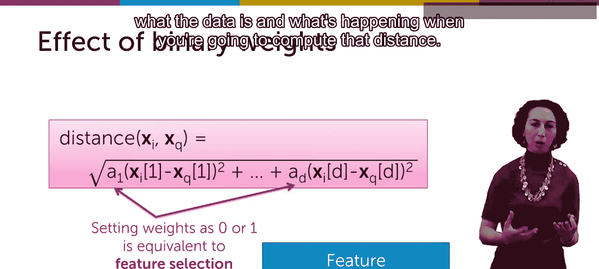

# 机器学习（分类，聚类和检索）：第3-4课：距离度量：欧几里得距离和缩放欧几里得距离

在本节课中，我们将要学习如何计算两个数据点之间的距离，这是许多机器学习算法的核心。我们将从简单的欧几里得距离开始，然后探讨在多维特征空间中更实用的缩放欧几里得距离，并理解特征权重和缩放的重要性。

---

## 从一维到多维的距离计算

上一节我们讨论了数据表示，本节中我们来看看如何计算两个给定文章之间的距离。

在只有一个特征（一维）的情况下，一个非常简单的度量方法是欧几里得距离。其公式为：
`distance = |x1 - x2|`
然而，这通常不是我们关注的重点，因为它假设我们的词汇表中只有一个词。在本课程涉及的大多数场景中，我们都需要考虑多个特征或多个维度。

在多维情况下，距离计算变得非常有趣，我们可以考虑使用多种不同的距离函数。其中一个有趣的做法是，我们可以为不同的维度赋予不同的权重。这意味着我们可以为词汇表中的不同词语或不同的特征设置不同的重要性。

以下是几个需要不同权重的例子：

*   **回归预测中的特征重要性**：回想第二门课程中关于回归预测房价的例子。我们使用最近邻回归来预测房价，并可以为房屋的不同属性设置不同权重。例如，卧室数量、浴室数量和房屋面积对于预测房价非常重要，而楼层数或翻新年份可能重要性较低。
*   **文档相似性中的特征权重**：在我们的文档示例中，也存在类似的类比。计算两篇文章的相似性时，我们可能希望更重视标题，因为它可能比包含大量噪声词语的文章正文更具信息性。同样，对于科学文章，摘要部分可能比正文更具信息性。
*   **特征尺度差异**：另一种需要不同权重的情况是，当某个特征在不同观测值之间变化很小，而另一个特征变化很大时。这可能是因为特征的单位不同，或者某个维度本身方差很大。如果直接计算等权重的欧几里得距离，变化大的特征可能会主导距离计算，但实际上，特征一的微小变化可能与特征二的较大变化同等重要。

---

## 缩放欧几里得距离

为了解决特征尺度差异的问题，人们通常会对特征进行缩放，这都与尺度有关。具体做法是按观测值分布的某种度量来缩放特征。

以下是两种常见的缩放方法：

1.  **按范围缩放**：对于特征 `j`，取该列的所有观测值（即数据矩阵的整列），然后将其缩放。缩放因子可以是该列所有值的最大值减去最小值。
2.  **按方差缩放**：另一种方法是按该特征所有观测值方差的倒数进行缩放。

以上所有情况都引入了在不同特征间计算距离时的权重。

正式地，我们可以计算所谓的**缩放欧几里得距离**。它的形式与标准的多维欧几里得距离非常相似，但现在我们在每个不同的维度上都有一个不同的权重。

缩放欧几里得距离的公式可以表示为：
`distance = sqrt( a1*(x1_1 - x2_1)^2 + a2*(x1_2 - x2_2)^2 + ... + ad*(x1_d - x2_d)^2 )`
其中 `a1` 到 `ad` 是不同特征上的权重，它们代表了这些不同特征的相对重要性。

设置权重的一个例子是将其视为二元权重，即0和1。这是缩放欧几里得距离计算的一个特例。这等价于**特征选择**，因为如果将权重设置为0，就等于完全排除了该特征，它不会被纳入距离计算。这意味着在评估两篇文章的相似性或距离时，该特征无关紧要。

但请注意，与Lasso或其他特征选择方法不同，在这里我们是预先指定这些权重（或在二元情况下，预先指定包含或排除哪些特征）。

---

## 特征工程的重要性

这里我真正想强调的是，**我们如何指定数据表示并计算这个距离是极其重要的**，同时这也是一项非常具有挑战性的任务。因此，特征工程或特征选择的想法非常重要，但它本质上也是一项困难的任务。机器学习领域有大量关于如何进行特征工程的文献。

但这确实是机器学习中需要进行大量调整的领域之一，这里有一个可以调节的“旋钮”。通常需要大量的领域知识来思考如何设置这些权重或定义这些距离。我想强调的是，这真的很重要，没有一种通用的解决方案。请务必仔细思考，不要只是计算某个距离就假设它代表了应用中的重要距离，而不去思考数据是什么以及在计算该距离时发生了什么。

---

## 总结

本节课中我们一起学习了距离度量的核心概念。我们从一维的简单距离出发，引出了在多维空间中计算距离的必要性。我们重点介绍了**缩放欧几里得距离**，它通过为不同特征引入权重 `a_i` 来应对特征尺度不一和重要性不同的问题。权重的设置可以基于领域知识（如标题比正文更重要）或数据统计特性（如按范围或方差缩放）。最后，我们强调了**特征工程**——即如何表示数据和定义距离——是机器学习中至关重要且充满挑战的一环，需要结合具体问题和领域知识进行仔细设计。