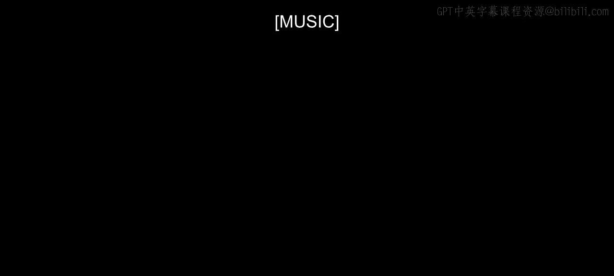
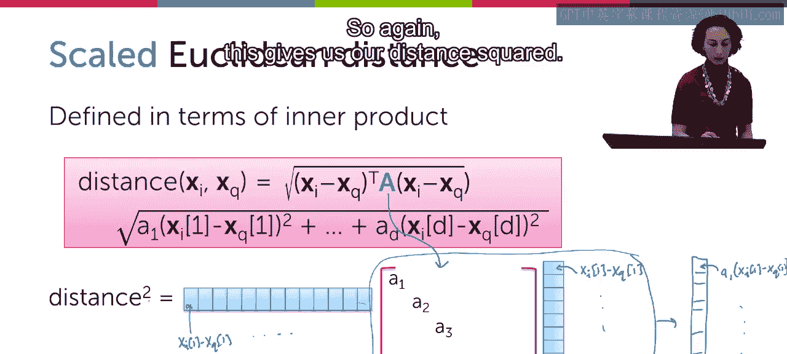

# 华盛顿大学《机器学习（分类，聚类和检索，第3-4课⧸共4课）｜Machine Learning》中英字幕 p131 9_使用加权内积表示缩放欧几里得距离.zh_en -BV1Sr421F7N7_p131-

。

Now， we're going to step back and do a little mathematical exercise。

 And we're going to think about how we can write our Euclidean distance。

 And now we're returning just to nonscaled standard vanillaella Euclidean distance and multiple dimensions。

 or we're going to think about how we can write this as a calculation in terms of an inner product。

 And this is going to be useful for two reasons， One is it's going to lead into our next discussion on an alternative distance calculation。

 But also this can be useful in terms of practical implementations of computing Euclidean distance。

 So what we can do is we can rewrite our Euclidean distance as follows。 So what we've done here。

Is we're taking this green vector， Xi， we're subtracting our query article Xq。

 and that's going to give us this difference vector， which we're highlighting in blue。

 which is Xi minus Xq。And then to compute our distance， we take this vector where each element。

 this is。X。I 1 minus x Q1。And this might be X I J minus Xq J and likewise。This vector。

 which is its transpose， is has elements X I 1 minus X Q1 in the first entry。

And then how many do I leave here，1，2，3，4，5。Here we would have X I J minus Xq J。

So if we do this inner product between this difference vector and its transpose。

Then what you end up is with the square of the distance because you're going to get Xi1 minus Xq1 squared when you multiply by this element。

 and then you're going to get plus all the squares of all these other differences。

And then to compute this distance that we see here， we're going to take。The square root。Okay。

 so this is how we think about writing Euclidean distance in terms of an inner product。

 which we see right here。And then if we looked at our scaled Euclidean distance。

 it's a simple modification where we add this matrix A。Where this matrix is this diagonal matrix。

With our weights A1 to A D， sorry there should be a D here， oop to fill off the screen。嗯。

And then we take the same difference vectors we had before。

Where here we have elements just like before Xi1， minus X Q1， and so on。

And then if we think about multiplying。This matrix。Times this vector。

 And just look at what that gives us。 what that gives us。A vector。With elements。

 let's just look at the first one。 The first one would be a 1。Times X， I 1 minus X Q1。

And down at the bottom， we would have。AD。Times X， I， D minus x。Q D。

And all the other elements in between。 So then when we think about taking this vector and multiplying it by this one。

 which， again， simply has the。The terms， without the scaling。

Then we get out exactly what's inside here， inside the square root， so again。

 this gives us our distance squared。

