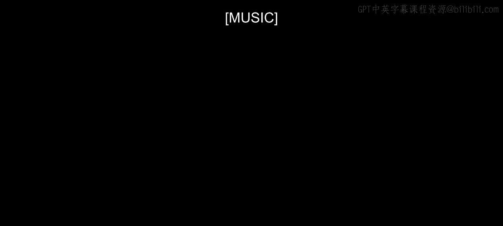
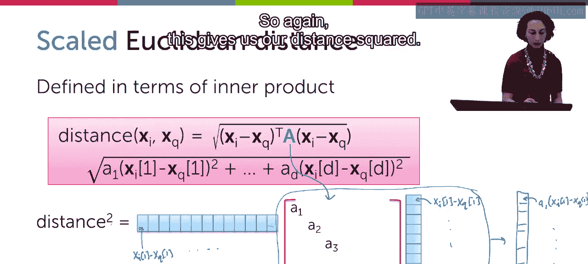

# 机器学习（分类，聚类和检索）：第3-4课：使用加权内积表示缩放欧几里得距离

在本节课中，我们将回顾欧几里得距离的计算方式，并学习如何将其改写为内积的形式。这种表示方法不仅有助于理解距离计算的本质，还能为后续讨论其他距离度量方法以及实际计算实现提供便利。

## 从标准欧几里得距离到内积表示

上一节我们讨论了基本的欧几里得距离。本节中，我们将通过一个数学练习，看看如何将标准的多维欧几里得距离用内积运算来表示。

欧几里得距离衡量的是两个点之间的直线距离。对于数据点 **x_i** 和查询点 **x_q**，其距离公式为：

**d(x_i, x_q) = √[ Σ_j (x_ij - x_qj)² ]**

我们可以将这个计算过程用向量运算来重新表述。具体做法是，构造一个差值向量，其元素是 **x_i** 和 **x_q** 在每个维度上的差。

这个差值向量是：**v = x_i - x_q**

其转置向量为：**vᵀ**

如果我们计算这个差值向量与其自身转置的内积，即 **vᵀ v**，得到的结果正是所有维度差值的平方和。因此，要得到欧几里得距离，我们只需对这个内积结果开平方根：

**d(x_i, x_q) = √[ (x_i - x_q)ᵀ (x_i - x_q) ]**

这种内积表示法清晰地展示了欧几里得距离的核心是计算差值向量的模长。

## 引入缩放因子：加权欧几里得距离

理解了标准距离的内积表示后，我们现在可以很容易地将其扩展到加权欧几里得距离，即缩放欧几里得距离。

在加权版本中，我们希望不同维度对总距离的贡献不同，因此为每个维度 `j` 引入一个权重 `a_j`。这些权重可以构成一个对角矩阵 **A**：

**A = diag(a_1, a_2, ..., a_D)**

其中，`D` 是特征的总维度数。这个矩阵的主对角线元素就是各个维度的权重。

加权欧几里得距离的计算，就是在标准距离公式的每个平方项前乘以对应的权重：

**d_A(x_i, x_q) = √[ Σ_j a_j (x_ij - x_qj)² ]**

## 用加权内积表示缩放距离

那么，如何用内积的形式来表达这个加权距离呢？方法非常直接。我们只需要将权重矩阵 **A** 插入到之前的标准内积表达式中即可。

具体步骤如下：

1.  首先，计算标准差值向量：**v = x_i - x_q**
2.  然后，用权重矩阵 **A** 左乘这个差值向量，得到一个新的缩放后的向量：**A v**
3.  最后，计算这个缩放后向量与原始差值向量 **v** 的内积，并开方：

**d_A(x_i, x_q) = √[ (x_i - x_q)ᵀ A (x_i - x_q) ]**

让我们仔细看看这个运算过程。当矩阵 **A** 作用于向量 **v** 时，由于 **A** 是对角矩阵，其结果相当于将 **v** 的每个元素 `(x_ij - x_qj)` 乘以对应的权重 `a_j`，生成一个新的向量。

然后，这个新向量再与原始差值向量 **v** 做内积。内积运算会将两个向量对应元素相乘后求和。因此，最终求和式中的每一项都变成了 `a_j * (x_ij - x_qj) * (x_ij - x_qj) = a_j (x_ij - x_qj)²`，这正好符合加权欧几里得距离的定义。

所以，公式 **√[ (x_i - x_q)ᵀ A (x_i - x_q) ]** 完美地捕捉了缩放欧几里得距离的计算。

## 本节总结

本节课中我们一起学习了欧几里得距离的两种重要表示形式。

我们首先将标准的欧几里得距离改写为差值向量内积的平方根形式：**d = √[ (x_i - x_q)ᵀ (x_i - x_q) ]**。接着，我们引入了对角权重矩阵 **A** 来表示不同维度的重要性，并推导出加权（缩放）欧几里得距离的内积表达式：**d_A = √[ (x_i - x_q)ᵀ A (x_i - x_q) ]**。

这种内积表示法不仅数学上简洁优美，而且为理解和实现距离计算，以及衔接后续更复杂的距离度量方法（如马氏距离）奠定了坚实的基础。