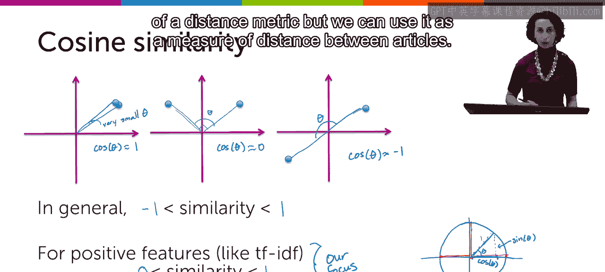

# 华盛顿大学《机器学习（分类，聚类和检索，第3-4课⧸共4课）｜Machine Learning》中英字幕 p132 10_距离度量：余弦相似度.zh_en -BV1Sr421F7N7_p132-

。

And so that was one idea of computing an inner product to compute a distance。

 But here's another really natural inner product measure that we could have。

 And this is simply to look at the inner product between。A。One article。

 which might be our query article X Q and another article X I。

 simply as the inner product between these two vectors where we're going to multiply。Element wise。

 each of the different values add them up and call that the similarity so it's the inner product between Xi and Xq so it's simply the sum over all our dimensions of the product of the values in these two vectors so we can think of this as measuring how much these articles overlap in terms of the vocabularies used and what's the weight of that overlap。

Okay， so in this example， it would give us a similarity of 13 between these two different articles about soccer。

But if we looked at an article about soccer relative to an article about some world news event。

 then maybe there would be very little overlap， actually in this case。

 no overlap in the vocabularies of these articles， so the similarity would be zero。

And the similarity that we talked about on the previous slide where we just summed up the products of the different features。

Is very related to a popular similarity metric called cosine similarity。

 where it looks exactly the same as what we had before， but in cosine similarity。

 you're going to divide by the following two terms where I think it's a little bit more straightforward to write it as follows where what we see is that each one of these terms it's just normalizing the vector。

 So we're summing over the square of each element just within vector Xi and just within vector Xq。

So that's。By definition， this norm here。So this is equivalent。To this。

 that's the definition of these bars here is the norm of the magnitude of this vector。

 and we can rewrite this further as。X I divided by the magnitude。Of this vector。

 the norm of the vector transpose。Times xq divided by the norm of xq。And so what we're seeing。

 what we're doing relative to the example we had on the past two slides is instead of just computing the similarity as the inner product between these vectors。

 we're first going to normalize the vectors。And this is a really， really critical difference。

 actually， which we'll discuss more。嗯。Okay， and so you can show that。

What we're doing here is equivalent to just looking at the angle between two vectors。

 regardless of their magnitude and the reason this this normalized inner product of vectors is equivalent to cosine of the angle between the vectors comes straightforward from the definition of an inner product。

 So we know that a transpose B is equal to magnitude of some vector A。M to the vector B。

Times cosine of the angle between the vectors， A and B。Okay， so if we have two different points here。

 two different articles， let's say there's just a vocabulary with two words， word one and word two。

So， this is。Maybe。The word count vector for one article and the word count vector for the other article。

 what cosine similarity is doing is just looking at the cosine of the angle between the articles。

 regardless of the magnitude of this vector。So I want to highlight a couple things about cosine similarity。

 one is the fact that it's not actually a proper distance metric like Euclidean distance because the triangle inequality doesn't hold。

 but it's also important to know that it's extremely efficient to compute for sparse vectors because you only need to consider the non-zero elements when you're forming this calculation。

Okay， but now I want to run through an example of what I mean by this normalization just to make sure it's very clear to everyone。

 so here's our standard word count vector or maybe TF IDF vector。

 and when we think about normalizing it， we're simply thinking about dividing by the sum of the squares of the counts in this vector square rooted。

And if we do out this calculation， then our normalized representation of the document would be as follows。

Okay， so let's talk a little bit more about this cosine similarity metric where let's think about the values that it can take。

 So let's say there are two really， really similar articles。 So they have a very small angle theta。

Very small。Data。Then。The cosine of theta is going to be。approximately equal to。Do you guys remember。

One， as you would hope， high similarity if they're very close together。

 So let's just remember how we think about cosine。 We can think about drawing this unit circle。

That does not look at all like a circle， let's try again。Okay， not sure that's much better。

 but imagine that we're circle with radius 1。Okay， well， if we're looking at some angle theta。Then。

This length here is sine of theta。And。This length here。Is cosine。Of datata。Okay。

 so as we're walking around the circle， when the angle is 0， we see that cosine of theta is 1。

When we get up to 90 degrees so vertical， we see that that cosine drops down。

 maybe I can switch colors and make this clear instead of weaving my hands around。

So let's see when we're at。anglele zero you see cosine is，1， when we're at angle。

Pi over 2 or 90 degrees。 You see that this distance along this x axis is dropped to 0。

And when we shift over here。To cosine of pi or 180 degrees， we see that cosine of theta is minus1。

Okay， so now that we've reviewed cosine a little bit， let's go back。To these drawings here and this。

Was supposed to be。Roughly 90 degrees。 It's a little bit more， but。嗯。

When we look at cosine of theta here， we know that it's approximately0。And if we have。

Cosine of theta in this case， it's going to be approximately -1。Okay， so in general。

 cosine similarity can range from minus1 to  one。But if we restrict ourselves to having just positive features like we would if we're looking at a T F I DF vector for a document。

 then our similarity， we could never have this example here。

 We're always going to be living in the positive quadrant。

 So our angles are going to range from 0 to 90。 So our cosine similarity is going to range from 0 to 1。

Okay， so this is going to be our focus。And in these cases。

 the way we're going to define a distance is simply one minus the similarity。And remember。

 it's not a proper distance。According to formal definitions of a distance metric。

 but we can use it as a measure of distance between articles。

