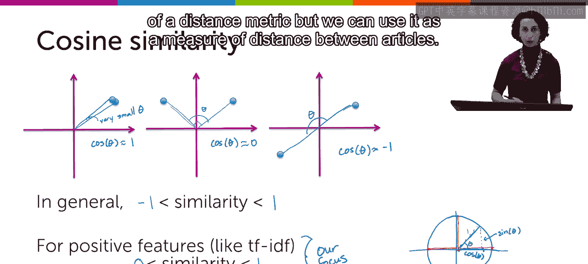

# 机器学习（分类，聚类和检索）：第3-4课：距离度量：余弦相似度 📐

在本节课中，我们将要学习一种在文本分析等领域非常常用的相似度度量方法——余弦相似度。我们将了解它的定义、计算方法、几何意义以及它与简单内积的区别。

上一节我们介绍了通过计算内积来衡量相似度的基本想法。本节中我们来看看另一种更常用、更自然的度量方法。

## 内积相似度

一种衡量两篇文章相似度的直接方法是计算它们特征向量之间的内积。对于查询文章向量 **Xq** 和另一篇文章向量 **Xi**，其内积定义为：

**相似度 = Xi · Xq = Σ (Xi_j * Xq_j)**

这个公式表示将两个向量对应维度的值相乘，然后求和。我们可以将其理解为衡量两篇文章在所用词汇及其权重上的重叠程度。

以下是内积相似度的特点：
*   它测量了文章间词汇使用的重叠量。
*   如果两篇文章词汇完全不同，相似度为零。
*   在之前的足球文章例子中，计算出的内积相似度为13。

## 从内积到余弦相似度

我们之前讨论的简单内积相似度，与一个更流行的度量——**余弦相似度**——密切相关。余弦相似度的公式如下：

**余弦相似度(Xi, Xq) = (Xi · Xq) / (||Xi|| * ||Xq||)**

其中，||X|| 表示向量 **X** 的范数（或长度），计算公式为 **√(Σ X_j²)**。这个公式可以进一步重写为：

**余弦相似度 = (Xi / ||Xi||)ᵀ · (Xq / ||Xq||)**

相对于简单的内积，关键区别在于我们首先对向量进行了**归一化**处理。这是一个非常重要的差异，接下来我们会详细讨论。

## 余弦相似度的几何意义

可以证明，上述归一化后的内积等价于计算两个向量之间夹角的余弦值，而**与向量的长度（大小）无关**。这直接源于内积的定义：

**Aᵀ · B = ||A|| * ||B|| * cos(θ)**

其中 θ 是向量 **A** 和 **B** 之间的夹角。

想象一个仅包含两个词汇的二维空间，每篇文章对应一个点。余弦相似度所做的，就是忽略向量从原点出发的长度，只关注这两点与原点连线之间的夹角 θ 的余弦值。

关于余弦相似度，有几点需要注意：
*   它**不是**像欧氏距离那样的严格距离度量，因为它不满足三角不等式。
*   对于稀疏向量（如文本的TF-IDF向量），它的计算效率极高，因为只需要考虑非零元素。

## 归一化示例

为了让大家更清楚归一化的含义，我们来看一个例子。假设我们有一个标准的词频或TF-IDF向量。

当我们对其进行归一化时，就是将该向量除以其自身的范数（即所有元素平方和的平方根）。

如果进行此计算，文档的归一化表示就是将每个原始值除以该向量的长度。

## 余弦相似度的取值范围

现在，让我们更深入地探讨余弦相似度度量，思考一下它的取值范围。

假设有两篇非常相似的文章，它们之间的夹角 θ 非常小。那么 cos(θ) 将近似等于 1，正如我们所期望的，高相似度对应高余弦值。

我们可以通过单位圆来回忆余弦函数：
*   当夹角 θ 为 0 度时，cos(θ) = 1。
*   当夹角 θ 为 90 度时，cos(θ) = 0。
*   当夹角 θ 为 180 度时，cos(θ) = -1。

因此，一般来说，余弦相似度的取值范围是从 -1 到 1。

但是，如果我们限制特征值为正数（例如在处理文档的TF-IDF向量时），那么所有向量都位于正象限内。向量间的夹角范围是 0 到 90 度，因此余弦相似度的实际取值范围是 0 到 1。

在这种情况下，我们通常将距离定义为：

**距离 = 1 - 余弦相似度**

需要再次记住，虽然这不是一个形式化的距离度量，但我们可以将其用作衡量文章间差异的一种有效方法。

---

本节课中我们一起学习了余弦相似度。我们了解到它是通过计算向量间夹角的余弦值来衡量相似度，并且对向量长度不敏感。我们还探讨了它的计算方法、几何解释、取值范围，以及如何将其转化为一个简单的距离度量。在处理像文本这样的高维稀疏数据时，余弦相似度是一个非常强大且高效的工具。