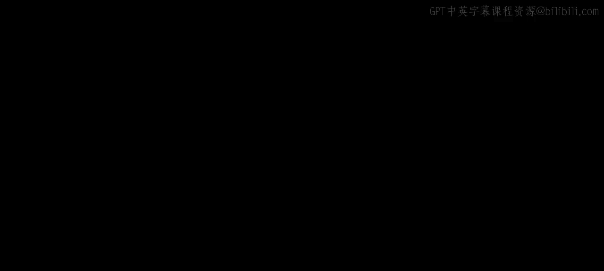
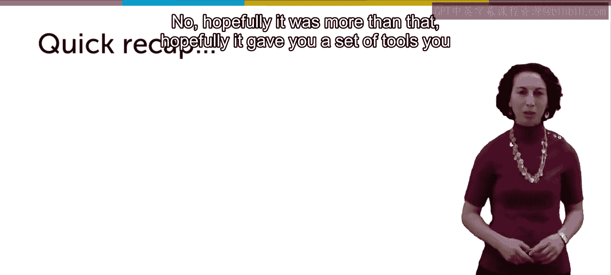

# 华盛顿大学《机器学习（分类，聚类和检索，第3-4课⧸共4课）｜Machine Learning》中英字幕 p133 11_是否归一化和其他距离考虑.zh_en -BV1Sr421F7N7_p133-

So what we saw was that the thing that made cosine similarity different than the first presentation of just similarity between two articles that we had was the fact that in cosine similarity。

 you operate with normalized vectors。 So this begs the question of should we normalize or not。

 should we use cosine similarity or just a finalella version of a similarity calculation。

 which is just the inner product between two vectors。 So to think about this。

 let's look at an example where we take two different document， a green document and a blue document。

 and let's compute the similarity between them。Now let's simply double the length of each of these documents and the way we're going to double the length is just by taking our document and replicating it。

So it has exactly the same set of words， but just twice as many of those words。Now。

 when we think about computing our similarity in their original space， the similarity was 13。

 This was the number we computed before， but now when we think about computing the similarity in for the documents that are each twice as long。

The similarity is 52， So the similarity has increased by a factor of 4。

 just by doubling the length of the documents， not changing the content at all。

Is that really something that we want， Do we want documents to be more similar as they become longer and longer。

 or do we just care about the， the content of them and not so much how long they are。Well。

 if we normalize the documents， so here's this green document。

 here's the normalization we did before， this was our normalized representation。

 and now we go to compute the similarity with this normalized representation of both the green document and separately the blue documents。

 then we compute the similarity as 13 over 24。And now if we think about doubling the length of each document again and then think about normalizing each of those double those documents that were doubled in length。

 we get exactly the same normalized representations so we get exactly the same computed similarity So what we see is that cosine similarity is invariant to the length of the documents just the sheer number of words or the scale of that。

 and it focuses much more on what the content of those words or the content of those documents in terms of which words appear。

So on the one hand， that seems really， really appealing。But it's not something that's always desired。

 We don't always want to be invariant to the length of the document， because what that's doing is。

 it might be taking really dissimilar objects and making them look more similar than they really are。

 So， for example， let's say， we're reading a really long document。

 This is maybe some article that appeared in the Atlantic。And then on the other hand。

 we have a really short tweet。Very， very little content to it。

If you look at the cosine similarity between these two， that's going to make that tweet。

 And this really long article appear much more similar than they are in reality。

 And if somebody is sitting there reading a really long article。

 do we really want to suggest that they go and read a tweet。Maybe not。

 So instead what people often do is some compromise between this normalization of cosine similarity and just ignoring normalization altogether。

 and what they do is cap the maximum word counts that appear in the vector。So up to this point。

 we've really focused on Euclidean distance and cosine similarity as the two distance measures that we've examined because of our focus on document modeling or document retrieval in particular。

 but there are lots and lots of other interesting distance measures that we could use things like Mahalanovaba's rank-based correlationbased Manhattan jaard。

 hamming and many others that we have not gone through in this course。

 but there is one last thing that I wanted to mention that's really commonly used out there in practice。

 which is to use different distance measures over different subsets of your features。

 So for example in our document case maybe we would have features of text of the document。

 that's what we've really been focusing on， but maybe we also have counts of how many times somebody read that article。

 So some numerical quantity， it's something that's inherently numerical。 So in this case。

 maybe we would use cosine。Similarity for comparing texts of the documents where we want this invariance to the scale or the length of the documents。

 but for the counts， we definitely want the counts in their raw form。

 no normalization of that and so for that maybe we would use just Euclidean distance and so you can think about computing different types of distance measures over our different features and then weighting them in whatever way you would like to like we talked about for weighted Euclidean but now it doesn't have to be just weights over Euclidean distances。

 it can be weights over all these different fun forms of distances and then use that as our measure of similarity between in this case documents。

And this is quite natural if we actually think about our housing application where if you think of a listing of a house。

 you'll have some text description of that house and maybe you don't care if the real estate agent was really verbose or not so you want to be invariant to that and maybe you use cosine similarity to compare the text of。

The the different house listings。 But then for features like number of square feet。

 number of bedrooms and bathrooms， the actual scale of these numbers matters a lot。

 So using Euclidean distance would be quite natural。Okay。

 so you see this type of things in lots and lots of different application areas。 So in summary。

 what we've gone through so far in this module is different notions of how we can represent our document in different ways in which we can compute the distance between two documents。

 And these were these fundamental pieces to our nearest neighbors search。

 And really the conclusion of what we've gone through to this point is giving you a set of options to consider。

 But hopefully the take home message is to think carefully about what you're doing and the implications of what you're doing。

 There's no one right answer for how to go about something。

 But it's very important to think about whatever choice you make。

 What does that mean for the problem that you're looking at。Okay。

 so maybe this whole module up to this point was a word of warning now hopefully it was more than that。

 hopefully it gave you a set of tools that you can think about using and the building blocks for learning about other tools out there。

