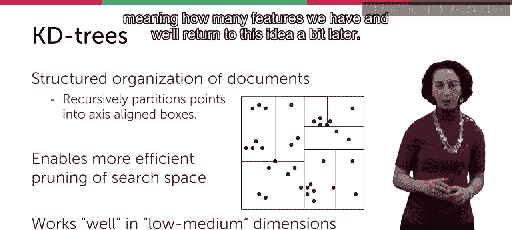
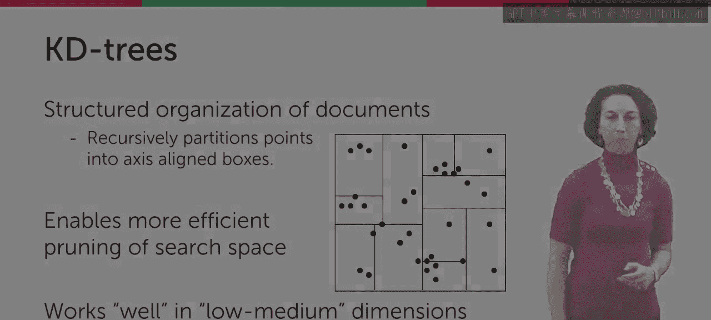
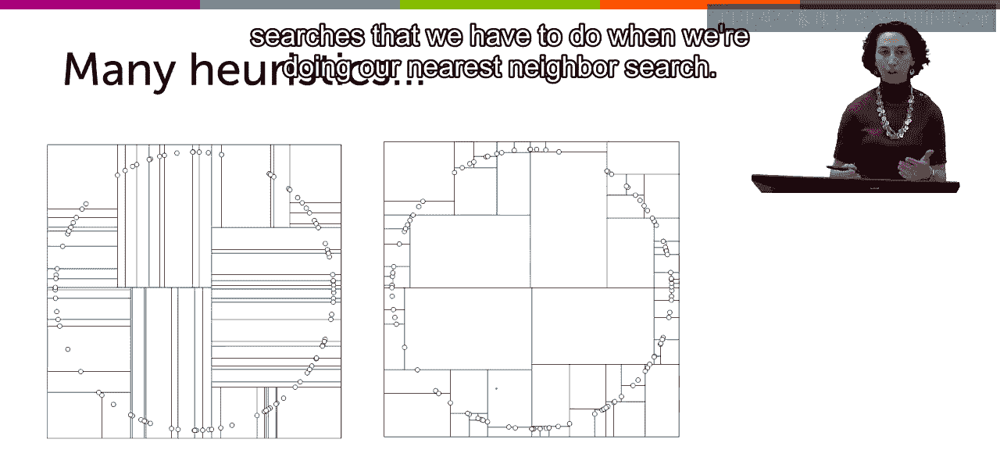

# 华盛顿大学《机器学习（分类，聚类和检索，第3-4课⧸共4课）｜Machine Learning》中英字幕 p135 13_KD树表示.zh_en -BV1Sr421F7N7_p135-

。

Well， luckily， the answer is yes or often yes。 And we're going to discuss a few different ways of doing this。

 And the first thing that we're going to talk about are Kd trees and Kd trees are a specific data structure for efficiently representing our data。

In particular， Kd trees provide an organization of our documents in terms of this partitioning of our space。

 we're going to be making these access aligned cuts and maintaining lists of points that fall into each one of these different bins and what this structure allows us to do as we're going to show is efficiently prune our search space so that we don't have to visit every single data point for every query necessarily。

 sometimes we'll have to， but hopefully in many cases we won't have to。And these methods。

 these Kd trees work really well in low to medium dimensions， meaning how many features we have。

 and we'll return to this idea a bit later。

To start with， let's talk about the K D tree construction。

 So what we're going to do is we're going to take our data table。 So we have in this example。

 just two different features。 So we have。Peature  one， and this is。Feature2。 So maybe this is。

Just the first word in our vocabulary。 And this is the second word。

And then here are the indices of our data points。So these are our observation indices。And。

These points are displayed just in R2 here。 So this is。Feature 1。And this is。Feature 2。Okay。

 so the first thing that we do is we're going to split our data table into two different groups。

And the way we're going to do that is by choosing a split dimension。

 So which feature are we splitting on and a split value。 So what's the threshold for this split？

 So here。This， in this example， we chose a split value as 0。5。

 and we're splitting on the first feature。 So everything to the right are cases where this first feature takes values greater than 0。

5 and everything to the left are cases where。The first feature takes values less than or equal to 0。

5。Okay， so if we look at a data point and the first feature has a value greater than 0。5。

 we're going to place it in the yes table， the table to the right。

 otherwise it's going to go into the no table， the table to the left。

Then what we're going to do is we're simply going to recurse on each of these different groups separately。

 So we're going to continue to split into two groups on each side。 So remember， this was 0。5。

Looking at our split， now what we're going to do is we're going to choose a new split。

Where first we choose a split dimension where in this case we're choosing feature 2 and a split value in this case。

 we're choosing the value 0。1。So here's the value 0。1。

 and here these are cases where the second feature is greater than 0。1。And here。

 these are cases where this second feature。Is less than or equal to 0。1。And so to be clear。

All of these points here。Will appear in this list here。 They're the ones where x1 is less than 0。5。

 They fall on the left hand side of this first vertical line， And they also points where x 2。

 that second feature dimension is less than 0。1。 So they fall below that horizontal cut that we made。

So the answers to these questions were no， no， and so they fall into this table here。Okay。

 so we continue doing this process， splitting， splitting， splitting， splitting。

 and this creates a binary structured tree so。At the leaf nodes of this tree。

 we're going to have a list of points that fall within that bin。Okay， so there's gonna be。

Lists of points at each of these leaf nodes。Representing the different observations within each bin。

So to be clear， if we trace our way。Down the tree to any given leaf node。

 the points that appear here will satisfy all conditions。

That were specified at each one of the splits above along the path so。Points。Here。😔，Satisfy all。

Conditions。Down the tree。To this point。So we're going to keep one extra piece of information that's going to be very helpful when we're going to do our nearest neighbor search。

 So just to be clear at any given node in the tree， we're going to store the following information。

First， we're going to store。Which dimension we split on。We're also going to store the split value。

So where did we set that split threshold， And the third thing we're going to store is the tightest bounding box。

So， the box。That's as small as possible that contains all observations within that node。

Or that satisfy the conditions to that node。 So this will be。Bounding。Fox。Md。Is as small。As possible。

Well， containing points。Okay， so that's this is number three above。Okay， so hopefully that's clear。

 it's a very， very intuitive type of structure for storing the data。

But there are lots of important choices。 It's kind of been the theme of this module。

 and it continues to be true， even when we're talking about these data structures like kd trees。

 So examples include how are we going to figure out which dimension to split on。

 what value to split on and when are we going to stop splitting。And in practice。

 people just use heuristics for this。 so one example for which dimension to split on。

 we can split on the one that's the widest dimension。

So if we think about any box and we're looking at it， let's say it's just a box in R2。

 we look at how。How big x2 is versus x1。 And if x1 is bigger than x2。

 then maybe we choose to split on x1。Or you can think about alternating dimensions。

Then when we think about what value we split at。One option is to split out the median。

Value of the observations that are contained in that box。

Or you could split at the center point of the box， ignoring the spread of data within the box。

Then a question is when do you stop and here there are a couple of choices that we have。

 one is you can stop if there are fewer than a given number of points in the box。

Let's say M data points。Left。Or， alternatively。If a minimum width to the box has been achieved。

So again， the second criteria would ignore the actual data in the box。

 whereas the first one uses facts about the data to drive the stopping criterion。

So as an example of how important these choices can be。

 here's an example where depending on the distribution of data in this space。

 whether we look at this median heuristic for where to put the split point or we just use the center of range can give really。

 really different data structures and we're going to show how this can have implications for the number of searches that we have to do when we're doing our nearest neighbor search。

。

